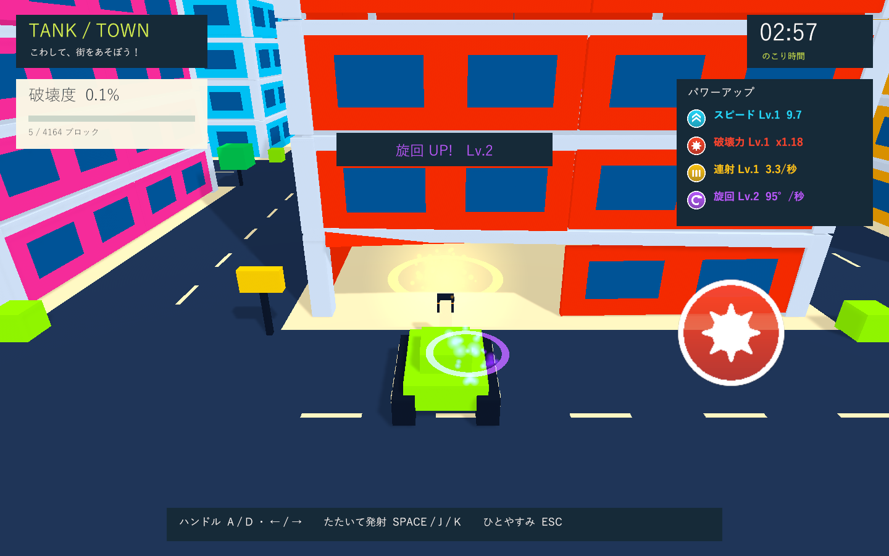

# TANK / TOWN

子供向けの三人称戦車アクションのUnityプロトタイプ。3分間で箱庭の街を破壊し、街全体の部材数に対する破壊済み部材の割合を競います。



## 起動

Unity **6000.3.19f1** で開き、メニュー **Tank Town → Create or open playable scene** を選び、Playを押してください。開始画面の「あそぶ」またはEnterでスタートします。専用シーンは `Assets/TankTown/Scenes/TankTown.unity` です。街と戦車はPlay時に生成します。

## 操作

|操作|試作用の入力|
|---|---|
|前進|自動|
|左右旋回|A / D、← / →、ゲームパッド左スティック|
|左圧センサー相当|Space / J、ゲームパッドLボタン|
|右圧センサー相当|K、ゲームパッドRボタン|
|開始・再挑戦・再開|Enter、ゲームパッドStart、画面ボタン|
|一時停止|Esc。アプリがフォーカスを失った場合も停止|

砲塔は車体の正面に固定。小物は体当たりで破壊できます。大きな建物への強い衝突や街の外への移動で戦車が爆発し、安全地点へ戻ります。暫定で3秒のペナルティと1.2秒の復帰待ち時間があります。待ち時間も制限時間に含まれます。

## 街・破壊・描画

- 220×220のフィールド。従来の120×120に対して面積約3.36倍。36棟、幅20、高さ14.4〜25.2のビルと街灯・看板・木・箱。
- 建物は柱・梁・薄い床・薄い外壁で構成し、室内は空洞。窓は外壁と一緒に飛散します。
- 爆風で部材を切り離し、柱・梁・床の接続グラフから地面への支持を失った部材もRigidbodyにして落下させます。外壁は骨組みを支えません。
- 同じ部材は1回だけ加点。破片が消えても街全体の分母は変わりません。
- 破片は最大280個・9秒。戦車・地面・未破壊建物と物理衝突し、戦車に当たった破片は押しのけます。破片によって戦車は爆発しません。破片同士は衝突を省略します。
- 彩度を上げた専用URPトゥーンシェーダー、段階的な陰影、影、リムの明るさ。砲口の閃光、砲弾の軌跡、着弾の火花・衝撃波、小さなカメラ振動。
- 安全地点の履歴、復帰直後の衝突猶予、停止・タイムアップ・結果・再挑戦。

## 強化アイテム

道路上に76個の浮遊する2Dビルボードを配置。カメラに正対するアイコンに触れると取得し、色付きの取得演出とHUDのレベル・実値を更新します。開始直後の道には4種類を並べています。

|色・アイコン|効果（1レベルごと）|
|---|---|
|水色・二重矢印|スピード: 基本速度の8%を加算|
|赤・爆発マーク|破壊力: 基本衝撃力の18%、爆風半径の7%を加算|
|黄色・3発の弾|連射: 射撃間隔を `基本間隔 / (1 + 0.16 × レベル)` に短縮|
|紫・回転矢印|旋回: 基本旋回速度の6%を加算|

暫定上限は各8レベル。射撃間隔の下限は0.12秒。強化は爆発・復帰しても維持し、再挑戦でリセットします。取得済みアイテムはそのラウンド中は復活しません。上限に達した種類のアイテムは取得しません。アイテム取得は自動射撃には変更せず、短い間隔で次の打撃を受け付けられるようにします。

## 調整と実機接続

`Assets/TankTown/Resources/TankTownSettings.asset` で制限時間、速度、旋回速度、射撃間隔、爆風、復帰、圧センサー閾値、破片上限、街区数・間隔・建物寸法、強化係数と上限を変更できます。射撃間隔0.35秒は試作用の値です。建物幅は道路との重なりを避けるため街区間隔−12までに制限します。

外部入力アダプターから `TankInput` に、Unityのメインスレッドで以下を渡してください。

```csharp
input.useHardware = true;
input.SetWheel(normalizedSteering); // -1: 左、0: 中央、+1: 右
input.SetPressure(0, leftPressure); // 0〜1
input.SetPressure(1, rightPressure);
// デバイス側で打撃を検出済みなら input.PulsePad(0 または 1)
```

センサーは押し込み閾値で1回発火し、解除閾値まで戻ると再発火できます。左右の信号は `PadPressed(int)` で区別していますが、試作では両方とも同じ砲撃につないでいます。左右の最終的な役割と通信方式は未定です。まずキーボードで試します。

支持判定は部材の接続と基礎への到達による簡易モデルです。荷重・曲げ・ヒンジを計算する建築シミュレーションではありません。成長係数・アイテム数は暫定値。イージーモードは未実装です。

## 検証・ビルド

Unity Test RunnerのPlayModeで `TankTown.Tests` を実行します。前進・旋回、砲弾命中、体当たり、支持喪失、空洞の室内、外壁と骨組みの関係、重複加点、圧入力、破片の衝突、アイテム取得、実際の強化射撃、復帰とラウンド初期化を検証します。

[今回の検証記録](docs/expansion-validation.md) と [初回の記録](docs/validation.md) を参照してください。

Windows Development BuildはUnityを閉じた検証コピーで以下のメソッドをバッチ実行できます。

```text
Unity.exe -batchmode -projectPath <project> -executeMethod TankTown.Editor.TankTownSetup.BuildWindows -quit -logFile <log>
```

出力先は `Builds/TankTown/TankTown.exe`。初回起動時のパッケージ解決にはネットワークが必要です。

Development Buildを `TankTown.exe -batchmode -force-d3d11 --tank-town-smoke` で起動すると、開始・街の全景・アイテム取得・着弾・骨組み・復帰・結果の7画面を実行ファイル横の `Captures` に保存します。支持の喪失を連続発生させて破片上限も確認します。診断用の骨組み画面では外壁を直接分離しています。ネイティブUnityゲームのため、画面検証はWindowsプレイヤーを対象とします。
