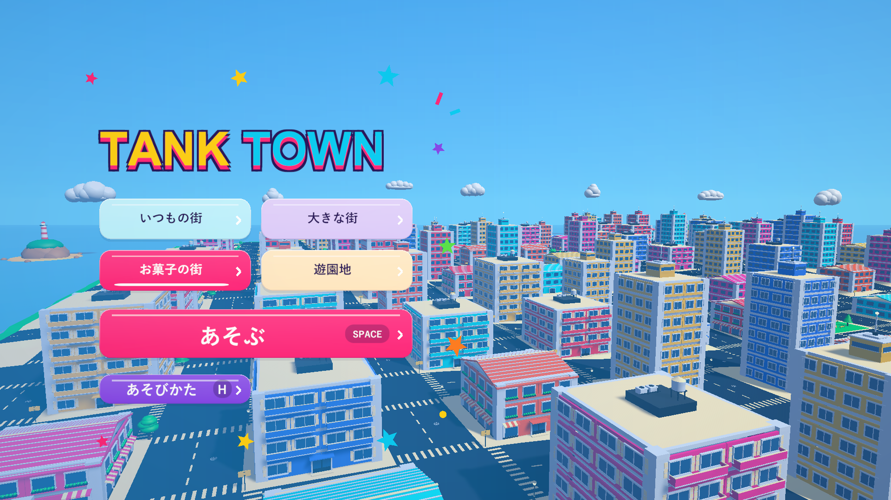

# TANK / TOWN

子供向けの戦車アクション（戦車と周囲を見渡せる三人称カメラ）のUnityプロトタイプ。Unityプロジェクトではお菓子の街・従来の街・面積4倍の大型ステージ・遊園地の最初の試作を選び、1分20秒間で自動生成された街を破壊します。街全体の部材数に対する破壊済み部材の割合を競います。



## ブラウザーで遊ぶ

[GitHub Pages版を開く](https://negi310.github.io/mission2026-game/)。PCのChrome / Edgeで、A/D・左右矢印でメニュー選択とハンドル、Spaceで決定と砲撃、Escで一時停止です。読み込み後にゲーム画面をクリックするとキーボードを使えます。

BLE UARTコントローラーは、ページ上の「ハンドル接続」からブラウザーに接続を許可します。既存の「角度,ピエゾ値＋改行」を送るmicro:bitプログラムを使います。Windows版の自動接続とは接続手順が異なります。ブラウザーでの実機接続は未検証です。

## 起動

Windowsで遊ぶ場合は[最新リリース](https://github.com/Negi310/mission2026-game/releases/latest)から **TankTown-vX.Y.Z-Windows-x64.zip** をダウンロードしてください。ZIPを「すべて展開」し、展開先の`TankTown/TankTown.exe`を起動します。Unityのインストールは不要です。`TankTown_Data`などの同梱ファイルは移動せず、フォルダごと保持してください。更新時は新しいZIPを別フォルダへ展開します。ランキングは同じPC・Windowsユーザーで引き継ぎます。

[配布ビルドの作成・公開手順](docs/releases.md)。

現行ソースから作ったWindows版は、起動時にモニターの解像度に合わせた枠なし全画面になります。以前のウィンドウ表示設定が残っていても全画面へ切り替えます。Alt+Enterでウィンドウ表示と切り替えられます。Unity EditorのGameビューは通常のままです。

現在は非公開リポジトリのため、ダウンロードにはアクセス権のあるGitHubアカウントでログインしてください。

公開済みのv0.1.0は既存3ステージの配布ビルドです。遊園地の試作はUnityプロジェクト、またはローカルの`Builds/TankTown-Amusement/TankTown.exe`で確認できます。[必要素材の一覧](docs/amusement-assets.md)、[元画像と実画面](docs/amusement-review.html)。

Unity **6000.3.19f1** で開き、メニュー **Tank Town → Create or open playable scene** を選び、Playを押してください。起動時は「お菓子の街」が選ばれています。タイトルの「あそぶ」、Enter、Space/J/K、左右パッドでスタートします。タイトル背景は常に大型街の軽い表示用モデルを屋根近くの高さからゆっくり巡回します。背景にも通常の街と同じBlenderの部品（窓・バルコニー・屋上・店先・道路の模様・街灯と木・公園・島・雲・帆船）を使い、細かい窓はカメラの近くの建物だけに付けます（[タイトル背景の検証](docs/title-kit-validation.md)）。街ボタン・数字1/2/3/4では背景を作り直さず、遊ぶステージだけを選びます。選んだ街が未生成の場合は、開始後の暗転中に生成します。「あそびかた」またはHで操作とアイテムの案内を開けます。タイトル中は街と制限時間を停止し、短い暗転と3→2→1→GO!を経てスタートします。開始用の打撃では砲撃しません。専用シーンは `Assets/TankTown/Scenes/TankTown.unity` です。

## 操作

タイトル・リザルト・一時停止の操作ボタンは、中央を大きく見せる横スライド式です。スコア・記録・遊び方は通常のボードや一覧で表示します。ハンドルの左右（A/D・左右矢印も可）で選び、砲撃ボタン・Space・Enterで決定します。ハンドルを倒したままならゆっくり続けて移動します。[カードUIとWeb版の準備](docs/card-menu.md)

**F7** で操作感の調整を開けます。移動・旋回・砲塔の追従・射撃間隔、micro:bitの中立・感度・左右反転・砲撃閾値を調整し、その場で適用できます。「適用して保存」は次回起動後も同じPC・Windowsユーザーで引き継ぎます。[操作感の調整方法](docs/control-tuning.md)

v0.4.4では、Windowsから通知されたデータ長がペイロード長として報告される環境で、受信データを誤って拒否する問題を修正しました。実機での再確認が必要です。

v0.4.3ではmicro:bitのBLE UART送信特性を優先し、診断に購読状態と通知回数を表示します。実機の受信0 bytesの原因は未確定です。

v0.4.2はMakeCodeのBluetooth UART出力で、改行と文字列の `\n` の両方を区切りとして受け付けます。F8診断でBLE UARTの発見件数も確認できます。Bluetooth実機での受信は未確認です。

v0.4.1では **F8** で接続診断を開けます。同梱の`接続診断.cmd`からも起動できます。Bluetooth COMの自動探索、受信値・不正行・砲撃判定の表示、閾値の保存と再接続を追加し、初回の短い砲撃入力の取りこぼしを修正しました。実機で旋回・砲撃ができないという報告の原因は未確定です。

v0.4.0からmicro:bitのBLE UART／USB・Bluetooth COMから`角度,ピエゾ値\n`を受信し、Input Systemの`MicrobitWheel`へ旋回軸・閾値による砲撃・センサー生値を渡します。角度の送信値は-1023〜1023、ピエゾは0〜1023。[接続・閾値の調整・Input Actions](docs/microbit-controller.md)。配布ZIPの`microbit-controller.json`で接続先、中立、感度、閾値を設定できます。Windows向けで、Bluetooth実機の接続確認は未実施です。

|操作|試作用の入力|
|---|---|
|前進|自動|
|左右旋回|A / D、← / →、ゲームパッド左スティック|
|左圧センサー相当|Space / J、ゲームパッドLボタン|
|右圧センサー相当|K、ゲームパッドRボタン|
|開始・再挑戦・再開|Space / J / K、Enter、ゲームパッドStart、画面ボタン|
|遊び方|タイトルでHまたは「あそびかた」、Escで閉じる|
|ステージ選択|タイトルの街ボタン、数字1＝いつもの街、数字2＝大きな街、数字3＝お菓子の街、数字4＝遊園地の試作|
|一時停止|Esc。アプリがフォーカスを失った場合も停止|

前進は自動で、加速度10で基本巡航速度16に達します。ハンドルを切ると砲塔が先に最大22度まで向きを変え、0.08秒遅れて車体が旋回します。旋回速度はパワーアップで上がります。横方向の慣性はグリップで抑え、ハンドルを戻すと砲塔・車体が滑らかに直進へ戻ります。カメラは砲塔の水平な向きへ緩やかに追従し、回転速度135度/秒・角加速度240度/秒²を上限に切り返しをつなぎます。画面の水平を固定し、坂の傾斜や車体の演出的な揺れを画面の傾きへ反映しません。後方9.0・高さ3.0から戦車と周囲を見渡し、位置・高さ・巨大化時の距離変更も滑らかに追従します。砲塔と車体表示の回転を描画フレームごとに補間し、物理更新の間にも連続して動かすことで旋回時のガクつきを防ぎます。車体の操舵応答を5から12へ上げ、旋回の開始とハンドルを戻した後の直進復帰を速めています。砲弾・砲口のエフェクト・照準は砲塔に追従し、砲身は少し上向き（標準4度）です。

坂道では車体が地面に沿って上下・傾斜し、カメラは水平を保ったまま高さを緩やかに変えます。進行先の前後左右の地面と車体全体の接地高さを調べ、急な道路脇や坂の頂上でも車体の端が地面に引っかからないようにしています。小物は体当たりで破壊できます。大きな建物への強い衝突や街の外への移動で戦車が爆発し、安全地点へ戻ります。暫定で3秒のペナルティと0.45秒の復帰待ち時間があります。衝突爆発は大きな火球と二重の衝撃波を出し、半径10・衝撃力21.6で近くの構造物も破壊します。待ち時間も制限時間に含まれます。ブルドーザー・ハイスピードの効果中は衝突で爆発せず、街の外ではペナルティなしで開始地点へ戻ります。

通常砲弾は銀色の尖った先端・緑の細長い弾体・尾部の金色の帯を持ち、砲口の方向に向いて飛びます。見た目を3倍（長さ3.75・直径1.38）に拡大し、通常のプレイカメラからも弾体を見やすくしています。`shellVisualScale`で表示サイズを調整でき、当たり判定・爆風・破壊力には影響しません。弾速は52から120へ変更（約2.3倍）、30の距離を約0.25秒で進みます。軌跡は細い短い金色の光です。各フレームの移動区間全体をSphereCastし、低い描画頻度でも薄い壁や車・人をすり抜けないようにしています。`shellSpeed`で速度を調整できます。最大飛行時間は3秒です。

[砲弾の形状・弾速の検証](docs/fast-shell-validation.md)。更新版は`Builds/TankTown-FastShell/TankTown.exe`にも配置しています。

[砲弾の表示サイズ拡大の検証](docs/visible-shell-validation.md)。

## 街・破壊・描画

- 268×268のフィールド。道路幅16、街区間隔40。33棟と3つの公園。幅14.4〜20、2〜8階の低層店舗・集合住宅・高層ビルを混在させ、屋根や屋上設備にも変化をつけています。街灯・看板・木・箱・ベンチ・噴水を配置。柱幅1.8、基本の爆風半径8。
- 大きな街は536×536で面積4倍、街区12×12・建物132棟・公園12か所。建物寸法と道路幅は共通で、海岸・雲と遠景も広さに追従します。レーザー射程は800。1分20秒間の制限時間は共通で、再挑戦とタイトルへの帰還で選んだステージを維持します。ランキングとベストはステージ別に保存し、従来の街の記録を保持します。
- お菓子の街は536×536へ拡大しました。ショートケーキ・板チョコ・ビスケットに、ピンクのキャンディショップ・水色のアイスクリームショップ・カップケーキの家を追加し、6種類を132棟と、壊せるドーナツゲート1基、公園12か所を配置します。ケーキのイチゴは屋上・各段ともクリームに約半分埋まります。ロリポップの木、キャンディケーンの街灯、カップケーキの広場、ココア色の道路を使います。柱・梁・床の支持と部分破壊を保ち、窓・ひさし・屋根の飾りも物理破片へ付いて飛びます。帯・ひさしの色、新しい店舗の六角形看板が報酬の目印です。全壊後の円形エリア・6種類のアイテム・車・通行人を引き継ぎ、ランキングは独立して保存します。
- タイトルはリザルトと同じピンク・水色・黄色・紫でまとめ、ロゴとボタンを街並みに直接重ねています。全体を囲むベージュのパネルは削除しました。ボタンの縁と影は控えめです。1行のTANK TOWNロゴは太い縁取りとピンクの影。4つの街は2段の大きなボタンにし、選択中は鮮やかな色と下線で示します。あそぶはピンク、あそびかたは紫で、ホバーで少し浮き、押すと軽く沈みます。周囲の星はゆっくり動き、右側には巡回する街並みを広く見せます。説明文とアイテム一覧は遊び方にまとめています。[カラフルなタイトルの実画面と検証](docs/colorful-title-validation.md)、[以前の比較](docs/title-screen-review.html)。プレイ画面にはTANK TOWNロゴを表示しません。

お菓子の街の実装・画像・検証は[試作の記録](docs/candy-town-validation.md)を参照してください。

現在の拡大と建物の追加は[検証記録](docs/candy-expansion-validation.md)と[実画面の一覧](docs/candy-variety-review.html)を参照してください。更新版は`Builds/TankTown-CandyExpansion/TankTown.exe`です。

お菓子版で無傷の外壁まで一斉に外れていた支持接続の漏れを修正しました。材質の耐久は通常版と共通の3です。外壁を梁へつなぎ、壊れた支持に属する部分だけが外れるようにしました。[原因と検証](docs/candy-wall-support-validation.md)、[修正前後の実画面](docs/candy-wall-support-comparison.html)。更新版は`Builds/TankTown-WallSupport/TankTown.exe`です。

お菓子の街にはスポンジ・ウエハース・ビスケット・チョコ・クリーム・糖衣・イチゴ・キャンディの縞と渦巻き・ドーナツ生地の10種類のテクスチャを使用します。気泡・種・細い格子などは画像で表現し、果物・飴・ドーナツの輪郭と法線を滑らかにしています。材質と画像は破片にも共有されます。[素材一覧と生成プロンプト](docs/candy-materials.md)。

遠景でも果物・飴・ドーナツの輪郭を維持します。[実画面と検証記録](docs/candy-textures-validation.md)。更新版は`Builds/TankTown-CandyTextures/TankTown.exe`から起動できます。

参考画像に合わせ、ケーキを大きな段と白いクリームの縁で構成し、屋上だけでなく段の周囲にもイチゴを並べています。板チョコの壁は厚さ0.95の角丸ブロックと浅いくぼみを持つ共有メッシュです。ビスケットの家には縞のひさし、カップケーキには3段の白いクリームを追加しました。[建物のディテールと検証](docs/candy-building-details-validation.md)。

通常の街33棟・大型街132棟・お菓子の街33棟すべてに、道路側の1階へ入口を追加しました。両開きのガラス扉・取っ手・段差を設け、ビルはひさし、お菓子の家はクリームまたはウエハースのアーチで飾っています。入口は外壁に付いて壊れる閉じた扉のモデルです。[入口の実画面と検証](docs/entrances-validation.md)。更新版は`Builds/TankTown-Entrances/TankTown.exe`から起動できます。
- 建物は近景も材質ごとにまとめ、ひび・カメラの透過対象・飛散した部材を個別に描きます。車と固定した地面・道路もまとめ、角の丸みの三角形数と遠景のシェーダー計算を削減。物理の広域検索はAutomatic Box Pruning、爆発・支持判定の一時データは再利用し、破片の更新を所有者に集約します。2,000個の物理破片・ランダム消去・部分破壊を維持します。交通の周辺グリッド検索、64mの地面衝突区画、大型街の30Hz物理更新と実時間タイマーも継続しています。[追加の軽量化とタイトル変更の検証](docs/performance-title-validation.md)。
- 通行人は手足のアニメーション付きの共有メッシュ2種類・3材質で描画し、車も色ごとに形状を複製せず共有します。建物の破壊時は固定部材の描画情報とメッシュ結合の作業領域を再利用します。[描画と再構築の追加軽量化・実測](docs/performance3-validation.md)。更新版は`Builds/TankTown-Perf3/TankTown.exe`です。
- 新しいラウンド・タイトルへの帰還ごとに、建物の形・階数・色・位置、公園、道路上のパワーアップ、丘の形をシード付きで自動生成します。格子状の道路は常につながり、33棟・公園3か所・6種類の報酬を確保します。同じ色でも高層ビル・集合住宅・店舗を選べます。
- 地形は標準で0〜9.8の範囲を持つ滑らかな丘。各ラウンドで高低差の位置が変わります。交差点と建物の敷地は平坦、道路間は滑らかな坂道。建物全体が平坦な敷地に収まるよう幅と位置を制限しています。地面は実際のMeshColliderを持ち、アイテム・小物・海岸も地面に追従します。
- 建物は柱・梁・薄い床・薄い外壁で構成し、室内は空洞。窓は外壁と一緒に飛散します。
- 砲弾が直撃した部材と、着弾点から表面まで3以内の部材は1発で分離します。周囲は半径8の爆風で距離に応じてひびが入ります。周辺部材の耐久力は3、爆風の耐久ダメージ倍率は2.4で、損傷が蓄積すると分離します。遠くの骨組みへ同じ衝撃を伝える処理はなく、壁・床から部分的に壊していけます。連射で支持を失った部分や重心が偏った建物は物理的に倒壊し、燃料タンクの大爆発やスペシャルによる大規模破壊も有効です。[爆風範囲と威力を広げた検証記録](docs/wider-local-blast-validation.md)。
- 柱・梁・床の接続グラフから地面への支持を失った部材もRigidbodyにして落下させます。外壁は骨組みを支えません。各階で残った支柱の接地面から支持範囲を作り、上に残る部材の重心が範囲を外れると、その階から上を倒壊させます。一本残っていても偏っていると倒れます。
- 同じ部材は1回だけ加点。破片が消えても街全体の分母は変わりません。
- 破片は最大2,000個。寿命を各破片で3.6〜4.8秒にばらけさせ、最後の0.45秒でフェードします。上限超過時は既存の破片全体からランダムに選んで消し、一棟ずつまとめて消える見え方を抑えます。戦車・地面・未破壊建物と物理衝突し、戦車に当たった破片は押しのけます。破片によって戦車は爆発しません。戦車への衝突トルクは無効化し、旋回は入力、上下方向の姿勢は地面で制御します。木の葉や看板を含めて初接触から部材を分離し、すぐ押し返します。破片同士は衝突を省略します。
- 専用URPトゥーンシェーダーで、暖かい日差しと青みのある影、接地の陰影、材質別の反射とハイライトを表現します。窓は奥行きのある枠と空の反射、通常建物の屋上は縁を追加。木は枝付きの幹と色むらのある房状の樹冠で構成し、共有メッシュを使います。お菓子はチョコや飴のツヤ、スポンジやウエハースのマットな質感、柔らかいクリームを描き分けます。
- 砲口の閃光、砲弾の軌跡、着弾の爆炎・火花・煙、衝撃波、倒壊の粉塵を表示します。爆炎と煙は専用の密度テクスチャ・シェーダーとParticleSystemで構成し、光・炎・火花は約1秒で消え、続く薄い煙も約2秒で晴れるので、次の目標がすぐ見えます（[早めに消す調整](docs/short-explosion-validation.md)）。光は縮めず透明度を滑らかに落とします。爆炎の基準サイズは初回のParticleSystem版の2.8倍に拡大し、二重の衝撃波と太い火花も広く長く残します。爆発音は低めのピッチと強い音量に調整し、連鎖音も厚くしています。閃光と放射状の光は明るさを45%に抑え、表示時間は基準の1.4倍です。閃光は最大4か所の局所光として周囲の壁や地面を短く照らします。爆発3層を最大16組まで再利用し、上限時は0.18秒でフェードしてから次の着弾へ切り替えます。補助の光や粒子も上限64個とします。通常砲撃や爆発では画面揺れを使いません。爆発演出の標準倍率は1.55、破壊判定の半径とは別に調整できます。[実画面と検証](docs/visual-polish-validation.md)・[範囲と持続の拡大](docs/expanded-explosion-validation.md)・[煙への移行と表示距離](docs/smoke-lod-validation.md)。カメラの標準位置は戦車から高さ3.0・後方9.0、視野角は72度で一定です。遮る部材は専用シェーダーで一時的に透かし、建物を避けるための急なズームをなくしました。復帰や無敵中の街の外からの帰還は短い暗転で位置・角度の切り替えを隠します。照準は実際の砲撃方向を示します。
- 建物の詳細表示は外形からの距離で判定し、160m以内で詳細へ戻し、185m以上で簡易表示へ切り替えます。窓や飾りを遠めまで保ち、切替付近の往復でちらつかない幅を設けます。遠景の軽いメッシュ、当たり判定・破壊、材質別の描画結合は維持します。
- 30度以下の坂を対象にした安全地点の履歴、復帰直後の衝突猶予、停止・タイムアップ・結果・再挑戦。
- 道路を72台の車が走行。信号の赤で停止、青で発進し、前の車との間隔を保ちます。車の爆発は半径10・基準衝撃力の1.6倍で、近くの車や建物を巻き込みます。誘爆の火球・衝撃波は65%のサイズに抑えています。車・信号・電柱は体当たりや砲撃で壊せます。電線は両端の電柱につながり、支柱を壊すと消えます。
- 72人のローポリ通行人が各街区の歩道を歩きます。顔・服・手足を持ち、歩行に合わせて腕と脚を動かします。当たり判定は半径0.95・高さ2.8のカプセルで、通常砲弾・ミサイルも接触位置で炸裂します。戦車・車・爆風・レーザーに触れるとコミカルに転がり、歩道へ戻ります。通行人は戦車を押さず、破壊度の加点対象にも含めません。
- 赤いドラム缶・燃料タンクを11か所に4個ずつ配置。車・ドラム缶は命中・体当たり・落下した部材の衝突で点火し、0.18秒後に爆発します。燃料タンクは近くで起きた爆発で点火します。周囲の爆発物へ連鎖し、建物も巻き込みます。HUDは連鎖段数のポップ・カウントアップ・加算表示・光・時間バーを表示し、下段に誘爆の累計を分けて表示します。浅い枝の連鎖が届いても表示中の最大段数を保持します。結果には誘爆回数・最高段数・ランクを表示します。[段数と回数の仕組み](docs/chain-system.md)。
- 専用の青空グラデーション、ゆっくり動く雲、海、遠景の島。遠方は距離フォグで空になじませます。フィールド端は波打つ砂浜・崖・壊せるガードレールで囲み、海へ向かうとHUDで曲がるよう案内します。視界を遮る飛散破片も、カメラを急に動かさず透かして見通しを保ちます。

## ポイント・ランキング

プレイ中は左上にポイントのみを表示します。この端末の上位10件を保存し、リザルトの「記録を見る」で順位とポイントを一覧表示します。今回の記録は色で強調します。アプリを閉じても記録は残り、以前のベストスコアも引き継ぎます。同点は先に記録したプレイを上位とし、0点は保存しません。オンラインランキング・名前入力はありません。

通常プレイではミニマップを表示せず、専用カメラと描画用テクスチャも作りません。以前の地図の検証は、明示的に地図を有効にする開発用診断で行えます。[以前の仕様と検証記録](docs/ranking-minimap-validation.md)。

## 強化アイテム

道路上に76個の浮遊する2Dビルボードを配置。カメラに正対するアイコンに触れると取得し、色付きの取得演出とHUDのレベル・実値を更新します。取得したフィールドのアイコンが0.14秒で戦車のすぐ上へ移動し、取得から2.2秒表示されます。表示サイズを約1.5倍にし、到着時は小さく弾みます。複数取ると端が重なり、少し傾きと高さの差がある表示になります。5個以上も同じ一列の中で重なりが増え、新しいものが手前へ出ます。停止中は表示時間も止まり、最後の0.28秒で薄くなって消えます。開始直後の道には4種類を並べています。

[取得アイコンと短い復帰の検証](docs/pickup-feedback-validation.md)、[低い位置・大きな重なるアイコンへの調整](docs/pickup-icon-motion-validation.md)、[8個も一列へ重ねる検証](docs/pickup-row-validation.md)。更新版は`Builds/TankTown-PickupFeedback/TankTown.exe`から起動できます。

[整理したプレイ画面UI](docs/header-text-centering-validation.md)は、左上にポイント、上中央に控えめな陰影とハイライトのある時間（文字の上下余白を補正）、左下に4種類の強化アイコンとレベルを表示します。取得時の数字のカウントアップと「+2」などの通知を残し、種類名・能力の実値・説明文を外しました。戦車の真下には所持武器のアイコンとSpace、右横には使用中の武器を表示し、所持がない間は枠ごと隠します。右下の自動発動4種類はアイコン・円ゲージ・秒数・再取得で実際に延びた秒数だけです。チェインは背景カードを外して数字とCHAIN!を表示します。[実画面の比較](docs/minimal-hud-review.html)。更新版は`Builds/TankTown/TankTown.exe`、`Builds/TankTown-Amusement/TankTown.exe`、`Builds/TankTown-GameplayUI/TankTown.exe`から起動できます。

|色・アイコン|効果（1レベルごと）|
|---|---|
|水色・二重矢印|スピード: 基本速度の8%を加算|
|赤・爆発マーク|破壊力: 基本衝撃力の18%、爆風半径の7%を加算|
|黄色・3発の弾|連射: 射撃間隔を `基本間隔 / (1 + 0.16 × レベル)` に短縮|
|紫・回転矢印|旋回: 基本旋回速度の6%を加算|

暫定上限は各8レベル。射撃間隔の下限は0.12秒。強化は爆発・復帰しても維持し、再挑戦でリセットします。取得済みアイテムはそのラウンド中は復活しません。上限に達した種類のアイテムは取得しません。アイテム取得は自動射撃には変更せず、短い間隔で次の打撃を受け付けられるようにします。

## スペシャルアイテム

能力強化とは別に、6種類のスペシャルを各建物へ1個ずつ割り当てます（いつもの街33個、大きな街132個、お菓子の街・遊園地はゲートを含む133個）。外壁、お菓子の街ではクリーム・帯、遊園地では旗と売店の屋根が報酬と同じ色です。建物の部材をすべて分離すると、その建物の真下の中心に大きな円形アイテムエリアが現れます。円の中へ戦車で入ると取得し、円が消えます。外縁は太い発光リングと淡い光の輪を重ね、高さ5.5まで明るい光の筋が上へ流れます。中心には大きな六角形の2Dアイコンが浮きます。屋上や未破壊の建物にはアイコンを表示しません。

マグネットは円の中心のアイテムだけを吸引し、エリアは敷地の中心に固定します。アイテムが円の外へ出た時点でエリアを消し、アイテムの吸引・取得は続けます。保持枠が満杯ならアイテムを残し、円の中にいる場合も取得が成功するまでは円を維持します。全壊は破片の寿命や消去に影響されません。[円形報酬エリアの検証](docs/reward-area-validation.md)。

円の発光強化とレーザー角度の調整は[追加検証](docs/area-glow-laser-validation.md)に記録しています。

レーザー中は専用カメラへ滑らかに移ります。戦車の右9・高さ10・後方15から前方40付近を見下ろし、砲口の光と破壊箇所をずらして見せます。酔いやすさを抑えるため、カメラ振動は標準で無効（`megaBeamCameraShake: 0`）にしました。反動は砲身の見た目だけを最大8cm・18Hzで後退させて表現し、照準・発射位置・発射方向には伝えません。一時停止中は砲身も停止し、効果終了・中断で元の位置へ戻ります。[振動停止と砲身の反動の検証](docs/beam-comfort-validation.md)。終了・中断後は通常視点へ滑らかに戻ります。ブルドーザー併用時は車体の大きさに合わせて距離を調整します。

専用視点を遮る上階の部材も透かし、破壊の様子を見せます。[レーザーカメラと速度の検証](docs/beam-camera-dozer-validation.md)。

|種類|建物の色|発動方法|試作用の効果|
|---|---|---|---|
|メガビーム|水色|拾って次の砲撃|2秒、前進を止めて長さ400・半径9（街の対角線より長い射程）の巨大レーザーを放つ。砲身・発射方向は上向き1度（通常砲撃より3度下げる）。終了・中断で通常の4度へ戻す。白い芯・らせん状の光・砲口のリング・着弾の火花。砲塔の旋回は通常の18%の速さで重く動く。|
|追尾ミサイル|オレンジ|拾うと自動|5発が上昇し、6秒間、90以内の前方・画面内・障害物に遮られていない車・ドラム缶・燃料タンクを優先して狙う。誘爆の衝撃力は2.8倍、半径は約1.67倍で後続の誘爆にも引き継ぐ。対象が壊れると現在の前方視界から選び直す。選択後は画面外へ動いても追尾を続ける。武器枠を使わず、レーザーや巨大爆弾と併用できる。再取得は5発の残り時間を更新する。|
|マグネット|ピンク|拾うと自動|8秒間、半径50以内の能力強化と解放済みスペシャルを吸引。速度は最低120、加速時も戦車の約3倍を確保。|
|ブルドーザー|黄色|拾うと自動|8秒間、2.3倍の車体と巨大ブレードで建物を押し壊す。無敵。速度は通常の90%。|
|ギガント爆弾|赤|拾って次の砲撃|直径8の物理爆弾を水平速度90・上向き6で遠投。地面または建物の壁・柱・床に触れた瞬間、半径60・基準衝撃力12倍で大爆発。飛行中の接触で武器枠をすぐ解放する。6秒は場外や物理停止時の最終起爆までの待ち時間。|
|ハイスピード|青|拾うと自動|6秒間、速度2.2倍で駆け抜ける。無敵。|

保持できる武器はレーザー・巨大爆弾の1つ。満杯なら次の武器アイコンはその場に残ります。発動中も次の武器を保持できますが、発動終了まで使用を待ちます。その間は通常砲撃を使えます（ビーム中は砲撃を停止）。ミサイル・磁石・ブルドーザー・高速の4種類は取得時に自動発動し、武器と同時に有効です。同じ種類を拾うと残り時間を初期値へ更新します。HUDに保持武器とすべての効果の残り秒数を表示します。追加ボタンはありません。

爆発・復帰では保持武器を維持し、発射済みのミサイル・爆弾は続行します。ビームと車体に付く効果は解除します。タイムアップ・再挑戦で全アイテムを終了します。[詳細](docs/item-design.md)。 [吸引・遠投・ミサイル誘爆の強化と検証](docs/extreme-specials-validation.md)。

ブルドーザー・マグネット・ハイスピードは残り3秒から毎秒約2.4回の点滅で終了を知らせます。ブルドーザーは履帯・砲塔・ブレードを含む車体全体の色、マグネットは磁場の輪、ハイスピードはシールドと軌跡が対象です。点滅中も吸引や無敵などは有効です。一時停止で点滅も止まり、再取得すると通常表示に戻ります。

一時停止・結果画面から「タイトルへ」で街を作り直せます。結果の「もういちど」は新しいラウンドへ直接進みます。

街の生成は`randomizeCitySeed`が標準で有効です。同じ街を再現する場合は無効にして`citySeed`を指定するか、起動引数`--tank-town-seed=2026`で固定します。実際のシードは起動ログの`TOWN GENERATED`と`TankTownGame.CitySeed`で確認できます。[生成の仕組み](docs/random-town-design.md)。

## 調整と実機接続

通常砲撃には子供向けの照準アシストがあります。砲身の前方90m・最大6度以内で、照準の方向に最も近い壊せる部材や車、小物へ発射方向を少しだけ補正します。そのまま命中する場合は補正せず、壁越し・画面外・破片・パワーアップ・通行人は補正対象にしません。発射後の弾は直進します。照準は四隅のマークと分割リングで表示し、対象があると金色になり、小さなひし形で着弾位置を示します。射撃間隔はリングの充填と小さな開閉で分かります。カメラ・操舵・スペシャル武器には補正を加えません。設定の `cannonAimAssist`・`cannonAimAssistAngle`・`cannonAimAssistRange` で無効化や調整ができます。[1分20秒・照準の変更と検証](docs/aim-assist-validation.md)。

`Assets/TankTown/Resources/TankTownSettings.asset` で制限時間、巡航速度、加速、ハンドル応答、砲塔の角度・速度、車体の旋回遅延、グリップ、車高、砲身の仰角、旋回速度、射撃間隔、爆風、復帰、圧センサー閾値、破片上限、街区数・間隔・道路幅・建物寸法・柱幅・安定判定の余白・地形の高低差、車と通行人の数、車の爆発範囲・衝撃倍率、爆発演出倍率、カメラ位置と視野角、強化係数と上限、各スペシャルアイテムの時間・範囲・倍率・追尾速度を変更できます。射撃間隔0.35秒とアイテムの数値は試作用の値です。建物幅は道路との重なりを避けるため街区間隔−道路幅−4までに制限します。道路幅も街区間隔−14までに制限します。

外部入力アダプターから `TankInput` に、Unityのメインスレッドで以下を渡してください。

```csharp
input.useHardware = true;
input.SetWheel(normalizedSteering); // -1: 左、0: 中央、+1: 右
input.SetPressure(0, leftPressure); // 0〜1
input.SetPressure(1, rightPressure);
// デバイス側で打撃を検出済みなら input.PulsePad(0 または 1)
```

センサーは押し込み閾値で1回発火し、解除閾値まで戻ると再発火できます。左右の信号は `PadPressed(int)` で区別していますが、試作では両方とも同じ砲撃につないでいます。左右の最終的な役割と通信方式は未定です。まずキーボードで試します。

支持判定は接続グラフ、部材の体積と種別による重心、支柱断面の凸包を使う簡易モデルです。対角の二本で重心が支持範囲に収まる場合は残りますが、重心が偏ると倒れます。実際の荷重限界・曲げ・ヒンジの構造解析ではありません。成長係数・アイテム数は暫定値。イージーモードは未実装です。

## 検証・ビルド

現在のスペシャルの取得方式は [円形報酬エリア](docs/reward-area-validation.md)、以前のタイトル・街の演出・連鎖爆破・落下報酬の実装記録は [街とUIの検証記録](docs/city-presentation-validation.md) を参照してください。

編集イメージを反映した角丸HUD、斜面と履帯のある戦車、街の部材の丸み、接地影・ハイライト、明るい大爆発は [見た目の改善と実画面の検証記録](docs/toy-presentation-validation.md) を参照してください。通常の能力は丸、スペシャルは六角形です。

戦車の見た目は、Blenderのスクリプト（`scripts/blender/models/player_tank.py`）で作ったモデルを試験的に使っています。転輪のある履帯、前すぼまりの砲塔、太さの変わる砲身、前照灯などを持ち、大きさ・回転軸・当たり判定は従来の箱の戦車と同じです。設定の`importedTankModel`をオフにすると従来の戦車に戻ります。[戦車モデルの検証記録](docs/tank-model-validation.md)。

通常の街と大きな街では、建物の窓・バルコニー・店先・屋上の飾りと、街灯・標識・木・木箱・ベンチ・噴水・ドラム缶・燃料タンク・ガードレール・電柱も、Blenderで作った部品（`scripts/blender/models/city_kit.py`）を使います。建物の部材・当たり判定・壊れ方は従来のままで、飾りだけを置き換えています。設定の`importedCityModels`をオフにすると従来の飾りに戻ります。[街の部品の検証記録](docs/city-kit-validation.md)。道路には交差点ごとの横断歩道、マンホール、丸い端の破線を加え、信号機も作り直しました。空には3種類のもこもこした雲、海には丘と林・灯台・小さな村のある島と帆船が見えます。道路の面と坂は従来どおりです。[道路・雲・遠景の検証記録](docs/scenery-kit-validation.md)。更新版は`Builds/TankTown-CityKit/TankTown.exe`です。

光と影のコントラストを強め、爆炎を0.6秒、破片を2.4秒へ短縮した調整は [陰影と破壊後の視認性の検証記録](docs/visibility-validation.md) を参照してください。破片とその影は最後の0.45秒で滑らかに消えます。

衝突で爆散するときの「ドカーン！」と復帰の説明文字を削除しました。[取得アイコンと短い復帰の検証](docs/pickup-feedback-validation.md)。外壁・柱・道路、塗装、金属、ゴム、ガラス、木には控えめな粒子感と材質ごとの光沢を設定しています。詳細は [文字表示とマテリアルの検証記録](docs/material-ui-validation.md) を参照してください。

燃料タンクは表面から3m以内の位置で爆発すると点火し、0.18秒後に半径24m・通常砲撃の3倍の衝撃力（現在36）の大爆発を起こします。広い爆風の端が触れただけでは点火せず、近い位置を撃ち直せます。体当たりや爆発を起こさない破片の接触だけでは燃料の大爆発は起こしません。車・ドラム缶は接触や爆風で誘爆します。[近距離誘爆を導入したときの検証記録](docs/fuel-blast-validation.md)。

ユーザー提供の4音源を使用しています。「大砲2」は発射、「爆発1」は砲弾・ミサイルの着弾、「爆発2」は車・ドラム缶・破片の連鎖、「大爆発2」は燃料タンク・巨大爆弾・戦車の爆発に割り当てています。爆発音には距離と方向を反映し、発射・爆発音の同時再生は12音まで。音が重なったときは音量を抑えます。ポーズで音も停止・再開し、結果画面では停止します。[音源と検証記録](docs/sound-effects-validation.md)。

大きな床・外壁・梁・屋根は、壊れると最大12個の小さなRigidbodyへ分裂します。3mを目安に分割し、床の厚さを維持した薄い板になります。窓や材質も破片に引き継ぎます。通常砲撃は破壊半径4m・衝撃力12。前回の半径6.5m・衝撃力16からさらに下げています。破片の局所爆発は現在の砲撃力の50%（初期値6）で次の破片を飛ばします。[砲撃の威力調整と検証記録](docs/cannon-power-validation.md)、[前回の飛散力の調整](docs/debris-force-validation.md)。破壊度と建物の倒壊・報酬の判定は、分裂前の部材ごとに一度だけ計算します。

高速の破片がまだ壊れていない物に正面から12m/s以上で当たると、その接触点で半径3.5mの爆発を起こし、新しい破片が飛びます。地面・戦車・既に外れた破片への接触、低速の接触、速く横を滑る接触では炸裂しません。破片1個につき1回、最大4段、0.12秒の時間窓で3回までとしています。破片の局所爆発も、燃料の表面から3m以内なら点火できます。[分裂と破片連鎖の検証記録](docs/debris-chain-validation.md)。その後、飛散を見届けやすいように破片の寿命を3.6秒・上限を360個へ調整しました。最後の0.45秒で滑らかに消えます。[破片の表示時間の検証記録](docs/debris-lifetime-validation.md)。

上限720個の段階でも連鎖中に上限へ到達し、一度4,000個へ増やしました。現在は上限2,000個とし、超過時の消去順と通常の寿命をランダム化しています。[ランダム消去の検証記録](docs/random-debris-validation.md)、[720個時点の記録](docs/debris-budget-validation.md)、[4,000個時点の記録](docs/massive-debris-validation.md)。

Unity Test RunnerのPlayModeで `TankTown.Tests` を実行します。前進・旋回、砲弾命中、体当たり、支持喪失、空洞の室内、外壁と骨組みの関係、重複加点、圧入力、破片の衝突、アイテム取得、実際の強化射撃、復帰とラウンド初期化を検証します。

[酔いを抑えるカメラの検証記録](docs/camera-comfort-validation.md)、[引きのカメラの以前の検証記録](docs/camera-framing-validation.md)、[旋回時のカメラのガクつきの検証記録](docs/camera-jitter-validation.md)、[砲塔との方向一致・カメラ距離の以前の検証記録](docs/camera-alignment-validation.md)、[砲塔カメラ・追従強化の以前の検証記録](docs/turret-follow-validation.md)、[車体カメラの以前の検証記録](docs/camera-validation.md)、[6種類のアイテム・戦車操舵の検証記録](docs/items-validation.md)、[速度16・加速度10の検証記録](docs/speed-validation.md)、[坂道の詰まり・上向き砲撃の検証記録](docs/slope-validation.md)、[高低差・車の挙動・大型エフェクトの検証記録](docs/terrain-validation.md)、[操作・倒壊・大爆発の検証記録](docs/feel-validation.md)、[街の拡張の記録](docs/expansion-validation.md)、[初回の記録](docs/validation.md) を参照してください。

Windows Development BuildはUnityを閉じた検証コピーで以下のメソッドをバッチ実行できます。

```text
Unity.exe -batchmode -projectPath <project> -executeMethod TankTown.Editor.TankTownSetup.BuildWindows -quit -logFile <log>
```

出力先は `Builds/TankTown/TankTown.exe`。初回起動時のパッケージ解決にはネットワークが必要です。

2026-10-06のミサイル自動発射と武器の併用・大型ステージとタイトル選択・建物に接触して起爆する巨大爆弾・強力な吸引・強化誘爆・ランキング・ミニマップのビルドは、`Builds/TankTown/TankTown.exe` と `Builds/TankTown-LocalBlast/TankTown.exe` の両方へ同じ内容を反映しています。[最新のステージと自動ミサイルの検証](docs/auto-missiles-stages-validation.md)、[吸引と誘爆の検証](docs/extreme-specials-validation.md)、[ランキング・ミニマップ](docs/ranking-minimap-validation.md)。以前の通行人・当たり判定・誘爆抑制・チェイン表示は [検証記録](docs/chain-polish-validation.md) を参照してください。

Development Buildを `TankTown.exe -batchmode -force-d3d11 --tank-town-smoke` で起動すると、開始・街の全景・アイテム取得・砲口・大爆発・骨組み・復帰・坂道・結果の9画面を実行ファイル横の `Captures` に保存します。片側二本の支柱の喪失による倒壊を33棟で連続発生させ、破片上限も確認します。診断用の骨組み画面では外壁を直接分離しています。ネイティブUnityゲームのため、画面検証はWindowsプレイヤーを対象とします。

`--tank-town-items-smoke` では6種類のアイコン、砲塔と車体、各効果、結果の14画面を保存します。診断ではアイテムを直接付与して建物前に移動し、物理演算・通常の発動入力を使います。取得判定はPlayModeテストで別に確認します。

`--tank-town-camera-smoke` では砲塔の先行旋回・車体の旋回・ハンドルを戻した後の3画面を、砲塔と向きが一致する通常カメラで保存します。

`--tank-town-camera-motion-smoke` では60・144fpsを目標に旋回・切り返し・直進復帰を実行し、6画面と毎フレームの回転速度・角加速度・水平からの傾きを記録します。`--tank-town-camera-comfort-smoke` ではこれに実際の登り坂・下り坂、巨大化、遮蔽物、暗転復帰を加えた12画面を確認します。

`--tank-town-reward-area-smoke` は屋根・部分破壊による取得不可、最後の部材での円形エリアの出現、円の端での取得、マグネットによる引き出しと円の消去、保持枠を空けた後の取得、レーザーと砲身の低めの角度の一致・終了時の復帰を実描画で確認し、10画面を保存します。`--tank-town-reward-area-big` を併用すると大型街で検証します。診断用のカメラ・戦車の配置と部材の分離を使い、ランキングは保存しません。

`--tank-town-beam-camera-smoke` は通常視点、レーザーへの移行、専用視点での倒壊、通常への復帰を実描画で確認し、4画面を保存します。ブルドーザー90%と高速併用時の倍率、レーザーによる破壊、視野角の維持も確認します。`--tank-town-beam-camera-big` の併用で大型街を検証します。戦車を固定した診断配置を使用し、ランキングは保存しません。

`--tank-town-candy-smoke` はお菓子の街のタイトル・通常プレイ・段ケーキ・砲弾によるチョコの部分破壊・全壊後の報酬・ドーナツゲート・支柱喪失後の倒壊と、素材・イチゴの列・チョコのくぼみ・カップケーキを近くで見た計20画面を保存します。拡大した全景、新しい3種類、屋上へ埋め込んだイチゴも撮影します。10種類のテクスチャが使われ、画面の角のロゴがなくなったことも確認します。診断用のカメラと配置、ゲート支柱・全壊確認の直接分離を使い、ランキングは保存しません。`--tank-town-performance-smoke --performance-candy`で拡大したお菓子ステージの描画計測も実行できます。

`--tank-town-shell-smoke` は共有している砲弾モデルの診断用拡大表示、実際の高速飛行、砲弾による部分破壊の3画面を保存し、実測弾速も確認します。診断用の表示位置とカメラを使用し、ランキングは保存しません。

`--tank-town-entrance-smoke` は各建物に入口が1つあることを確認し、3種類の建物の入口をWindows実画面で保存します。`--tank-town-entrance-stage=Town`、`BigCity`、`CandyTown`で対象を選べます（既定はお菓子の街）。シード2026、固定した戦車と診断用のカメラを使い、ランキングは保存しません。

`--tank-town-pickup-feedback-smoke` は取得前・移動途中・戦車上・4個の同時取得・1280×720・旋回中・建物との実衝突・復帰・8個の一列表示・HUDなしの10画面を保存し、UI案用に既存のアイコンを書き出します。取得には診断用アイテムを配置して同じ取得処理を使い、衝突は実際の物理接触で起こします。爆発物と通行人を無効にし、シード2026のお菓子の街と診断用の戦車配置を使います。ランキングは保存しません。

`--tank-town-hud-smoke`は更新した実際のHUDを16画面で確認します。所持枠のない初期画面、数字が変わる途中、8個取得、所持と自動発動4種類、1280×720・1440×900、効果時間の更新、レーザー中の待機武器、レーザー終了、爆弾の飛行表示、停止、効果終了を撮影します。`--hud-town`・`--hud-big`・`--hud-amusement`を追加すると各ステージを確認できます。[実画面の一覧](docs/ui-proposal/native-review.html)と[検証記録](docs/gameplay-ui-validation.md)を用意しています。

`--tank-town-city-smoke` はタイトル・通常走行・島の全景・車・実砲撃による車の誘爆・破壊前の建物・燃料の連鎖・全壊後の報酬エリアと接触回収・2秒ビーム・結果の13画面を保存します。全景・破壊・報酬の画面は診断用カメラです。狙いを固定するため車と戦車を移動し、建物の支持を追加で外す操作も含みます。`--tank-town-title-wide-smoke` は1920×1080のタイトルと通常HUDを保存します。手動プレイ全体の代わりにはなりません。

`--tank-town-generation-smoke` はシード2026・67541の街の全景、1分20秒のタイトル・通常HUD、前方の車を選ぶ5発のミサイル、巨大爆弾の遠投と着地での爆発、タイムアップをWindows実画面で確認し、`Captures/generated-*.png`へ保存します。全景と爆弾は診断用カメラです。

`--tank-town-mobility-smoke` は通常の街・通行人・追尾・命中・車の大爆発・レーザー・結果の8画面を1920×1080で保存します。18台・通行人なしと、72台・72人で同じ視点の平均描画速度を比較します。追尾と爆発の診断では実際の車モデルの経路を設定し、他の爆発物を無効にします。通行人・ミサイル・車の爆発は診断用カメラで、レーザーは通常カメラで確認します。

`--tank-town-chain-smoke` は通行人を減らした街、通常砲撃による通行人への接触、車2台の誘爆とチェイン表示、抑えた火球、1280×720のHUD、結果の7画面を保存します。戦車と対象を診断用に配置し、他の爆発物を無効にします。通行人と火球の近接画面は診断用カメラです。

`--tank-town-toy-smoke` は見た目を改善した16画面を保存します。通常HUDを1920×1080・1280×720・1440×900で確認し、実砲撃の着弾・連鎖・倒壊、ミサイル、4効果の同時発動、停止・結果を描画します。復帰の文字を2解像度で撮影し、材質の近接画面も保存します。位置・強化・所持アイテムは診断用の設定です。復帰表示の撮影中だけ時間を止め、解除後のリスポーンも確認します。

`--tank-town-fuel-smoke` は燃料タンク近くの支柱へ実砲撃し、遠い着弾では点火しないこと、タンクへの実砲撃で大爆発すること、破片と煙が消えることを通常カメラの5画面で確認します。1920×1080で実行します。戦車の配置を設定し、対象以外の爆発物は無効にして距離による差を切り分けます。燃料の点火距離・爆発半径・衝撃倍率はSettingsのFuel tanks欄で調整できます。

`--tank-town-debris-smoke` は実砲撃で街の部材を吹き飛ばし、分裂・衝突爆発・消去の8画面を1920×1080で保存します。後半は床と壁を診断用に配置し、分裂した1枚を壁へ飛ばします。二次爆発と新しい破片の飛散は、ゲームと共通の実際の物理接触で起こします。分割サイズ・接触速度・局所爆風・連鎖上限はSettingsのDebris destruction欄で調整できます。

## タイトル・開始・リザルトのテンポ

タイトルは実際に生成された街を、一番高い屋根より9ほど上から緩やかに見下ろし、毎秒3.5度で回り込みます。街そのものは停止するので、開始前に破壊や制限時間は進みません。遊び方には旋回・砲撃・連鎖・建物の色と報酬・アイテムの発動方法を載せています。

開始の暗転は0.10秒、視点を切り替えて0.12秒で戻し、3・2・1をそれぞれ0.22秒で表示します。GO!で操作と80秒のタイマーが始まり、GO!の文字は0.40秒で消えます。再挑戦はSpaceで即座に受け付け、0.10秒の暗転、新しい街の生成、0.12秒の復帰、同じカウントダウンでプレイへ進みます。街の生成時間は環境に依存します。

スコアは破壊度1%につき1,000点（100%で100,000点）です。ラウンドごとの部材数に依存せず、同じ破壊度なら同じ点数になります。リザルトは水色の背景とピンク・黄色・紫のカラフルなスコアボードに、大きなptとおもちゃのメダル風の端末内順位を表示。弾む登場・数字のポップ・メダルの小さなスイング・虹色のメーター・紙吹雪・短いファンファーレでお祝いします。紙吹雪は数字とボタンを避け、詳細を開くと非表示になります。画面全体の回転や振動、激しい点滅は加えていません。「記録を見る」またはTabで、破壊した部材数・連鎖爆破回数・最高チェイン・リスポーン数とTOP 10を開き、Escで戻れます。0.95秒のカウントアップと端末への記録保存を維持し、Spaceなら集計途中・記録画面のどちらからも再挑戦できます。[カラフルなリザルトの実画面と検証](docs/colorful-results-validation.md)、[前回のデザイン](docs/arcade-results-validation.md)、[画面フローの検証](docs/round-flow-validation.md)。

`--tank-town-round-flow-smoke`は通常の開始演出を有効にし、タイトルの巡回・遊び方・3/2/1/GO・リザルト・Spaceによる新しい街への再挑戦を、Windows実画面と仮想キーボードの入力で確認します。この診断はベストスコアを保存しません。既存の破壊・カメラ診断は開始演出を省略します。

タイトルの高さ・演出の速度・レーザーの射程は[屋根の高さからの巡回と全域レーザーの検証](docs/rooftop-beam-validation.md)に記録しています。

