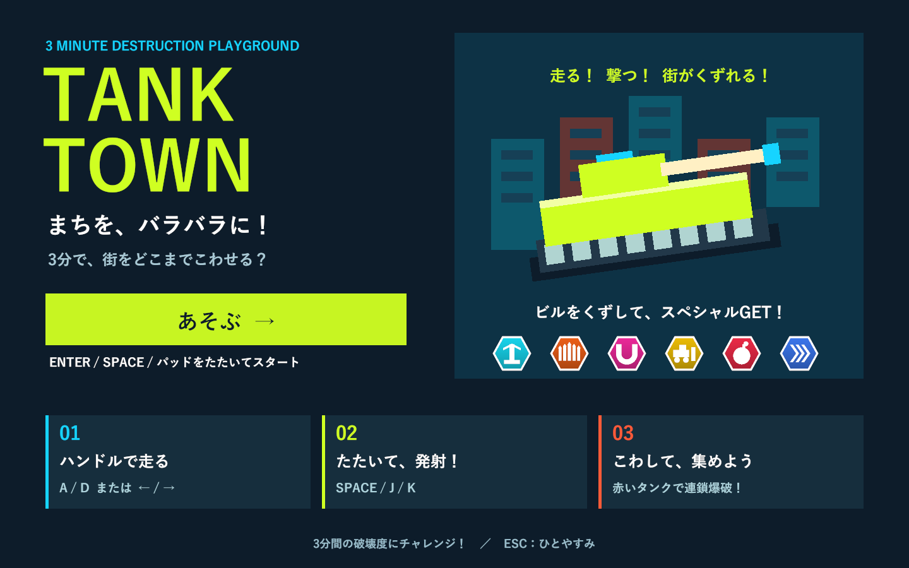

# TANK / TOWN

子供向けの戦車アクション（戦車と周囲を見渡せる三人称カメラ）のUnityプロトタイプ。3分間で箱庭の街を破壊し、街全体の部材数に対する破壊済み部材の割合を競います。



## 起動

Unity **6000.3.19f1** で開き、メニュー **Tank Town → Create or open playable scene** を選び、Playを押してください。タイトルの「あそぶ」、Enter、Space/J/K、左右パッドでスタートします。タイトル中は街と制限時間を停止し、開始用の打撃では砲撃しません。専用シーンは `Assets/TankTown/Scenes/TankTown.unity` です。街と戦車はPlay時に生成します。

## 操作

|操作|試作用の入力|
|---|---|
|前進|自動|
|左右旋回|A / D、← / →、ゲームパッド左スティック|
|左圧センサー相当|Space / J、ゲームパッドLボタン|
|右圧センサー相当|K、ゲームパッドRボタン|
|開始・再挑戦・再開|Enter、ゲームパッドStart、画面ボタン|
|一時停止|Esc。アプリがフォーカスを失った場合も停止|

前進は自動で、加速度10で基本巡航速度16に達します。ハンドルを切ると砲塔が先に最大22度まで向きを変え、0.08秒遅れて車体が旋回します。旋回速度はパワーアップで上がります。横方向の慣性はグリップで抑え、ハンドルを戻すと砲塔・車体が滑らかに直進へ戻ります。カメラは砲塔の水平な向きへ緩やかに追従し、回転速度135度/秒・角加速度240度/秒²を上限に切り返しをつなぎます。画面の水平を固定し、坂の傾斜や車体の演出的な揺れを画面の傾きへ反映しません。後方9.0・高さ3.0から戦車と周囲を見渡し、位置・高さ・巨大化時の距離変更も滑らかに追従します。砲塔と車体表示の回転を描画フレームごとに補間し、物理更新の間にも連続して動かすことで旋回時のガクつきを防ぎます。車体の操舵応答を5から12へ上げ、旋回の開始とハンドルを戻した後の直進復帰を速めています。砲弾・砲口のエフェクト・照準は砲塔に追従し、砲身は少し上向き（標準4度）です。

坂道では車体が地面に沿って上下・傾斜し、カメラは水平を保ったまま高さを緩やかに変えます。進行先の前後左右の地面と車体全体の接地高さを調べ、急な道路脇や坂の頂上でも車体の端が地面に引っかからないようにしています。小物は体当たりで破壊できます。大きな建物への強い衝突や街の外への移動で戦車が爆発し、安全地点へ戻ります。暫定で3秒のペナルティと1.2秒の復帰待ち時間があります。待ち時間も制限時間に含まれます。ブルドーザー・ハイスピードの効果中は衝突で爆発せず、街の外ではペナルティなしで開始地点へ戻ります。

## 街・破壊・描画

- 268×268のフィールド。道路幅16、街区間隔40。33棟と3つの公園。幅14.4〜20、2〜8階の低層店舗・集合住宅・高層ビルを混在させ、屋根や屋上設備にも変化をつけています。街灯・看板・木・箱・ベンチ・噴水を配置。柱幅1.8、基本の爆風半径6.5。
- 街は0〜10.5の高低差を持つ低地・丘・高台で構成。交差点と建物の敷地は平坦、道路間は滑らかな坂道。地面は実際のMeshColliderを持ちます。アイテムと小物も各地点の地面に配置。
- 建物は柱・梁・薄い床・薄い外壁で構成し、室内は空洞。窓は外壁と一緒に飛散します。
- 爆風で部材を切り離し、柱・梁・床の接続グラフから地面への支持を失った部材もRigidbodyにして落下させます。外壁は骨組みを支えません。各階で残った支柱の接地面から支持範囲を作り、上に残る部材の重心が範囲を外れると、その階から上を倒壊させます。一本残っていても偏っていると倒れます。
- 同じ部材は1回だけ加点。破片が消えても街全体の分母は変わりません。
- 破片は最大280個・9秒。戦車・地面・未破壊建物と物理衝突し、戦車に当たった破片は押しのけます。破片によって戦車は爆発しません。戦車への衝突トルクは無効化し、旋回は入力、上下方向の姿勢は地面で制御します。木の葉や看板を含めて初接触から部材を分離し、すぐ押し返します。破片同士は衝突を省略します。
- 彩度を上げた専用URPトゥーンシェーダー、段階的な陰影、影、リムの明るさ。砲口の閃光、砲弾の軌跡、着弾の立体火球・多数の火花・二重の衝撃波・煙、倒壊の粉塵。画面揺れは使いません。火球は専用シェーダーで近距離のみ透過し、放射状の光と拡大した火花・衝撃波を加えています。爆発演出の標準倍率は1.55、破壊判定の半径とは別に調整できます。カメラの標準位置は戦車から高さ3.0・後方9.0、視野角は72度で一定です。遮る部材は専用シェーダーで一時的に透かし、建物を避けるための急なズームをなくしました。復帰や無敵中の街の外からの帰還は短い暗転で位置・角度の切り替えを隠します。照準は実際の砲撃方向を示します。
- 30度以下の坂を対象にした安全地点の履歴、復帰直後の衝突猶予、停止・タイムアップ・結果・再挑戦。
- 道路を18台の車が走行。信号の赤で停止、青で発進し、前の車との間隔を保ちます。車・信号・電柱は体当たりや砲撃で壊せます。電線は両端の電柱につながり、支柱を壊すと消えます。
- 赤いドラム缶・燃料タンクを11か所に4個ずつ配置。車を含め、命中・体当たり・落下した部材の衝突で点火し、0.18秒後に爆発します。周囲の爆発物へ連鎖し、建物も巻き込みます。HUDに連鎖段数を大きく表示し、結果には誘爆回数・最高段数・称号を表示します。
- 専用の青空グラデーション、ゆっくり動く雲、海、遠景の島。遠方は距離フォグで空になじませます。フィールド端は波打つ砂浜・崖・壊せるガードレールで囲み、海へ向かうとHUDで曲がるよう案内します。視界を遮る飛散破片も、カメラを急に動かさず透かして見通しを保ちます。

## 強化アイテム

道路上に76個の浮遊する2Dビルボードを配置。カメラに正対するアイコンに触れると取得し、色付きの取得演出とHUDのレベル・実値を更新します。開始直後の道には4種類を並べています。

|色・アイコン|効果（1レベルごと）|
|---|---|
|水色・二重矢印|スピード: 基本速度の8%を加算|
|赤・爆発マーク|破壊力: 基本衝撃力の18%、爆風半径の7%を加算|
|黄色・3発の弾|連射: 射撃間隔を `基本間隔 / (1 + 0.16 × レベル)` に短縮|
|紫・回転矢印|旋回: 基本旋回速度の6%を加算|

暫定上限は各8レベル。射撃間隔の下限は0.12秒。強化は爆発・復帰しても維持し、再挑戦でリセットします。取得済みアイテムはそのラウンド中は復活しません。上限に達した種類のアイテムは取得しません。アイテム取得は自動射撃には変更せず、短い間隔で次の打撃を受け付けられるようにします。

## スペシャルアイテム

能力強化とは別に、6種類・33個を各建物の上階（最上階の床の上）へ1個ずつ配置しました。六角形の浮遊2Dアイコンで見分けられます。床が外れるとRigidbodyの重力で落下します。建物の部材を60%以上壊すと回収でき、アイコンへ戦車で触れると取得します。床だけを撃って落とした場合は、その建物をさらに壊すまで回収できません。落下中は光の軌跡が付き、回収可能になったときに取得位置が光ります。

|種類|発動方法|試作用の効果|
|---|---|---|
|メガビーム|拾って次の砲撃|2秒、前進を止めて長さ70・半径5の巨大レーザーを放つ。ハンドルで砲塔を動かせる。|
|ミサイル|拾って次の砲撃|5発が上昇し、6秒間、前方の広い範囲へ繰り返し爆撃。走行と通常砲撃もできる。|
|マグネット|拾うと自動|8秒間、半径22以内の能力強化アイテムを引き寄せて回収。|
|ブルドーザー|拾うと自動|8秒間、2.3倍の車体と巨大ブレードで建物を押し壊す。無敵。速度は85%。|
|ギガント爆弾|拾って次の砲撃|直径8の物理爆弾を投げ、3秒後に半径30の大爆発。爆発前も接触した建物を壊す。|
|ハイスピード|拾うと自動|6秒間、速度2.2倍で駆け抜ける。無敵。|

保持できる武器は1つ。満杯なら次の武器アイコンはその場に残ります。発動中も次の武器を保持できますが、発動終了まで使用を待ちます。その間は通常砲撃を使えます（ビーム中は砲撃を停止）。自動発動の3種類は同時に有効で、同じ種類を拾うと残り時間を初期値へ更新します。HUDに保持武器とすべての効果の残り秒数を表示します。追加ボタンはありません。

爆発・復帰では保持武器を維持し、発射済みのミサイル・爆弾は続行します。ビームと車体に付く効果は解除します。タイムアップ・再挑戦で全アイテムを終了します。[詳細](docs/item-design.md)。

一時停止・結果画面から「タイトルへ」で街を作り直せます。結果の「もういちど」は新しいラウンドへ直接進みます。

## 調整と実機接続

`Assets/TankTown/Resources/TankTownSettings.asset` で制限時間、巡航速度、加速、ハンドル応答、砲塔の角度・速度、車体の旋回遅延、グリップ、車高、砲身の仰角、旋回速度、射撃間隔、爆風、復帰、圧センサー閾値、破片上限、街区数・間隔・道路幅・建物寸法・柱幅・安定判定の余白・地形の高低差、爆発演出倍率、カメラ位置と視野角、強化係数と上限、各スペシャルアイテムの時間・範囲・倍率を変更できます。射撃間隔0.35秒とアイテムの数値は試作用の値です。建物幅は道路との重なりを避けるため街区間隔−道路幅−4までに制限します。道路幅も街区間隔−14までに制限します。

外部入力アダプターから `TankInput` に、Unityのメインスレッドで以下を渡してください。

```csharp
input.useHardware = true;
input.SetWheel(normalizedSteering); // -1: 左、0: 中央、+1: 右
input.SetPressure(0, leftPressure); // 0〜1
input.SetPressure(1, rightPressure);
// デバイス側で打撃を検出済みなら input.PulsePad(0 または 1)
```

センサーは押し込み閾値で1回発火し、解除閾値まで戻ると再発火できます。左右の信号は `PadPressed(int)` で区別していますが、試作では両方とも同じ砲撃につないでいます。左右の最終的な役割と通信方式は未定です。まずキーボードで試します。

支持判定は接続グラフ、部材の体積と種別による重心、支柱断面の凸包を使う簡易モデルです。対角の二本で重心が支持範囲に収まる場合は残りますが、重心が偏ると倒れます。実際の荷重限界・曲げ・ヒンジの構造解析ではありません。成長係数・アイテム数は暫定値。イージーモードは未実装です。

## 検証・ビルド

今回のタイトル・街の演出・連鎖爆破・落下報酬は [街とUIの検証記録](docs/city-presentation-validation.md) を参照してください。

Unity Test RunnerのPlayModeで `TankTown.Tests` を実行します。前進・旋回、砲弾命中、体当たり、支持喪失、空洞の室内、外壁と骨組みの関係、重複加点、圧入力、破片の衝突、アイテム取得、実際の強化射撃、復帰とラウンド初期化を検証します。

[酔いを抑えるカメラの検証記録](docs/camera-comfort-validation.md)、[引きのカメラの以前の検証記録](docs/camera-framing-validation.md)、[旋回時のカメラのガクつきの検証記録](docs/camera-jitter-validation.md)、[砲塔との方向一致・カメラ距離の以前の検証記録](docs/camera-alignment-validation.md)、[砲塔カメラ・追従強化の以前の検証記録](docs/turret-follow-validation.md)、[車体カメラの以前の検証記録](docs/camera-validation.md)、[6種類のアイテム・戦車操舵の検証記録](docs/items-validation.md)、[速度16・加速度10の検証記録](docs/speed-validation.md)、[坂道の詰まり・上向き砲撃の検証記録](docs/slope-validation.md)、[高低差・車の挙動・大型エフェクトの検証記録](docs/terrain-validation.md)、[操作・倒壊・大爆発の検証記録](docs/feel-validation.md)、[街の拡張の記録](docs/expansion-validation.md)、[初回の記録](docs/validation.md) を参照してください。

Windows Development BuildはUnityを閉じた検証コピーで以下のメソッドをバッチ実行できます。

```text
Unity.exe -batchmode -projectPath <project> -executeMethod TankTown.Editor.TankTownSetup.BuildWindows -quit -logFile <log>
```

出力先は `Builds/TankTown/TankTown.exe`。初回起動時のパッケージ解決にはネットワークが必要です。

Development Buildを `TankTown.exe -batchmode -force-d3d11 --tank-town-smoke` で起動すると、開始・街の全景・アイテム取得・砲口・大爆発・骨組み・復帰・坂道・結果の9画面を実行ファイル横の `Captures` に保存します。片側二本の支柱の喪失による倒壊を33棟で連続発生させ、破片上限も確認します。診断用の骨組み画面では外壁を直接分離しています。ネイティブUnityゲームのため、画面検証はWindowsプレイヤーを対象とします。

`--tank-town-items-smoke` では6種類のアイコン、砲塔と車体、各効果、結果の14画面を保存します。診断ではアイテムを直接付与して建物前に移動し、物理演算・通常の発動入力を使います。取得判定はPlayModeテストで別に確認します。

`--tank-town-camera-smoke` では砲塔の先行旋回・車体の旋回・ハンドルを戻した後の3画面を、砲塔と向きが一致する通常カメラで保存します。

`--tank-town-camera-motion-smoke` では60・144fpsを目標に旋回・切り返し・直進復帰を実行し、6画面と毎フレームの回転速度・角加速度・水平からの傾きを記録します。`--tank-town-camera-comfort-smoke` ではこれに実際の登り坂・下り坂、巨大化、遮蔽物、暗転復帰を加えた12画面を確認します。

`--tank-town-city-smoke` はタイトル・通常走行・島の全景・車・実砲撃による車の誘爆・屋上報酬・燃料の連鎖・報酬の物理落下と接触回収・2秒ビーム・結果の13画面を保存します。全景・破壊・報酬の画面は診断用カメラです。狙いを固定するため車と戦車を移動し、建物の支持を追加で外す操作も含みます。`--tank-town-title-wide-smoke` は1920×1080のタイトルと通常HUDを保存します。3分間の手動プレイの代わりにはなりません。
