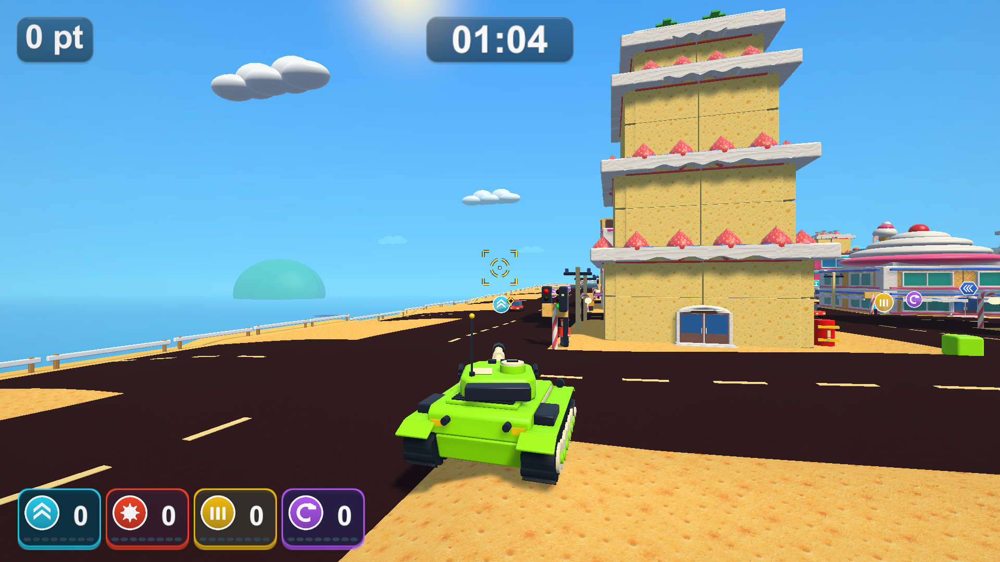

# 1分20秒のラウンドと子供向けの照準アシスト

2026-10-23

## 変更

- 全ステージ共通の制限時間を80秒へ変更。設定の初期値とResourcesの設定、HUDの初期表示、遊び方、ラウンド関連のテスト、既存の起動診断をそろえました。
- 通常砲撃は前方90m・砲身から最大6度の範囲で補正します。距離よりも照準方向との角度を優先し、壊せる部材・車・小物の表面に近い点へ向けます。すでに直撃する場合はその方向を優先します。
- 発射位置から実際の砲弾と同じ半径0.25mのSphereCastを行い、カメラからの見通しも確認します。遮蔽物の向こう、画面外、後方、破片、アイテム、通行人は補正対象にしません。
- プレビューは0.05秒ごと、発射時は必ず最新の配置で再計算します。検索配列を再利用し、混雑時だけ256個から最大2,048個へ拡張します。発射後の砲弾は直進し、カメラ・操舵・スペシャル武器の向きは変更しません。
- 巨大爆弾の飛行中に次の武器を保持している場合も、その間に撃つ通常砲弾には補正が働きます。保持武器を今すぐ使う場合と、使用待ちの武器を持ちながら通常砲撃する場合を分けて判定します。
- 照準はフォントの「＋」から、四隅のマーク・分割リング・中央の小さな十字へ変更。対象があると金色になり、ずれた着弾位置には小さなひし形が付きます。射撃時の開閉と再装填リングも追加しました。Canvasのメッシュで描画し、画像・新しいマテリアルは追加していません。
- `cannonAimAssist`、`cannonAimAssistAngle`、`cannonAimAssistRange`で有効・無効、補正角度、距離を調整できます。

## PlayMode

Unity 6000.3.19f1の別の検証コピーを使用。Input System・URP・UGUI・Test Frameworkは既存のローカルキャッシュを参照し、元プロジェクトのPackagesや利用者が変更した描画設定は変更していません。

関連74件を実行し、初回は73件成功、1件は報酬テストに残った「60秒未満」という旧期待値で失敗しました。80秒へ修正後、照準8件・報酬11件の19件を再実行し、全て成功（41.76秒）。74件の異なるテストすべての成功を確認しています。初回の74件は307.66秒でした。

新しい8件では、角度を優先する対象選択、直撃の維持、空振り時の直進、角度外・範囲外・後方・壊れた物の除外、砲口とカメラからの遮蔽、無効設定とスペシャルの除外、実弾の補正・命中・発射後の直進、80秒とポーズ・終了、照準表示と入力の透過を確認しました。既存の砲弾3件・生成6件・開始と結果6件・お菓子6件・遊園地5件・基本29件も成功しています。

記録: `Logs/aim-assist-tests.xml`、`Logs/aim-assist-final-tests.xml`と同名のログ。

最終確認で武器の併用時の補正判定も修正しました。同じ修正後の照準7件が成功し、残る併用ケースも再実行で成功（14.92秒）。このケースは先行する実レーザーが標的を破壊するため、別の標的を生成し、飛行中の爆弾を視線の外へ置いて保持状態を確認しています。記録は`aim-assist-queued-tests.xml`と`aim-assist-queued-final-tests.xml`です。途中にUnity Package ManagerのIPC起動失敗が1回あり、再起動で解消しました。

## Windows版と実画面

Windows x64 Development Build成功。`Builds/TankTown-AimAssist/TankTown.exe`で以下を実行しました。

```text
--tank-town-aim-smoke                  お菓子の街
--tank-town-aim-smoke --aim-town       いつもの街
--tank-town-aim-smoke --aim-big        大きな街
--tank-town-aim-smoke --aim-amusement  遊園地
```

4回とも終了コード0。制限時間80秒、補正対象への実際の砲撃・破壊を確認しました。補正角度は順に5.90・3.44・5.83・5.83度で、最大6度を超えていません。各ステージで通常画面、金色の照準、720p、発射、着弾、ポーズ、結果の7枚、計28枚を撮影しました。代表画面を目視し、1080pと720pの照準・マーカーと、ポーズでの非表示を確認しています。



シード2026・固定時間刻みで、静止させた戦車と標準のプレイ用カメラを使った診断です。制限時間には実時間の時計を使うため、撮影処理中も減り、写真の残り秒数は撮影負荷で変わります。画面は画像加工していません。手動操作の体感確認、実機入力、長時間の性能測定は今回の検証に含みません。

通常の`Builds/TankTown/TankTown.exe`にも同じビルドを反映しました。両方のRuntimeアセンブリのSHA-256は`E85B9D0A198077D71D4AE78DF7D0464F884812DE1BD8E7D29EA6E55543D54067`で一致しています。GitHub Releaseは変更していません。

変更したC#と設定18ファイルは検証コピーと改行正規化後一致。利用者の描画設定・一時撮影コード9ファイルのハッシュも作業前から変わっていません。既存のAGENTSや開発手順を変更する必要はありません。

記録は`Logs/aim-assist-build.log`、`aim-assist-{candy,town,big,amusement}-player.log`、`aim-assist-source-check.json`、`aim-assist-build-hashes.json`、`aim-assist-local-overlays-check.json`。全画面は`Builds/TankTown-AimAssist/Captures/Aim-*`にあります。
