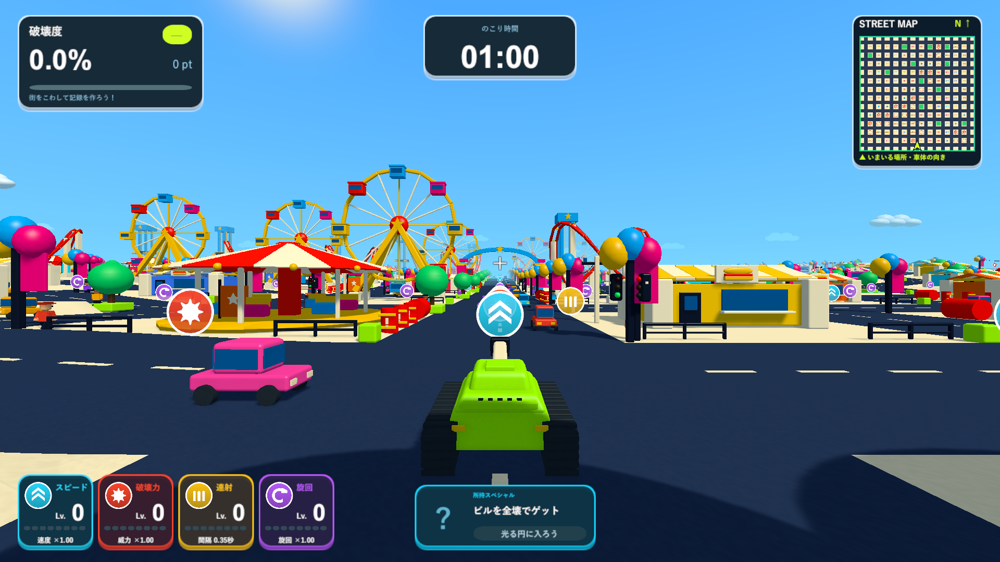

# 遊園地の最初の試作

2026-10-12。元の構想画像から[必要素材の一覧](amusement-assets.md)を作り、観覧車・コースター・メリーゴーラウンド・落下タワー・チケット売店・飲食売店と入口ゲートを試作しました。[元画像とUnity実画面の比較](amusement-review.html)。

タイトルの「遊園地」または数字4で選び、Spaceで開始できます。既存の3ステージ、選択時に背景を再生成しないタイトル、1分の制限時間と6種類のスペシャルを保っています。遊園地は536×536、132か所の遊具・売店、入口ゲート1基、公園12か所です。開始の大通りに主役の4遊具を配置し、ほかはシードに従って並べます。ランキングは`.AmusementPark`へ分けています。

支持脚・外周・スポーク・ゴンドラ、2本のレール・横桁・支柱、円形の床と扇形の屋根、タワーの区切った柱などが実際の破壊部材です。接地している支柱から支持グラフをたどり、支持を失った部分や偏った重心で倒壊します。通常砲弾は観覧車を部分的に壊し、全壊後に円形の報酬エリアが現れます。風船付き街灯・植木鉢・柵も体当たりで飛びます。遠景とミニマップで曲面と星・扇形の輪郭を保ち、建物ごとの共有描画を使います。

## 確認した内容

- 最初のPlayMode検証は28/28成功。新規5件に加えて、既存のお菓子・街生成・ランキングとミニマップの検証を含みます（`Logs/amusement-playmode-tests.xml`）。
- 円形床・タワーの支持の形状調整後に遊園地5/5成功（`Logs/amusement-final-playmode-tests.xml`）。無傷の7種類で支持が外れないこと、砲撃の部分破壊、偏った支持でのコースター倒壊と報酬、全種類の全壊、売店の入口、小物の物理化、シードの再現、選択・再挑戦・タイトル文字の収まりを確認しました。
- Windows x64 Development Build成功（`Logs/amusement-reviewed-build.log`）。実プレイヤーは終了コード0で14画面を保存し、`buildings=133, extent=536, parks=12, sevenShapes=true, partialCannon=true, supportCollapse=true, rewardArea=true`を記録しました（`Logs/amusement-reviewed-player.log`）。
- 撮影にはシード2026と一部固定したカメラ・戦車配置を使います。観覧車への砲撃は実際の通常入力と砲弾です。コースターの倒壊は診断用に支柱を分離して確認しました。車・爆発物は近接確認時に停止しています。手動プレイ全体や負荷の保証を表すものではありません。
- 非表示プレイヤーの画面と撮影先の寸法の差でUIが切れていた撮影処理を修正しました。撮影先をカメラへ設定してCanvasを合わせ、照準・取得アイコンも撮影先の寸法で投影します。通常の画面では従来のScreen寸法を使います。比較画像の1920×1080と1280×720でUIの端と照準を確認しました。
- Chromeで元画像1枚と実画面14枚の読み込み、1920・1280・720・390px幅、原寸リンクとエラーがないことを確認しました（`Logs/amusement-reviewed-browser.log`）。

## 次の制作工程

現在は形・支持・配置を確認する試作です。布目と接合部・看板の共用テクスチャ、馬や車両のモデル、観覧車の回転と座席の昇降、大きくつながったコースター、ランドマークの数と広場の配置を詰めます。素材一覧に部品と質感の制作対象を記載しています。

ローカルの更新ビルドは`Builds/TankTown-Amusement/TankTown.exe`です。GitHubの既存v0.1.0は3ステージの配布版で、今回の試作を含む新しいリリースは作成していません。

