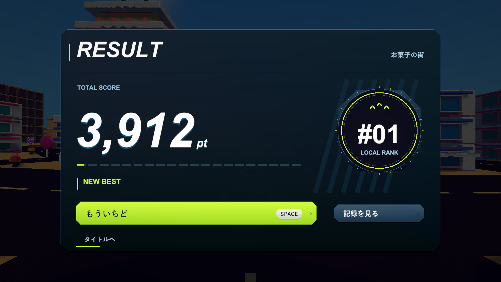
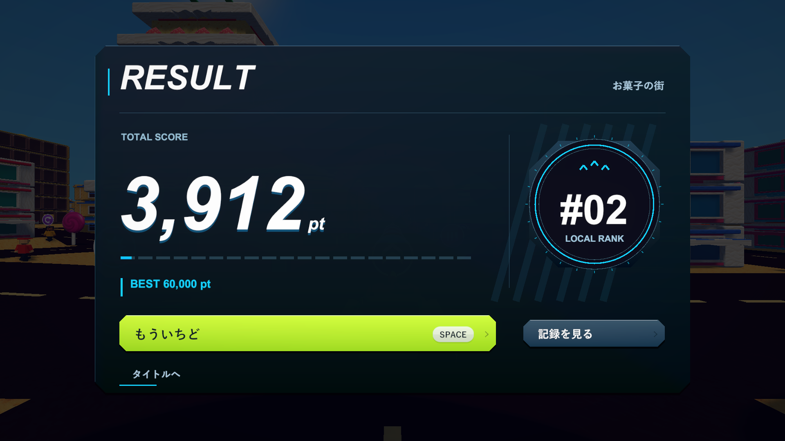

# アーケード風のリザルト（2026-10-25）

## 変更

小さな半透明カードから、カットした角と金属の陰影を持つ横長パネルへ変更しました。左の大きなスコアと右の順位エンブレムを中心に、ダークネイビー・白・シアンを使用し、NEW BESTではライムへ切り替えます。順位は実際の端末内ランキングで、0点では「—」を表示。評価用の新しいランクや採点規則は追加していません。

0.38秒の登場、0.95秒のスコア集計、エンブレムの点灯、確定時の小さな拡大と光の通過、確定音を組み合わせています。メーターは100,000ptまでのスコアに対応。紙吹雪や常時点滅は使わず、演出の後は静止します。装飾はUnity UIの頂点色と形状で描くため、新しい画像素材や描画用テクスチャを必要としません。

再挑戦は角を落とした大きなボタン。細かい集計とTOP 10は「記録を見る」にまとめ、詳細側も同じ材質・ボタンへ変更しました。Spaceの即時再挑戦、Tabでの詳細表示、Escでの復帰、マウス操作とホバーを維持しています。

## PlayMode

`TankTownRoundFlowTests`と`TankTownRankingMinimapTests`の18項目を検証。初回は17件成功し、詳細を開いてから非表示のエンブレムを検索していた追加のテスト記述1件が失敗。順位の確認を詳細表示の前へ移動し、該当テストを再実行して成功しています。この再実行ではテストの確認順だけを修正しました。その後の陰影・配置・音の仕上げは、下記の最終ビルドで確認しています。

集計の単調増加と正確な最終値、0点、NEW BEST、順位、詳細の各数値、ランキング保存、集計中のSpace、再挑戦時の二重生成や誤射、詳細の開閉を確認。記録は`Logs/results-v3-tests.xml`、`Logs/results-v3-final-tests.xml`と対応ログです。

## 最終ビルドと実画面

Windows x64 Development Build成功。`--tank-town-round-flow-smoke --tank-town-menu-layout`でタイトルからプレイ、結果、記録表示、Spaceによる再挑戦まで実行し、終了コード0。1920×1080・1280×720・1440×900・1280×1024の4解像度で、結果・記録・最大値の文字切れと画面端24単位の余白を機械的に確認しました。

100,000pt・順位11・各集計99,999・999 CHAIN・ランキング10件の最大表示も確認。最大値の写真はレイアウト用に文字とメーターを差し替えた診断です。通常写真の3,912ptは実際の建物5棟の支持喪失・連鎖から得た値です。保存される記録は増やさず、マウスとTab/Escで記録を開閉でき、Spaceで1回だけ再挑戦することも確認しました。

`--tank-town-result-existing-best`を付けた別実行では、保存しない診断用の60,000ptをメモリ上に準備し、BEST 60,000pt・今回3,912pt・順位2位・シアンの通常配色を確認。こちらも終了コード0。手動プレイの評価や全ステージの長時間検証は含みません。

確認用の`Builds/TankTown-ResultsV3/TankTown.exe`と通常の`Builds/TankTown/TankTown.exe`に同じビルドを配置。RuntimeアセンブリのSHA-256は`171B36BA86102A86422676F04E4E352BC0E635D06D60C59DC55E1DBFD63CA962`です。画像は`Builds/TankTown-ResultsV3/Captures/NewBest`と`ExistingBest`に保存しています。

最終C# 109ファイルは検証コピーと改行正規化後に一致。利用者の描画設定・撮影コード9ファイルは作業前のハッシュと一致。既存の削除3ファイルも復元していません。

記録：`Logs/results-v3-verified-build.log`、`Logs/results-v3-{newbest,existingbest}-player.log`、`Logs/results-v3-build-hashes.json`、`Logs/results-v3-source-check.json`、`Logs/results-v3-local-overlays-check.json`。既存のAGENTSや開発手順の変更は不要です。
