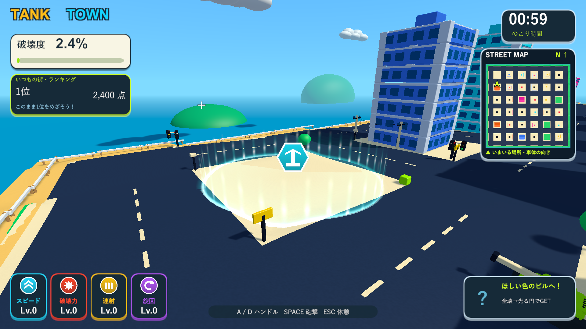
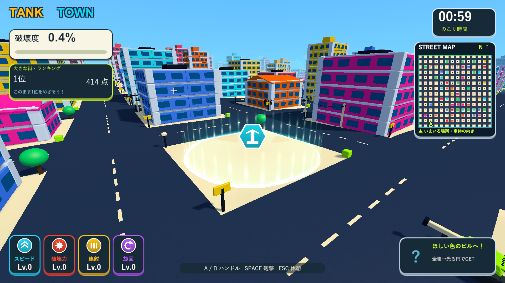
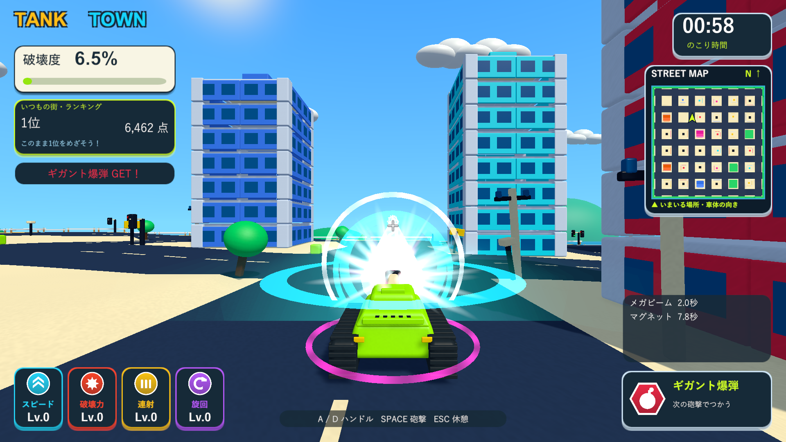

# 円形エリアの発光強化とレーザー角度

2026-10-08。Issue #5の追加調整。

この調整後、レーザー中だけ専用視点へ移る[カメラの追加調整](beam-camera-dozer-validation.md)を実施しました。以下の「カメラの傾きは変更しない」は仰角・発光を調整した時点の記録です。

## 変更

- エリアの光の高さを3.8から5.5へ変更。上昇する光の筋を広げ、発光を1.6から2.6へ強め、上部まで見える減衰にしました。
- 外縁の輪の太さを0.42から0.72へ変更し、太さ2.1の淡い光の輪を重ねています。薄い床の光も強めています。半径・取得判定・全壊条件・マグネットによる消去条件は維持しています。
- 発光は既存の共有加算マテリアルと専用シェーダーを使用。エリア当たり輪の描画が1つ増えます。Update、リアルタイムライト、パーティクルの追加はありません。FPSの比較測定は今回行っていません。
- メガビーム時だけ砲身の仰角を通常の4度から1度へ下げます。発動直後の初回から、砲身・砲口・レーザーの描画・破壊判定・砲口リング・着弾演出に同じ方向を使います。効果終了、衝突による中断、ラウンド終了で4度へ戻します。
- カメラの傾きは変更しません。レーザーの射程・半径・時間・旋回速度も維持しています。仰角は設定の`megaBeamElevation`で調整できます。

## 検証

分離したUnity 6000.3.19f1プロジェクトでPlayMode 31/31件成功（アイテム13、円形報酬11、カメラ7）。新規テストは初回レーザーの方向と砲口の一致、低下した仰角、カメラ回転の維持、終了後の通常弾の方向、中断・ラウンド終了時の復帰を確認します。ログは`Logs/area-glow-laser-tests.xml`。

Windows x64 Development Build成功（`Logs/area-glow-laser-build.log`）。ネイティブUnityの画面確認は、Skillのブラウザ確認に相当するD3D11のWindowsプレイヤー実描画で行いました。通常33棟と大型132棟の専用診断が両方exit 0で完了しています。

両ステージで高さ5.5、レーザー仰角1.0、復帰後4.0、描画と砲口の方向一致、発光シェーダーの動作を確認しました。全壊条件、円の端からの取得、マグネット中の円の固定、外縁を越えた時の消去、保持枠が満杯の時の報酬保持と後からの取得も成功しました。1920×1080の実画面で輪郭・上昇する光・アイコンの見え方を確認しました。

- `Logs/area-glow-laser-town-player.log`
- `Logs/area-glow-laser-big-player.log`

メイン・検証プロジェクト・レビュー用ブランチのソース、設定、音声、meta計182ファイルのSHA-256一致を確認しました。検証済み実行版を`Builds/TankTown`と`Builds/TankTown-LocalBlast`へ反映し、実行ファイル・Runtime DLL・resources.assetsの一致を確認しています。

- Runtime DLL：`F4F199823380682CA8BCAB97E1597154559A95518CB192754C914095A15A6A7C`
- resources.assets：`6557845E2DABEF08748E62535180FFD64500B0A715D3F9401FA6B4359EBE1835`

