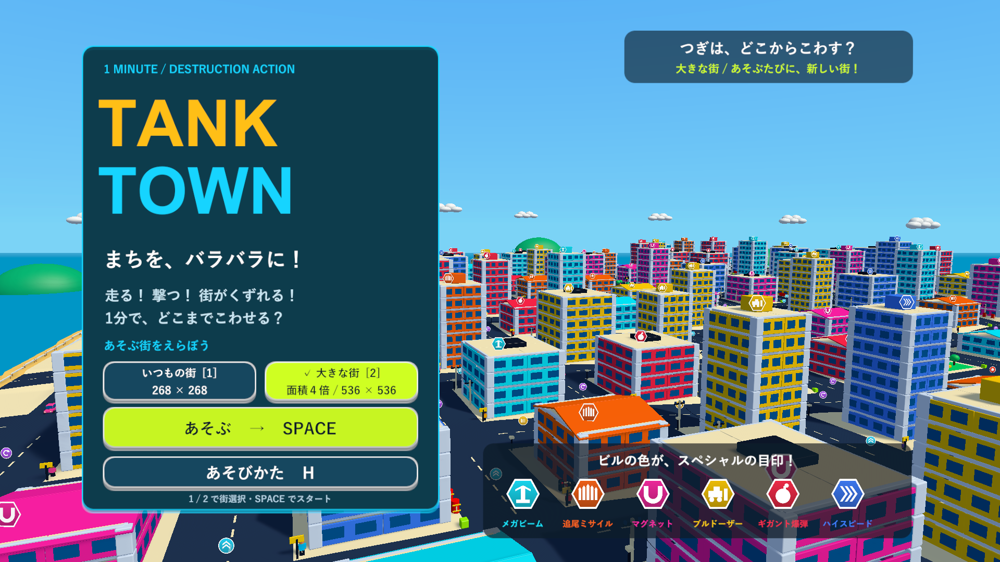
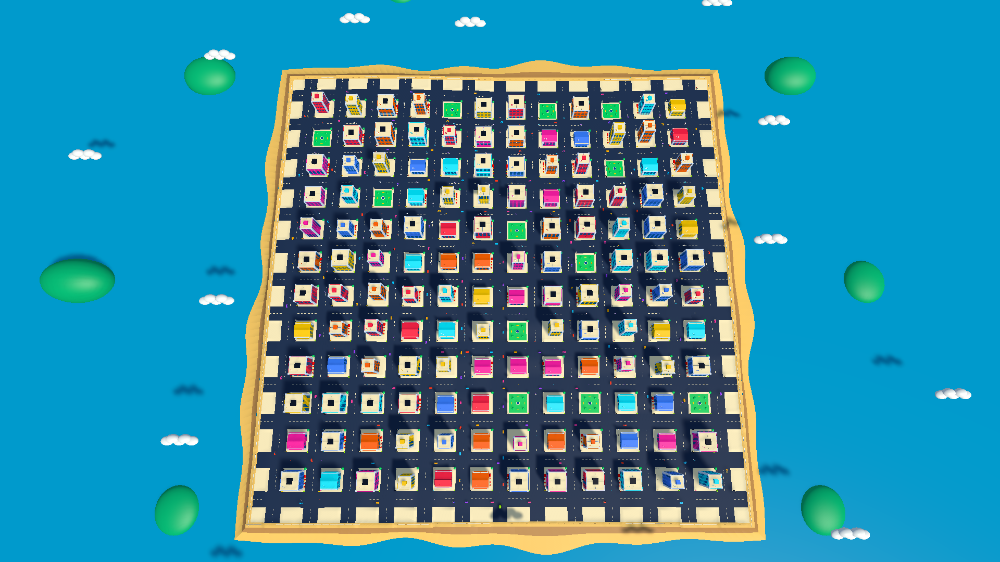
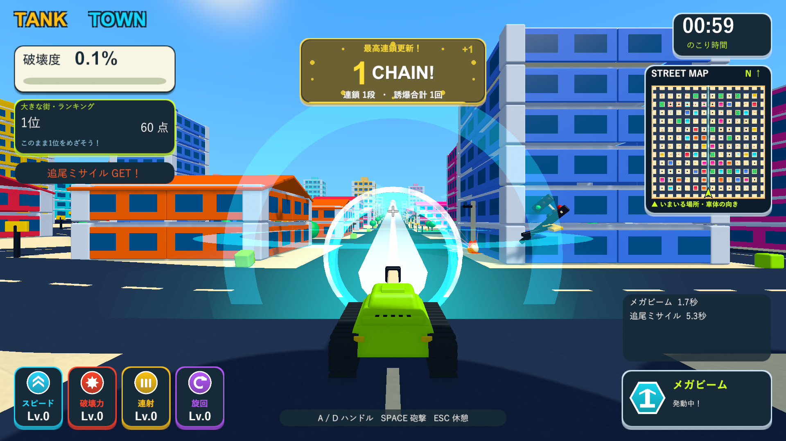

# 自動ミサイルと2つのステージ

2026-10-06。Issue #5の追加実装。ミサイルを拾った瞬間に自動発射し、レーザー・巨大爆弾と併用できるようにしました。タイトルから従来の街と面積4倍の大型ステージを選べます。

2026-10-07追記：タイトル背景は大型街の表示用モデルに固定し、ステージ選択ではロード・街の再生成を行わない方式へ変更しました。選択したプレイ用の街は開始時に確定します。以下の生成・操作検証は当時の記録です。[現在の構成と追加の最適化](performance-title-validation.md)。

## 遊び方と構成

|項目|いつもの街|大きな街|
|---|---|---|
|選択|タイトルの左ボタン・数字1|タイトルの右ボタン・数字2|
|縦横|268×268|536×536|
|面積|1倍|4倍|
|街区|6×6|12×12|
|建物・公園|33棟・3か所|132棟・12か所|
|能力強化・建物の報酬|76個・33個|292個・132個|
|車・通行人|72台・72人|144台・288人|
|レーザー射程|400|800|
|制限時間|60秒|60秒|

建物の寸法、道路幅16、街区間隔40、構造の部分破壊は共通です。地形・道路・海岸・遠景・雲・タイトル巡回とミニマップは生成した街の広さを使います。設定はラウンドごとに複製して拡大し、Resourcesの設定や従来の街を変更しません。ステージ選択はアプリ起動中に維持し、再挑戦・タイトル帰還で同じステージを再生成します。新しいアプリ起動ではいつもの街から始まります。

ランキングは従来の`TankTown.Ranking.v1`をいつもの街に維持し、大きな街は`TankTown.Ranking.v1.BigCity`に保存します。ベストにも同じステージ区分を付け、記録が混ざらないようにします。HUDとリザルトにステージ名を表示します。

## ミサイル

取得時に5発を即生成し、専用の6秒タイマーで繰り返し追尾発射します。保持枠や発動中の武器に影響せず、レーザー照射中も爆弾投擲中も飛び続けます。レーザー終了・爆弾の起爆でミサイルは消えません。同じミサイルを再取得した場合は既存の5発を維持して時間を更新します。ポーズで停止し、タイマー満了・ラウンド終了で5発を削除します。戦車の爆発中も発射済みのミサイルは継続します。

通常のSpace/J/Kは砲撃・保持したレーザーや爆弾の使用に使います。前方視界からの車・爆発物の優先選択とミサイル起点の2.8倍の誘爆を維持します。遊び方の文言とHUDの残り時間も自動発動に合わせました。

## 検証

Unity 6000.3.19f1の分離プロジェクトで関連PlayModeテスト60/60成功（88.22秒）。取得時の自動発射、保持武器との併用、レーザー終了後と爆弾起爆後の飛行、再取得時の5発維持、停止・時間切れによる破棄を確認しました。タイトルのボタンから大型街を生成し、縦横2倍・建物と公園4倍、Resourcesの設定維持、再挑戦と従来ステージへの切り替えを確認しました。ランキングは専用のテスト保存キーでステージ別に読み戻し、プレイヤーの記録を変更しません。ログは`Logs/auto-missiles-stages-tests.xml`・`.log`です。

Windows x64 Development Build成功（`Logs/auto-missiles-stages-build.log`）。ネイティブUnityゲームなので、Skillの画面確認はブラウザに代えてD3D11プレイヤーの実描画で実施しました。`--tank-town-extreme-specials-smoke --tank-town-stages-check`はexit 0で完了。仮想キーボードの数字2・Spaceで大型街を開始し、実際の取得処理だけで5発が飛び、Spaceでレーザーと爆弾を併用すること、結果からの再挑戦で大型街を維持すること、数字1で従来の街へ戻ることを確認しました。実測のHalfExtentは134→268、建物33→132、ResourcesのcityHalfBlocksは3のままです。プレイヤーログにゲーム例外・シェーダーエラーはありません（`Logs/auto-missiles-stages-player.log`）。

1920×1080と復帰後の1280×720で10画面を撮影しました。全景は診断用カメラです。武器の確認では戦車を固定し、アイテムを付与して、他の爆発物・通行人・通常のアイテムを無効化しています。診断はランキング保存を無効にしています。確認環境はGTX 1660 TiのWindowsプレイヤーで、異なる端末での長時間の性能測定は含みません。

検証コピー・主作業フォルダー・レビュー用ブランチのソース164ファイルのSHA-256が一致しました。検証したビルドを`Builds/TankTown`と`Builds/TankTown-LocalBlast`へ反映し、両方の実行ファイル・Runtime DLL・resources.assetsも検証コピーと一致しました。Runtime DLLのSHA-256は`465375CF2F5E0FBD411A4FAE54DC08DF290ECD1D2CF04823EFA82F06BC17BF0B`です。

