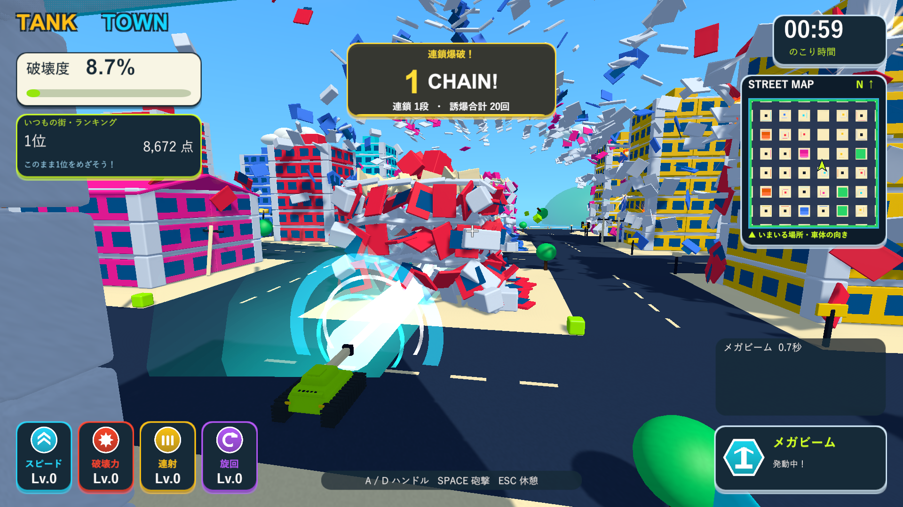
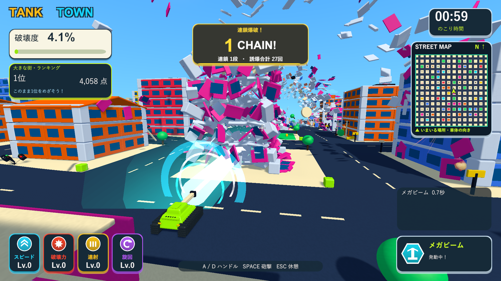
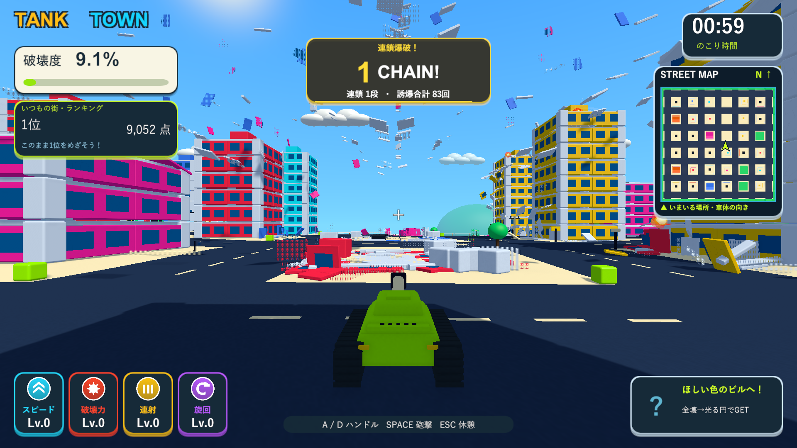

# レーザー専用カメラとブルドーザー速度

2026-10-08。Issue #5。レーザーの光で破壊箇所が見えにくい問題への調整。

## 動作

- レーザー中は右9・高さ10・後方15の斜め後方から、前方40付近を見下ろす専用視点へ移ります。砲口と倒壊箇所を画面上でずらして見せます。通常のカメラは高さ3・後方9です。
- 位置と角度の移行をSmoothDampで緩やかに進めます。通常と同じ旋回の速度・加速度制限を使い、直近の命中点による急な振り向きは行いません。横傾き、揺れ、視野角の変更はありません。
- レーザー終了・衝突中断後は通常視点へ滑らかに戻ります。ポーズ中は移行も止め、再挑戦では通常視点から始めます。巨大化時は通常と同じ滑らかな距離調整を併用します。
- レーザーの高い視線を遮る手前の壁・床・破片も透かします。通常の戦車への視線だけでは透過対象にならない上階も処理します。遮蔽物の検索配列は満杯の場合に拡張し、密集した破片による取りこぼしを防ぎます。検索用の配列は再利用します。
- ブルドーザーの速度倍率を0.85から0.9へ変更。スピード強化後の通常速度に対して90%です。高速と併用すると0.9×2.2＝1.98倍です。巨大化・破壊・無敵の効果は維持しています。
- 設定は`megaBeamCameraOffset`、`megaBeamCameraLookAhead`、`bulldozerSpeedMultiplier`。レーザーの仰角1度、射程、半径、時間は維持しています。

## 検証

分離したUnity 6000.3.19f1プロジェクトで関連33/33件成功。その後、実画面で手前の別の建物の上階が見え方を遮る場面を確認し、レーザーの視線に合わせた透過を追加しました。修正後の関連34件は33件成功し、新規の透過テストだけが移行中の0.35秒の総移動を「急な移動」と扱って失敗しました。1フレーム当たりの移動を確認する方式へ直し、最終カメラ10/10件が成功しました。他の関連24件は修正後の実装で成功済みです。

- `Logs/beam-camera-dozer-final-tests.xml`：33/33。
- `Logs/beam-camera-dozer-occlusion-tests.xml`：34件中33件成功。残る失敗は上記テストの総移動量の扱い。
- `Logs/beam-camera-dozer-camera-final-tests.xml`：最終カメラ10/10。

初回のテストでは、再挑戦後に古いシーンのカメラを参照していた確認を新シーンの再取得へ修正しています。レーザー方向の確認も、小さな角度をacosで比較する際の浮動小数点誤差を避け、正規化した方向ベクトルの差を比較しています。

専用視点の位置・俯角、移行中の移動量と回転量、視野角と横傾きの維持、終了・中断時の復帰、ポーズ、再挑戦、上階の遮蔽物の透過と共有マテリアルの維持を確認しました。既存の通常カメラの旋回、坂道、遮蔽物、巨大化・復帰、アイテムの併用と画面遷移も関連検証に含めています。

最終Windows x64 Development Build成功（`Logs/beam-camera-dozer-final-build.log`）。ネイティブUnityの画面確認は、Skillのブラウザ確認に相当するD3D11のWindowsプレイヤー実描画で行いました。通常33棟・大型132棟の専用診断が両方exit 0で完了し、1920×1080の移行・破壊中・復帰の画面を確認しました。診断は戦車を固定した配置を使用し、ランキングを保存しません。

- `Logs/beam-camera-dozer-final-town-player.log`：レーザーによる部材分離163件。
- `Logs/beam-camera-dozer-final-big-player.log`：レーザーによる部材分離327件。
- 両ステージ：最大専用視点比率0.999、復帰後0.001、移行中の最大1フレーム移動0.333、回転0.388度。診断の描画ステップは1/60秒。視野角72度を維持、ブルドーザー0.90、高速併用1.98。

メイン・検証プロジェクト・レビュー用ブランチのソース、設定、音声、meta計184ファイルのSHA-256一致を確認しました。検証済み実行版を`Builds/TankTown`と`Builds/TankTown-LocalBlast`へ反映し、実行ファイル・Runtime DLL・resources.assetsの一致を確認しています。今回FPSの比較測定は行っていません。

- Runtime DLL：`C3060ED30E1BCADE6206DC28071CF05A39418EC9BCA36DAE78857C8E2B7DE5CE`
- resources.assets：`710AD7813B02E5EC6E0A53C91FB0E62FCCAEB14248CAD27740D15BE5F1E417C0`

