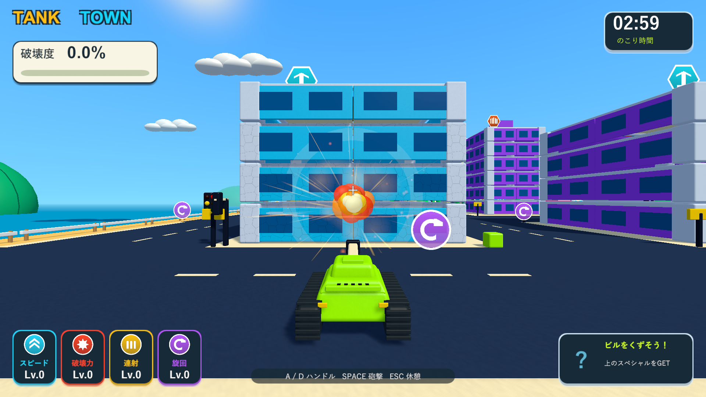
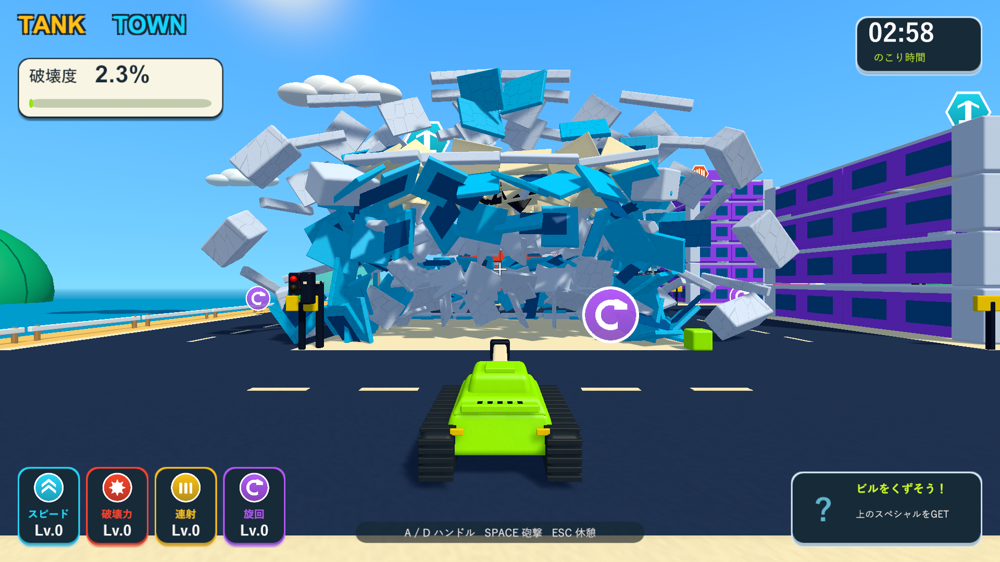
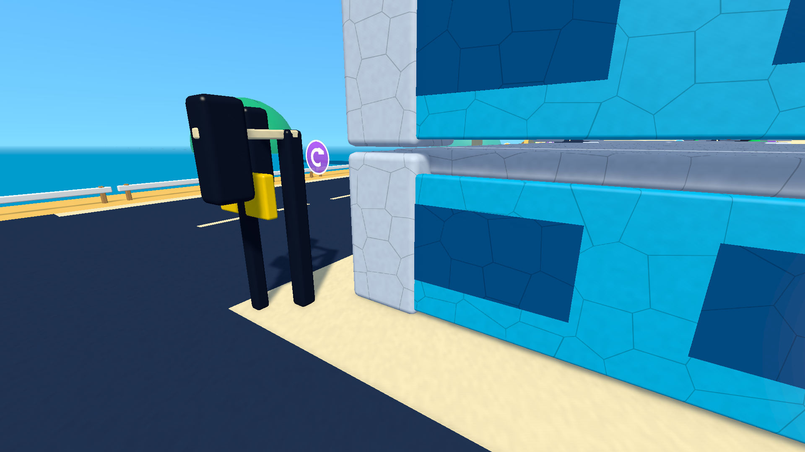

# 連射を前提にした建物の耐久力

2026-10-05。関連: [Issue #5](https://github.com/Negi310/mission2026-game/issues/5)。Unity 6000.3.19f1 / URP 17.3.0。

## 変更

建物を通常砲撃の約3発で全壊させるため、外壁・柱・梁・床・屋上部材に耐久力3を設定しました。初期砲撃のダメージは1。1・2発目はひびと黒ずみが現れ、3発目で部材がRigidbodyへ分離します。ダメージだけでは破壊度を加点せず、分離した部材ごとに一度だけ加点します。再挑戦で耐久力も初期化します。

砲弾・ミサイルの爆風が実際に命中した建物の骨組みには、着弾点から半径10まで衝撃を伝えます。低い正面を狙ったときに、手前の支柱2本を連射で壊せる範囲です。車や小物への爆風半径は4のままで、隣の建物を衝撃の対象へ追加しません。高い位置や端を狙った場合は局所破壊になり、全壊に必要な回数は変わります。

破壊力の強化は衝撃力と同じ倍率で耐久ダメージにも反映します。6段階強化した検証例では1発2.08ダメージとなり、2発で全壊します。燃料の爆発は3、破片の局所爆発は0.5ダメージを与えます。燃料の大爆発やギガント爆弾は骨組みを一度に壊せます。ビーム・ブルドーザーなどの直接破壊と、木・車・看板などの小物は従来どおり即座に分離します。

支持を失った部材や、残った支柱では重心を支えられなくなった建物は、その場で物理的に崩れます。倒壊にさらに3発を要求する仕組みではありません。壊れた屋上からスペシャルアイテムが重力で落ちる流れも継続します。

ひびは既存のトゥーンシェーダーに追加し、命中した部材のMaterialPropertyBlockで表示します。カメラの遮蔽透過・材質の色・破片のフェードを保持し、距離と画素幅に応じてひびの表示を弱めます。

同じ部材に複数Colliderがあっても、一つの爆風でのダメージは1回に制限します。破片が建物へ当たり、まだ部材を壊せない場合も接触爆発を一度発生させ、その破片の爆発を消費します。跳ね返るたびに同じ破片がダメージを繰り返すことを防ぎます。

SettingsのBuilding durability欄で耐久力と骨組みへの衝撃範囲を調整できます。射撃間隔は0.35秒、通常の衝撃力は12です。

## 検証

Unityの分離した検証プロジェクトとWindows Development Buildで確認しました。主作業フォルダーのPackages・シーン・設定を使ってUnityの検証を起動せず、確認済みの実行ファイルをBuilds/TankTownへ反映しています。ネイティブUnityゲームなので、画面検証はWindowsプレイヤーを対象とします。

| 検証 | 結果 | 記録 |
| --- | --- | --- |
| PlayMode | 88/88成功、110.55秒。実砲撃3回、3種類の建物、強化、複合Collider、ひびと遮蔽透過、破片の一度だけの接触ダメージ、既存の車・燃料・アイテム・停止・復帰・再挑戦を確認 | Logs/building-durability-tests.xml |
| Windows Development Build | 成功 | Logs/building-durability-build.log |
| 3発の実砲撃 | 3種類とも1発目の前方支柱の耐久率0.667、2発目0.333、分離した部材0。3発目で基部から全壊し、報酬を解放 | Logs/building-durability-durability-player.log |
| 燃料 | 遠い着弾では点火せず、近い砲撃で1個が大爆発。半径24・衝撃力36、破壊部材が1から197へ増加 | Logs/building-durability-fuel-player.log |
| 街の回帰 | 車18台・信号17か所、実砲撃による車2台の誘爆、連鎖6回・最大4段、屋上報酬の落下・接触回収、2.000秒のビーム、結果画面まで成功 | Logs/building-durability-city-player.log |

通常砲撃の例では、集合住宅81/81部材、高層ビル141/141部材、店舗62/62部材が3発目で分離しました。いずれも全壊前の報酬はロックされ、倒壊後に解放されます。最終のひびシェーダーを含むビルドでも3種類を再確認し、13画面を実際に描画しました。プレイヤーログにゲーム例外・シェーダーエラーはありません。

2発目。建物は立ち続け、低い階の壁と骨組みにひびが入ります。

3発目。手前の支柱が壊れ、支持を失った部材が物理的に飛散します。

`--tank-town-durability-smoke` は集合住宅・高層ビル・店舗の各1棟へ通常の発射入力で3発撃ちます。戦車の位置・高さを固定して低い正面への命中を切り分け、爆発物と走行車を無効にします。砲撃のたびに実際の耐久値・分離した部材数・倒壊・報酬解放を記録し、13画面を1920×1080で保存します。ひびの近接画面だけ診断用のカメラに切り替えます。3分間の手動プレイ全体の難易度確定は含みません。
