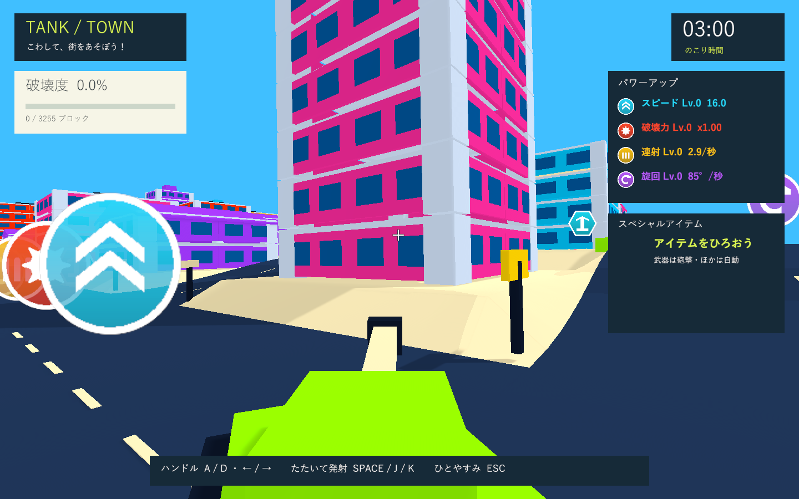

# 砲塔との方向一致とカメラ距離

実施日: 2026-10-02。カメラの回転を毎フレーム砲塔と一致させ、標準の後方距離を2.2から3.0へ広げました。高さ2.4と視野角72度は維持します。

カメラの方向を遠方の注視点から計算する処理と回転の補間をやめ、描画時の砲塔の回転を直接使います。Snapと通常追従の両方で同じ処理を使用。左右旋回だけでなく、砲塔の傾斜も一致させます。カメラ位置は砲塔の方向を基準に後方へ配置し、位置の補間・障害物回避・砲撃時の位置振動は維持します。位置の移動や振動はカメラの方向を変えません。一時停止中も方向を同期します。

砲身の上向き4度は別に維持します。照準は従来通り実際の砲口から投影し、カメラ更新後に表示位置を更新します。砲塔と方向が一致したカメラに対しても実際の砲撃方向を示し、前フレームのカメラ方向による表示の遅れを防ぎます。速度16・加速度10、車体遅延0.08秒・操舵応答12・先行角22度は変更していません。

## 検証

独立したUnity 6000.3.19f1 / URP 17.3.0のコピーで関連PlayMode **2件成功・0件失敗**（2.77秒）。標準の距離・高さ・視野角、Snap時の方向一致、砲塔先行・車体追従・実弾方向を確認しました。描画前のLateUpdate後に方向と上方向を毎フレーム比較し、左右の切り返し・砲撃振動中も誤差が0.00001未満であることを検証。最終XMLは `Logs/camera-alignment-final-tests.xml`、ログは `Logs/camera-alignment-final-tests.log`。

Windows版の描画は `--tank-town-camera-smoke` を使用します。通常追従の角度は描画フレーム末尾に測定し、カメラの更新前の値を混ぜません。Editorのバッチではフレーム末尾の待機が使えないため、PlayMode側は更新順序を指定した観測用コンポーネントを使用します。[Unity公式のフレーム末尾待機の説明](https://docs.unity3d.com/6000.3/Documentation/ScriptReference/WaitForEndOfFrame.html)

Windows x64 Development Build成功。Direct3D 11 / GTX 1660 Tiで砲塔先行・継続旋回・直進復帰の3画面を確認しました。

|診断項目|実測|
|---|---|
|砲塔先行時のカメラと砲塔の角度差|0.00度|
|継続旋回時のカメラと砲塔の角度差|0.00度|
|継続旋回時のカメラと車体の角度差|22.00度|
|Snap / 継続旋回 / 直進復帰の方向ベクトル差|すべて0.000000|
|標準のカメラ後方距離|3.00|
|衝突爆発|0回|

最終のテスト・ビルド・実プレイヤーログにゲーム例外・C#コンパイル・シェーダーエラーはありません。実行ログは `Logs/camera-alignment-player.log`、画像は `Builds/TankTown/Captures/aligned-camera-01-lead.png`、`aligned-camera-02-turn.png`、`aligned-camera-03-centered.png`。

検証済みWindows版を `Builds/TankTown` へ配置し、検証コピーとのRuntime DLLのSHA-256一致を確認しました: `21DD3591ED36C84253EB7F729EC815ED7D3CAC7522EA4302227D3270DEC3CCDD`。

formatter/lint専用設定はなく、コンパイルとGit差分チェックで検証しました。変更はカメラと照準・距離設定に限定し、関連2件を実行しています。前段の回帰38件と修正後の関連1件の結果は [以前の検証記録](turret-follow-validation.md) を参照してください。手動プレイでの操作感・通常ウィンドウのフレーム時間・実機入力は未検証です。
