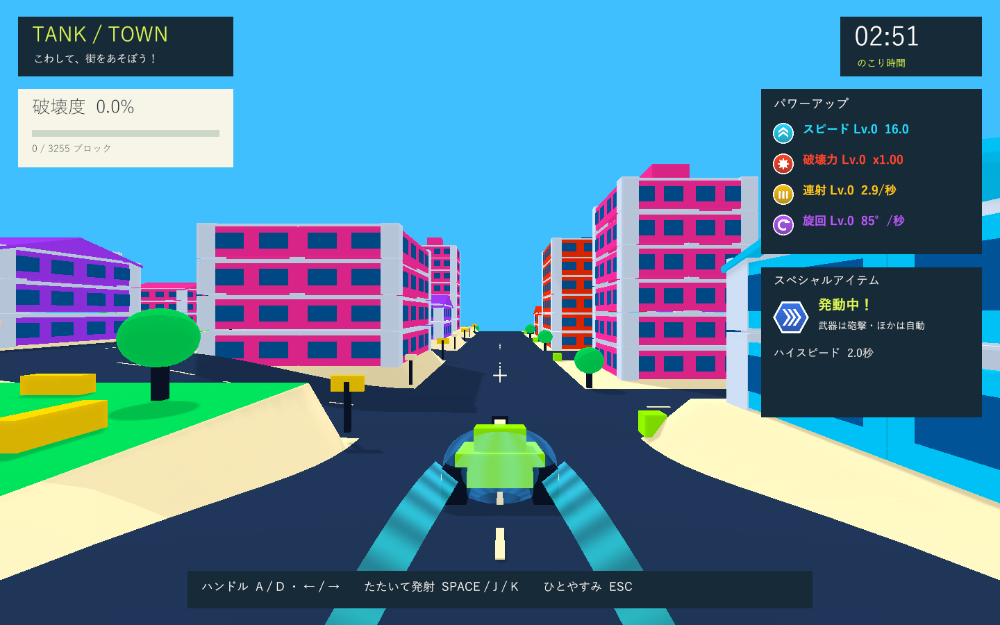

# 酔いを抑えるカメラ

実施日: 2026-10-03。急な角度変更をなくすため、砲塔の姿勢を直接コピーするカメラから、砲塔の水平な向きへ緩やかに追従するカメラに変更しました。水平な画面と操作への連続した応答を優先します。標準の後方9.0・高さ3.0・視野角72度は維持します。

## 変更

|動き|今回の対応|
|---|---|
|旋回・切り返し|減衰する追従に、回転速度135度/秒・角加速度240度/秒²の上限を追加。長いフレームでも一度に大きく追いつかず、1/30秒分まで進める。|
|坂道・車体の傾き|カメラのピッチとロールは固定。高さは0.4秒の追従で変え、進行先の地形を予測して地面の下へ入ることを防ぐ。|
|砲撃・爆発・体当たり|ランダムなカメラ振動を撤去。画面の方向と視野角を攻撃演出で変えない。|
|遮蔽物|戦車との間に入る部材を専用シェーダーで透過。距離を急に縮める処理を撤去。透過終了後に粒状の模様を残さず、遮らなくなった部材は元へ戻す。|
|巨大化・通常サイズへの復帰|車体倍率によるカメラ距離の変更を0.8秒の追従でつなぎ、急なズームを抑える。|
|リスポーン・無敵中の街の外からの帰還|0.2秒で暗転し、完全に覆われてから位置と向きを戻す。0.06秒の覆いを挟んで0.35秒で表示。HUDは読み続けられる。|
|一時停止・結果|停止した同じフレームから視点を固定。結果表示では暗転を解除してカードを見える状態にする。|

建物の透過はRendererごとのMaterialPropertyBlockで指定し、共有マテリアル・衝突・破壊度を変更しません。ForwardとDepthOnlyの両方で透過を扱い、物体の影は維持します。地形の最低クリアランスは1.5。速度16・加速度10、砲塔先行22度・車体遅延0.08秒・操舵応答12、砲身の上向き4度も維持します。照準は滑らかなカメラの更新後に実際の砲口方向から投影します。

## 検証

Unity 6000.3.19f1 / URP 17.3.0の独立した検証コピーで、関連PlayMode **17件成功・0件失敗**（31.76秒）。新規7件で急な照準角度変更、水平維持、砲撃・大爆発・高速中の無振動と固定視野角、遮蔽物の透過と復元・共有マテリアルの独立性、巨大化の往復、実際の登り坂と下り坂、復帰の覆い、一時停止と結果を確認しました。既存テストでは砲塔先行と実弾、物理更新間の旋回、衝突復帰、坂の頂上、ビームと巨大化・高速を確認。XMLは `Logs/camera-comfort-final-pass-tests.xml`。

120fps相当の描画時計を使う急角度変更の試験では、385フレームで最大回転速度135.001度/秒・角加速度240.381度/秒²・水平からの傾き0.000000度。物理更新を0.08秒へ粗くした旋回の試験では、102フレームで最大回転速度71.829度/秒・最大フレーム回転量0.599度・角加速度240.381度/秒²・傾き0.000000度でした。角加速度は30〜240fps相当の連続した描画刻みで評価し、極小の刻みの数値差や長いフレームの追いつき制限を混ぜません。

Windows x64 Development Build成功。Direct3D 11 / GTX 1660 Tiの実プレイヤーで旋回・切り返し・直進復帰を連続測定しました。PNG保存は測定後の別走行で行っています。

|目標fps|実測平均fps|フレーム|最大回転速度（度/秒）|最大角加速度（度/秒²）|最大フレーム回転量（度）|水平からの傾き（度）|
|---|---|---|---|---|---|---|
|60|60.0|72|87.07|240.60|1.45|0.000000|
|144|143.8|173|81.72|240.39|0.57|0.000000|

登り坂・下り坂でも傾き0.000000度、地面との最小距離3.61。巨大化時の距離変更は最大9.86/秒。診断用の部材をカメラと戦車の間へ置いてもカメラ移動量0.000000、部材の表示率0.00でした。復帰の位置変更時には覆いが1.000000で、復帰後は0.000000へ戻りました。衝突爆発は診断で明示的に起こした1回です。

旋回・切り返し・直進復帰を2種類の描画頻度で6画面、坂道・巨大化・遮蔽物・暗転・復帰を6画面、計12画面を確認しました。ログは `Logs/camera-comfort-final-player.log`、画像は `Builds/TankTown/Captures/comfort-camera-*.png`。画面検証はネイティブWindowsプレイヤーを対象とします。

最終のテスト・ビルド・実プレイヤーログにゲーム例外・C#コンパイル・シェーダーエラーはありません。formatter/lint専用設定はなく、コンパイルとGit差分チェックを使用しました。検証済みWindows版を `Builds/TankTown` へ配置し、Runtime DLLのSHA-256一致を確認しました: `49AA665674579EBE8802CDA5F5992D22F5316984B884CE26E062553817AD3333`。

数値は短時間の自動診断です。3分間の手動プレイでの体感や個人ごとの酔い、実機ハンドル・圧センサーは未検証です。
