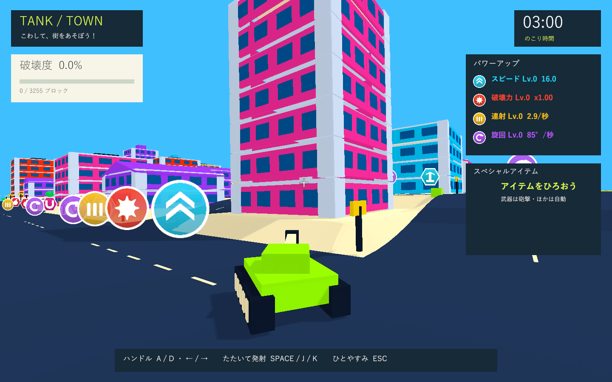

# 戦車と周囲が見える引きのカメラ

これは距離を引いた段階の記録です。その後、酔いを抑えるため水平を固定した緩やかな旋回・画面揺れの撤去・遮蔽物の透過・復帰の暗転を追加しました。[現在の実装と検証](camera-comfort-validation.md) を参照してください。

実施日: 2026-10-03。標準のカメラ位置を後方3.0・高さ2.4から後方9.0・高さ3.0へ変更しました。車体とキャタピラが画面内に収まり、左右の道路や交差点も見渡せる距離です。視野角は72度。カメラの向きは引き続き毎フレーム砲塔と一致し、砲塔・車体表示の回転補間も使用します。

設定アセット、設定クラスの初期値、カメラ単体の初期値を揃え、既存の距離テストを新しい配置に更新しました。障害物による距離調整、位置の滑らかな追従、巨大化時の距離倍率、照準の投影は同じ処理を使用します。

## 検証

Unity 6000.3.19f1 / URP 17.3.0の独立した検証コピーで、関連PlayMode **3件成功・0件失敗**（4.76秒）。カメラ位置と砲塔との方向一致、砲塔先行と実際の砲撃方向、物理更新間の滑らかな旋回を確認しました。結果は `Logs/camera-framing-final-tests.xml`。

旋回の回帰テストは120fps相当の描画時計と0.08秒の物理更新を組み合わせています。102描画フレームで最大回転速度209.980度/秒、最大フレーム回転量1.750度、砲塔との方向ベクトル差0.000000。ログは `Logs/camera-framing-final-tests.log`。

Windows x64 Development Build成功。Direct3D 11の実プレイヤーで砲塔の先行旋回・車体の旋回・直進復帰の3画面を1440×900で確認しました。車体下部が画面端や下側の操作案内に隠れず、旋回中も車体と砲塔の向きの差を見分けられます。

実プレイヤーの後方距離は9.00、初期姿勢の世界座標での高さ差は2.95（設定の高さ3.0は砲塔の姿勢を基準）。3時点とも砲塔との方向ベクトル差0.000000、衝突爆発0回でした。ログは `Logs/camera-framing-final-player.log`、画像は `Builds/TankTown/Captures/wide-camera-{01-lead,02-turn,03-centered}.png`。

テスト・ビルド・実プレイヤーログにゲーム例外・C#コンパイル・シェーダーエラーはありません。ネイティブUnityゲームの画面確認はWindowsプレイヤーを対象とし、formatter/lint専用設定はないためコンパイルとGit差分チェックを使用しました。検証済みビルドを `Builds/TankTown` へ配置し、Runtime DLLのSHA-256一致を確認しました: `12D2BF9B33DE70555903D61E97FF8928239BFA19AA536E814F35B0515EAFEA2C`。

今回はカメラ位置の調整に絞った検証です。旋回補間を修正した際の関連12件と60・144fpsの連続フレーム測定は [以前の検証記録](camera-jitter-validation.md) を参照してください。
