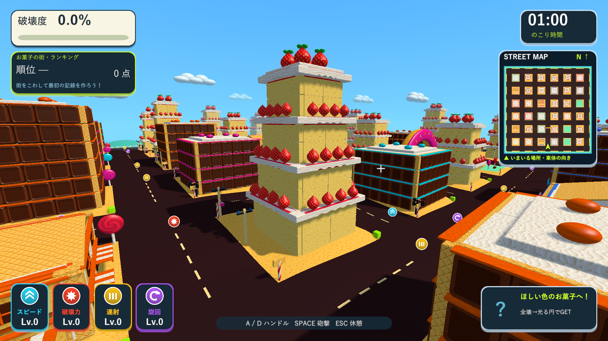
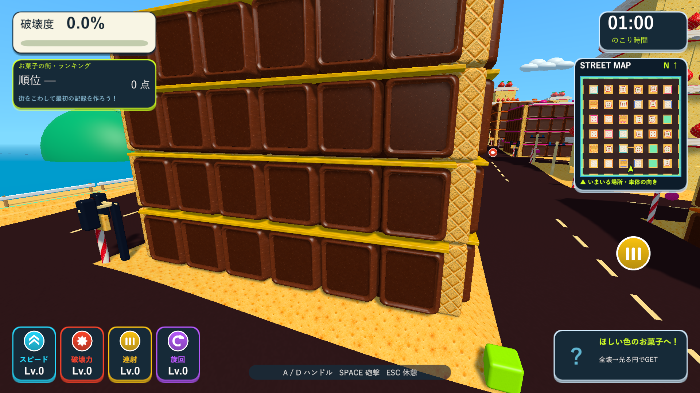

# お菓子の建物を参考画像へ近づける調整

2026-10-10。Issue #5。前回の10種類のテクスチャを使い、参考画像と異なっていた建物の形・飾りの配置を調整しました。

## ケーキ

2階分の骨組みを1段のケーキとして見せ、段ごとに細くなる形は維持しました。柱の表面をスポンジへ変更し、壁の隙間と縁の丸みを減らして、骨組みが露出した箱の見え方を抑えました。白いクリームを段の縁と四隅につなぎ、屋上のクリームも広げています。

屋上の大きなイチゴに加え、中間の段の各側面にもイチゴを列状に配置しました。1枚の壁に2〜3個を取り付け、壁が割れると近い物理破片へ付いて飛びます。飾りのための破壊度加点や新しい物理更新は追加していません。中間のイチゴは256三角形の共有形状を使い、遠景では従来の144三角形の果実へ置き換えます。

## チョコ・店舗・カップケーキ

細長い薄いプレートを、厚さ0.95の縦横比が1に近いチョコのブロックへ変更しました。角丸の肩、厚い縁、浅いくぼみを共有メッシュで作っています。くぼみには同じチョコ画像を少し暗い材質で使用し、日陰でも縁を読み取れるようにしました。微細な質感にはテクスチャを使います。

チョコの壁の当たり判定は厚さ1.4で、見た目の厚みを含むよう調整しました。濃い色の裏板は前面のチョコを隠さない薄い表示形状にし、分割後もその表示を維持します。ブロックとくぼみの飾りは壁の破片へ付いて飛び、等しい寸法では共有メッシュを使います。

ビスケットの家の1階には白と報酬色の縞のひさしと垂れた縁を追加しました。カップケーキはピンクの糖衣の上に3段の白いクリームと赤いチェリーを重ねています。報酬色の細い帯、建物全壊後の取得エリア、街の選択、通常の街の形状は維持しています。

## 検証

Unity 6000.3.19f1の分離したプロジェクトで`Logs/candy-details-final-tests.xml`のPlayMode 13/13件が成功しました。中間の段に果実があること、果実とチョコが実際の破片へ付くこと、チョコの裏板が分割後に前面を隠さないこと、共有形状のUV・法線を確認しています。通常砲撃の部分破壊、全壊後の報酬、支柱喪失後のドーナツの倒壊、表示の最適化の既存検証も成功しました。最後のくぼみの色差と模様の密度の調整はWindowsプレイヤーの実画面で確認しています。

`--tank-town-candy-smoke`は15画面を保存します。通常プレイのほか、診断用カメラでケーキの段・チョコの正面と日陰側・店舗・カップケーキを確認します。全壊の確認には部材の直接分離も使い、ランキングは保存しません。画面の確認はUnityネイティブゲームのため、Skillのブラウザ確認に相当するD3D11 Windowsプレイヤーの実描画で実施しました。

最終Windows x64 Development Buildは`Logs/candy-details-verified-build.log`で成功、`Logs/candy-details-verified-player.log`はexit 0で完了しています。素材10種類、34棟、部分破壊、全壊後の報酬を確認しました。検証したビルドを`Builds/TankTown-CandyDetails`と、従来の`TankTown-CandyTextures`、`TankTown-FastShell`、`TankTown`、`TankTown-LocalBlast`へ反映しています。

配布先の実行ファイル・Runtime DLL・resources.assets・テクスチャresS・音声resourceのSHA-256と、メイン・検証・レビュー用ブランチのソース・素材・meta計221ファイルの一致を確認しました。Runtime DLLは`54B9D35FB03B9A44FA4A2D6557899AEA7B8C39FBDD9D1119EA193BCE50A020C8`です。テクスチャと音声のリソースは前回と同じものを使います。

[日陰側のチョコ](images/tank-town-detailed-candy-15-chocolate-side.png)、[縞のひさし](images/tank-town-detailed-candy-10-biscuit-texture.png)、[カップケーキのクリーム](images/tank-town-detailed-candy-14-cupcake-cream.png)、[破壊後](images/tank-town-detailed-candy-04-chocolate-hit.png)。
