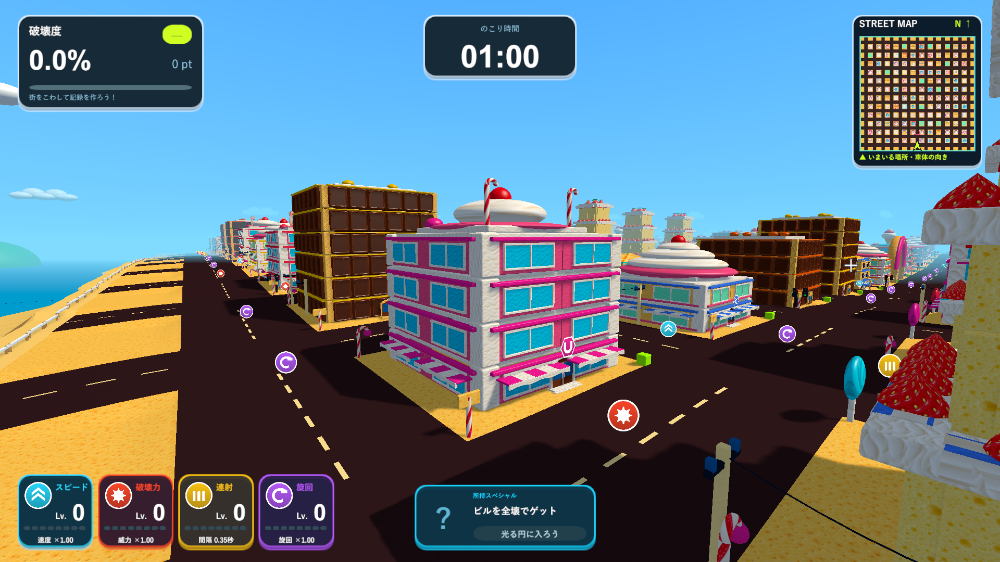
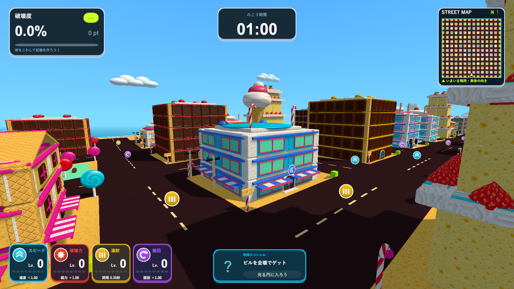
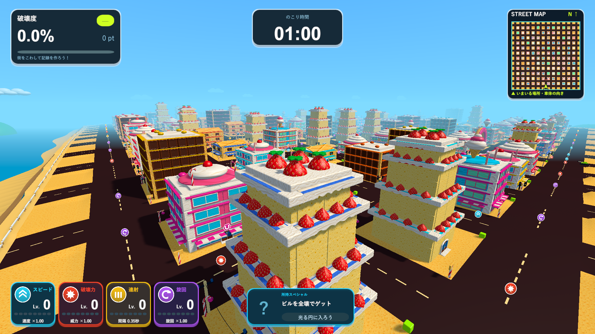

# お菓子ステージの拡大と建物の追加

2026-10-11。参考画像のピンク・水色の店舗とカップケーキの建物を追加し、ケーキのイチゴの座り方を調整しました。

- フィールドは268×268から536×536へ拡大。132棟、ドーナツゲート1基、公園12か所。制限時間は1分です。
- ケーキの屋上と段の縁のイチゴは、クリームの表面に約半分埋まります。段のイチゴは前へ飛び出す距離も小さくしました。
- ピンクのキャンディショップは水色の大きな窓・白い窓枠・縞のひさし・クリームドームとチェリー。
- 水色のアイスクリームショップはピンクの窓枠・ミント色の窓・屋上のウエハースコーンと重なったアイス。
- カップケーキの家はウエハースの壁とピンクの縁、屋根いっぱいの糖衣・3層のクリーム・チェリー。
- 店舗の固定の配色と、独立してランダムに決まる報酬は、帯・ひさし・六角形の看板で区別します。建物の6種類はほぼ同数でシャッフルし、ドーナツ用のStyle 3と衝突させていません。

細かな溝・種・気泡は既存10種類のテクスチャを共有し、Glazeの色違いとWafer・Creamを新しい店舗にも使用します。質感のための細かい立体や追加の物理ボディは増やしていません。屋根の円錐・丸いクリームは共有メッシュを使い、遠景の円錐も軽い形で残します。材質ごとの描画結合・遠景表示・大型ステージの30Hz物理ステップを維持します。

新しい建物も入口が1つあり、窓・ひさし・看板・屋根の飾りは既存の部材に属します。壁が割れると該当の破片へ付き、局所破壊では報酬を出さず、全壊後に中心の円形エリアを出します。

## 検証

Unity 6000.3.19f1の別コピーでPlayModeテスト、Windows x64 Development Build、D3D11の実画面を確認します。通常の街と大きい街の形の生成・記録キー・タイトルのステージ選択は維持しています。タイトルは従来通り、大型街の軽いプレビューを巡回し、ステージ変更で再生成しません。

[実画面の一覧](candy-variety-review.html)に全景、3種類の店舗、段と屋上のイチゴ、プレイ中、砲撃の部分破壊を保存します。全景だけは診断用にフォグを一時的に外し、撮影後に戻します。ゲームの通常フォグは変更していません。

PlayModeは15/15成功（`Logs/candy-expansion-final-tests.xml`）。初回のテストで見つかったコーンの面の向きを直し、全15件を再実行しました。入口と装飾が破片へ付くこと、局所破壊で報酬が出ないこと、全壊のエリア、10種類の画像、屋上と段のイチゴの44〜54%が埋まること、UV・法線・面の向き、既存ステージの生成とタイトル選択を確認しました。

描画計測は1920×1080でGPUの描画を同期して読み戻す診断です（`Logs/candy-expansion-performance.log`・`Logs/candy-expansion-performance-results.json`）。この環境で通常の街路とミニマップは平均11.1ms（約90fps）、爆弾で大規模破壊し破片が上限2000になった区間は平均31.3ms（約32fps）、95パーセンタイル66.9msでした。破壊中は重くなることを示しており、通常ウィンドウのプレイのフレームレート保証ではありません。

新しい3種類は各22棟、既存の3種類も各22棟、計132棟とゲート1基です。更新版は`Builds/TankTown-CandyExpansion/TankTown.exe`です。

Windows x64 Development Buildが成功し（`Logs/candy-expansion-build.log`）、最終版のD3D11プレイヤーで20画面の診断が完了しました（`Logs/candy-expansion-player.log`）。実際の砲弾でチョコが部分的に壊れること、全壊報酬、ゲートの倒壊、10種類のテクスチャ、132棟の内訳も確認しています。全景と近接は診断用のカメラ、報酬とゲート倒壊には部材の直接分離を含みます。

画像一覧はChromeで8枚の読み込み、1920・1280・720px幅での表示、原寸リンクを確認しました（`Logs/candy-expansion-browser.log`、確認スクリプト`docs/ui-proposal/verify-candy-review.cjs`）。Unityの機能は上のテストと実プレイヤーで確認しています。

ソース237ファイルは作業プロジェクト・検証用コピー・レビュー用ブランチで一致しました（`Logs/candy-expansion-source-hashes.txt`）。新しい更新版と既存8フォルダの実行ファイル・Runtime DLL・リソース3ファイル、計45件が検証したビルドと一致しました（`Logs/candy-expansion-delivery-hashes.txt`）。
