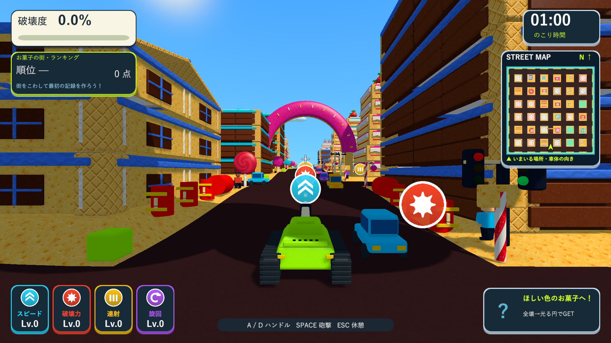
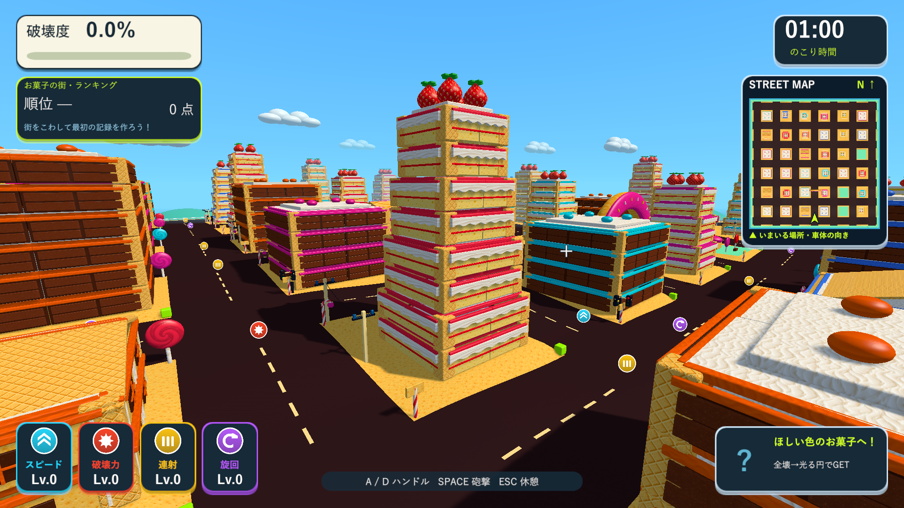
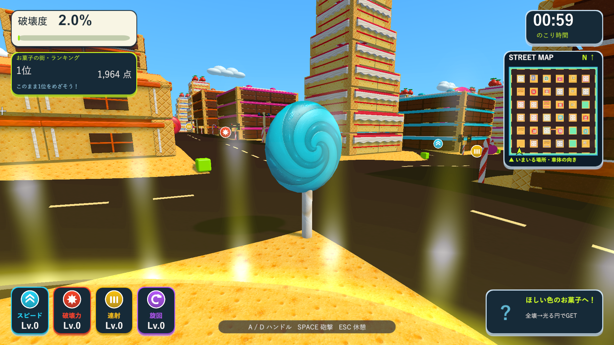

# お菓子の街のテクスチャと輪郭の検証

2026-10-10。Issue #5。[素材一覧と生成プロンプト](candy-materials.md)。

## 実装

10種類の共有画像を実際の建物・街灯・飴・ドーナツ・歩道へ適用しました。気泡、格子、種、縞、渦巻き、焼きむらはテクスチャで表現し、画像の明暗から微細な凹凸の陰影を加えます。果物・飴・ドーナツの滑らかな法線、クリームの波打つ縁、キャンディケーンの曲がり部分は共有メッシュを使います。個々の種や細い溝などの立体飾りを減らしました。

遠景のイチゴと飴は、それぞれ144三角形の共有モデルを使用し、箱に置き換えません。ドーナツの輪郭も維持します。材質別のバッチ、通常の街の簡略化、破壊の支持・耐久・取得ルールは維持しています。

画像は2Dとして明示的に取り込み、最大1024、BC7、ミップマップ、Trilinear、異方性4に設定しています。テクスチャを各部材へ複製せず共有します。Windowsプレイヤーの`resources.assets.resS`は13,988,512バイトです。大きな板の分割後も、破片の寸法に合わせた共有メッシュ・UVを使って質感の密度を保ちます。

## 検証

Unity 6000.3.19f1の分離した検証用プロジェクトで、砲弾・お菓子の街・破片・表示の最適化と新規の材質検証の25項目を確認しました。複数回の実行から各項目の最終結果をまとめた`Logs/candy-textures-test-summary.json`は25項目すべて成功です。最終の遠景修正後は`Logs/candy-textures-lod-tests.xml`で8/8件成功しています。

新規検証では、10種類の画像が実際の街で使われること、画像サイズ・ミップマップ・読み込み設定、近景の合成メッシュへのUVの保持、床の破片の共有材質と模様の密度、通常の街にお菓子の材質が混ざらないこと、近景・遠景の輪郭メッシュのUVと外向きの法線を確認しました。

Windows x64 Development Buildは`Logs/candy-textures-final-build.log`で成功。画面の確認は、Unityネイティブゲームのため、Skillのブラウザ確認に相当するD3D11 Windowsプレイヤーの実描画で行いました。`Logs/candy-textures-final-player.log`はexit 0で完了し、34棟、テクスチャ10種類、砲撃の部分破壊、全壊後の報酬、支柱喪失後のドーナツの倒壊を確認しています。

通常のプレイカメラと診断用のカメラから計11画面を1920×1080で保存しました。近景の材質、遠景の輪郭、破片・報酬を見比べています。診断では戦車の固定・視点移動・全壊確認の直接分離を使用し、ランキングは保存しません。

検証済みビルドを`Builds/TankTown-CandyTextures`、`Builds/TankTown-FastShell`、`Builds/TankTown`、`Builds/TankTown-LocalBlast`へ反映しました。各配布先の実行ファイル・Runtime DLL・resources.assets・テクスチャのresS・音声resourceのSHA-256と、メイン・検証・レビュー用ブランチのソース・素材・meta計221ファイルの一致を確認しています。

- Runtime DLL：`75028B8E2535478DDD7A40013BCC81B3A85A30FBF8EB212022870538C8DF63DB`
- resources.assets：`9B6C324FF70F49C54DDC887226D33ADBCA797035DCAEAE6B4BE41664074B0AD4`
- resources.assets.resS：`5BAE3B4B2AA6A4D004AC14F5542657687B9D3F24B8D4F5C41A5E0D212057AEE6`

[チョコの質感](images/tank-town-textured-candy-09-chocolate-texture.png)、[砲撃後の破片](images/tank-town-textured-candy-04-chocolate-hit.png)、[ビスケットの家](images/tank-town-textured-candy-10-biscuit-texture.png)、[ドーナツ](images/tank-town-textured-candy-06-doughnut.png)、[倒壊](images/tank-town-textured-candy-07-doughnut-collapse.png)。
