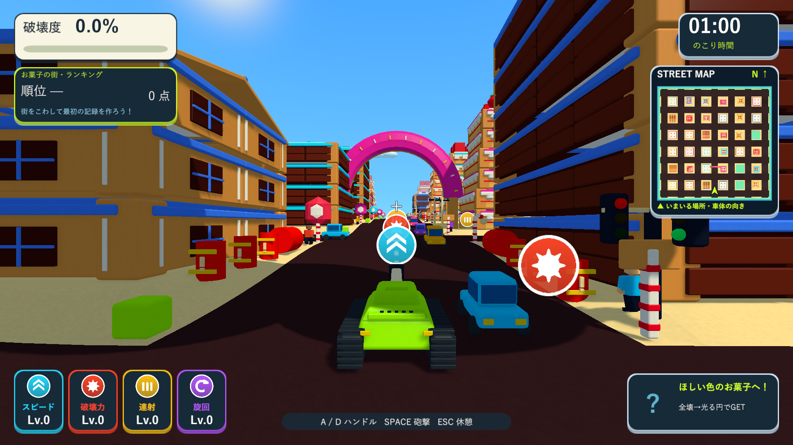
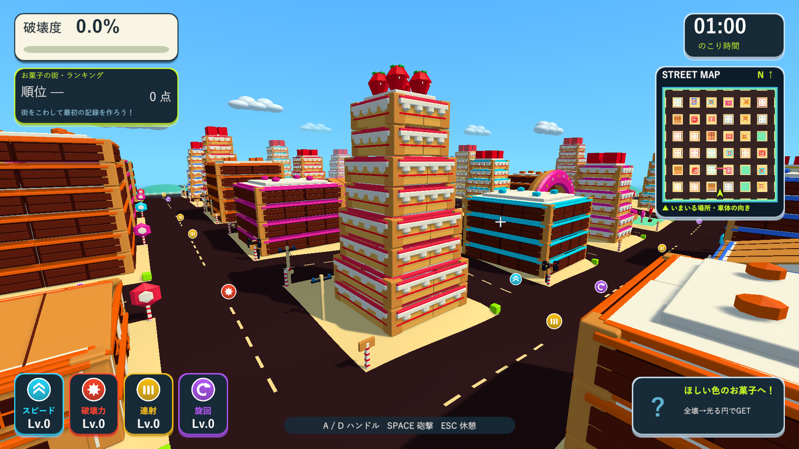
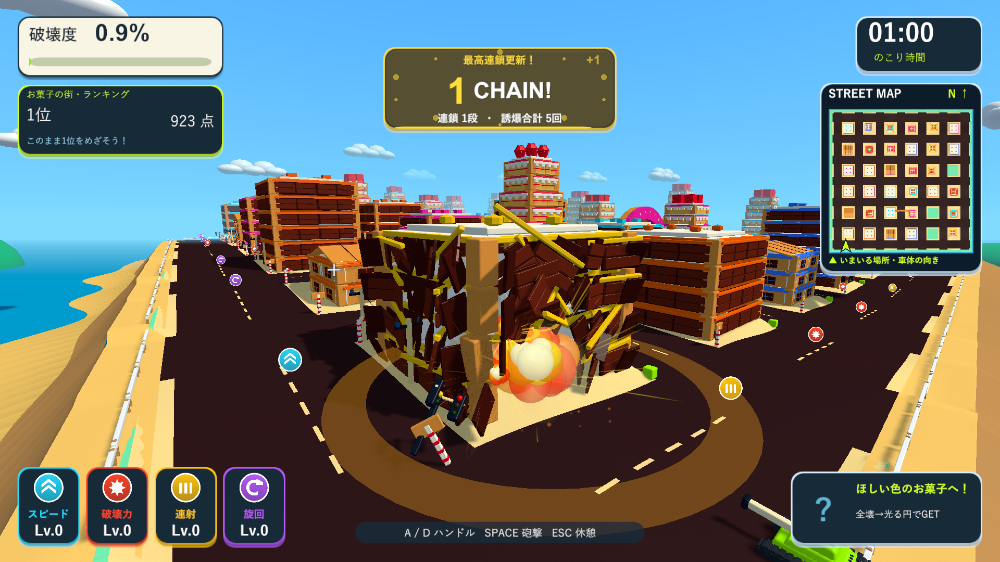
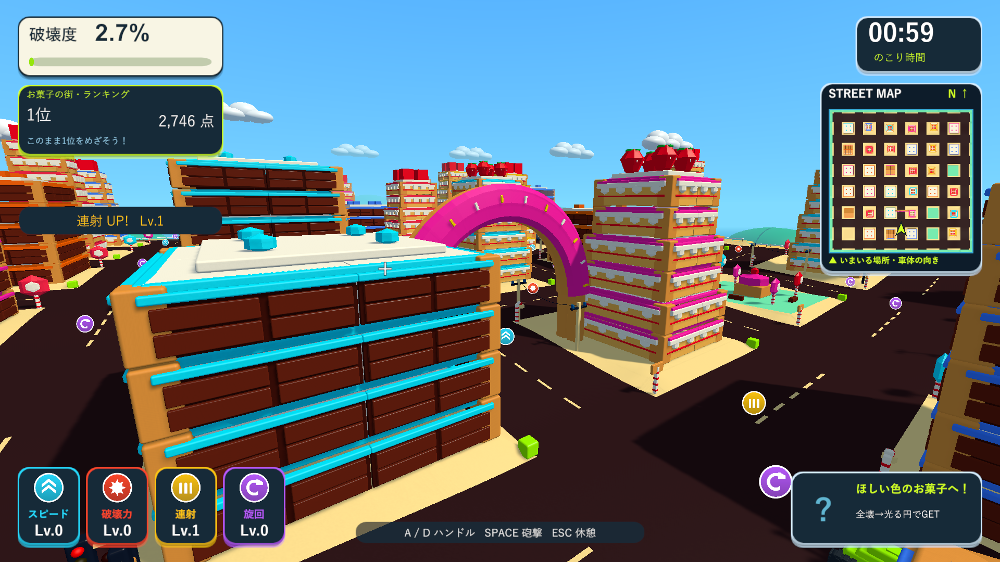

# お菓子の街の試作

2026-10-08。Issue #5。生成したお菓子の街のイメージを参考に、実際に走行・砲撃・物理破壊できるステージを追加しました。

## 内容

- タイトルの3番目に「お菓子の街」を追加。起動時に選択し、Spaceで開始します。数字1/2/3で通常・大型・お菓子を選べます。選択時は既存の大型街の軽量背景を作り直さず、必要な街の生成は開始時の暗転中に行います。
- 268×268、道路幅16、60秒。通常の自動生成と同じ33棟・3公園に、ドーナツゲート1基を加えています。建物の種類・報酬・位置・階数と地形のシードを引き継ぎます。シード2026は段ケーキ15棟、チョコ14棟、ビスケット4棟です。
- ケーキは2階分ごとに上の段を小さくし、クリームの縁・垂れ・赤い層・屋上のイチゴを持ちます。上段の柱は下段の床で支えます。チョコは盛り上がったマス、ビスケットは窓枠と溝のある傾斜屋根を持ちます。
- 柱・梁・床・外壁の支持とバランスの崩壊を使います。広い壁や床は複数の破片に分かれ、チョコのマス・クリーム・イチゴなどの飾りは近い破片へ付いたまま飛びます。
- ゲートは4本の支柱と12個の曲がった生地で構成し、支柱を失うと分離・落下します。曲がった部材は`PreserveShape`で形を保ったRigidbodyにします。通常の壁・床の分割は継続します。
- ロリポップの木、キャンディケーンの街灯、ビスケットの看板、カップケーキの広場、ビスケットのベンチ、ココア色の道路へ変更。共有のローポリ形状・マテリアルを使い、建物は既存の材質別バッチと遠距離LODを継続します。
- クリーム・帯の色がスペシャルの目印です。全壊後の円形取得エリア、マグネット、6種類のスペシャルを継承。ゲートはマグネットの報酬を持ちます。ランキングとベストは`.CandyTown`で独立して保存し、再挑戦時もステージを維持します。
- プレイ画面の角のTANK TOWNロゴを取り除き、破壊度とランキングを上へ詰めました。タイトルの大きなメイン見出しは残しています。戦車・操作・車・通行人・1分の制限時間・レーザー専用カメラを引き継ぎます。

## 検証

分離したUnity 6000.3.19f1プロジェクトで以下がすべて成功しました。

|検証|結果|ログ|
|---|---|---|
|お菓子・生成・画面遷移・円形報酬|27/27|`Logs/candy-town-tests.xml`|
|曲がった破片の維持・お菓子・ランキングとミニマップ|15/15|`Logs/candy-town-final-tests.xml`|
|従来の床の分割・飾りの維持・破片と戦車の挙動|2/2|`Logs/candy-town-fragment-tests.xml`|
|段ケーキの構造調整後のお菓子・通常と大型の生成|10/10|`Logs/candy-town-tier-tests.xml`|

ステージ選択がその場でシーンを再読み込みしないこと、3ボタンの文字が枠に収まること、開始・再挑戦・タイトル帰還でのステージ維持、独立した記録先、3種の家とゲートの実生成、通常砲弾での部分破壊、飾りを持つ物理破片、全壊後だけの報酬出現、支柱喪失でのゲートの倒壊と曲がった形の維持、ロゴの除去を確認しました。

最終Windows x64 Development Build成功（`Logs/candy-town-final-build.log`）。画面確認はSkillのブラウザ確認に相当するD3D11のネイティブWindowsプレイヤー実描画で実施。`Logs/candy-town-final-player.log`はexit 0で、局所的なチョコ破壊・円形報酬・ゲートの倒壊・ロゴの除去が成功しました。1920×1080の7画面を保存し、段ケーキ・板チョコ・ドーナツと通常プレイを確認しました。診断用の配置・カメラ・支柱と残り部材の直接分離を含み、ランキングは保存しません。

従来の大型街の実描画も`Logs/candy-town-classic-big-player.log`でexit 0。132棟、レーザーの破壊、専用視点と復帰、ブルドーザー90%と高速併用1.98倍を確認しました。今回FPSの比較測定は行っていません。

検証済み実行版を`Builds/TankTown`と`Builds/TankTown-LocalBlast`へ反映。両配布先の実行ファイル・Runtime DLL・resources.assetsのSHA-256と、メイン・検証プロジェクト・レビュー用ブランチのソース、設定、音声、meta計192ファイルの一致を確認しています。

- Runtime DLL：`5E431050639BE0BA745184C960DCE68E414C507F9D7CF3187BF2F59A5956FF86`
- resources.assets：`A24FF78B630DF3DD6335F7DC1F605169B65F5B003374A8918FAED8528B479D4B`

