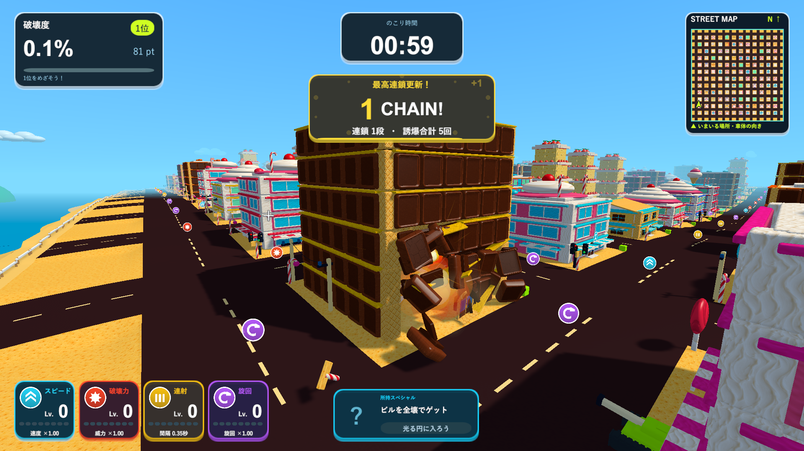

# お菓子版の外壁が一斉に外れる不具合

2026-10-11。通常版とお菓子版の素材に耐久の違いはありません。建物に属する部材はすべて`buildingDurability = 3`を使い、材質やステージによる倍率はありません。直撃と至近距離の砲撃は即時破壊し、周囲は距離に応じた累積ダメージを使います。今回、威力・範囲・耐久値は変更していません。

原因は`TankTownWorld.CreateBuilding`のお菓子版の分岐です。装飾を追加した後の`continue`が、外壁を梁へ接続する処理より前にありました。通常版の外壁には支持の接続があり、お菓子版の外壁にはありませんでした。砲撃後の`ReleaseUnsupported`は無傷でも支持につながっていない壁を落とすため、お菓子版では多数の外壁だけが一度に飛び、骨組みが残っていました。

外壁と梁の接続を分岐の前へ移し、全種類で同じ支持ルールにしました。無傷の壁は残り、破壊された梁に属する壁が落ち、柱を失いバランスが崩れれば建物が倒壊します。装飾・入口・全壊報酬は既存の仕組みを使います。

## 検証

Unity 6000.3.19f1の別コピーで、PlayMode 15/15成功（`Logs/candy-wall-support-final-tests.xml`）。通常の3種類とお菓子の6種類について、無傷での支持判定で部材が外れないこと、壁1枚を壊しても他の壁が残ること、梁を壊すとその梁の壁だけが外れること、3本の基礎柱の喪失で倒壊し報酬が出ることを確認しました。既存の耐久・部分破壊・材質と装飾の検証も通過しました。

Windows x64 Development Buildが成功しました（`Logs/candy-wall-support-build.log`）。実画面は既存の`--tank-town-candy-smoke`で20画面を確認しました（`Logs/candy-wall-support-player.log`）。通常の砲弾によるチョコの部分破壊後は121部材中9部材が分離し、外壁43枚と上階の壁が残りました。`CANDY WALL SUPPORT CHECK`へ耐久値3とともに記録しています。全壊報酬・ゲートの倒壊などの診断も完了しました。

[修正前後の実画面](candy-wall-support-comparison.html)。修正前は拡大時の同じシード2026の画面、修正後は今回のWindowsプレイヤーで撮影しました。どちらも同じ診断用の配置とカメラで、実際の砲撃を使っています。Chromeで2画像の読み込み、1920・1280・720px幅での表示と原寸リンクを確認しました（`Logs/candy-wall-support-browser.log`）。

更新版は`Builds/TankTown-WallSupport/TankTown.exe`です。既存の起動用フォルダも更新しています。ソース237ファイルが作業・検証・レビュー用コピーで一致し、10フォルダの実行ファイル・Runtime DLL・リソース3ファイルの計50件が検証したビルドと一致しました（`Logs/candy-wall-support-source-hashes.txt`・`Logs/candy-wall-support-delivery-hashes.txt`）。
