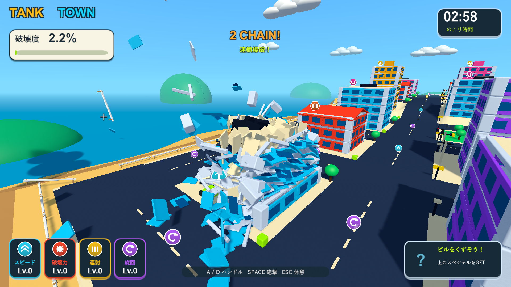
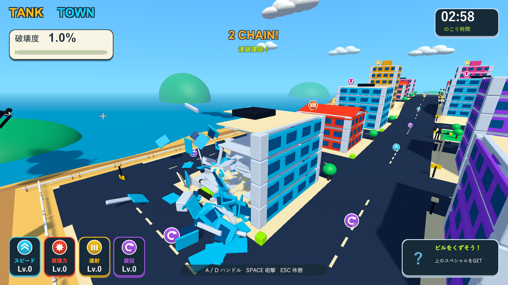

# 砲撃の破壊範囲と威力を下げる

2026-10-04。Issue #5。Unity 6000.3.19f1 / URP 17.3.0。

通常砲撃の破壊半径を6.5mから4mへ、衝撃力を16から12へ下げた。現在の破壊は爆風の範囲に入った部材を分離する仕組みなので、吹き飛ばす力に加え、着弾した瞬間に壊す範囲自体を小さくしている。Resources設定とScriptableObjectの既定値を揃えた。

破壊力パワーアップはこの基礎値から成長する。破片の二次爆発の力は50%のままなので8から6、燃料の衝撃力は3倍のままなので48から36になる。燃料の点火距離3m・大爆発半径24m、破片の局所爆発半径3.5m・接触速度12m/s・連鎖上限4段・ランダム消去・上限2,000個・寿命3.6〜4.8秒は同じ。

既存PlayModeで実砲撃、強化による射程と射撃間隔、物理接触と飛散、燃料点火、車、アイテム、倒壊、報酬、消去を確認する。二次爆発の飛散速度を初期状態でも12m/s以上とする旧テストの条件は、新しい弱い砲撃に合わせて変更した。飛散そのものと、速度を与えた次の物理接触から連鎖することは引き続き検証する。

ネイティブUnityゲームのためWindowsプレイヤーで画面と実砲撃を確認する。比較診断は同じ街・砲撃配置・乱数初期値・60分の1秒のゲーム時間で行う。`--tank-town-debris-smoke --tank-town-cannon-power-before` は半径6.5m・衝撃力16・破片爆発倍率0.5をそのプロセス内で復元し、設定ファイルには保存しない。比較は砲撃から約3秒までの一例であり、3分間の手動プレイや難易度全体の確定は含まない。

|検証|結果|記録|
|---|---|---|
|PlayMode全体|80/80成功、95.16秒。実砲撃、強化による範囲拡張、飛散、接触連鎖、燃料、車、アイテム、倒壊、報酬、消去を確認|`Logs/cannon-power-tests.xml`|
|Windows Development Build|終了コード0|`Logs/cannon-power-build.log`|
|調整前の比較砲撃|半径6.5m・衝撃力16。約3秒までに破壊部材76個、破片爆発7回、破片370個|`Logs/cannon-power-before-player.log`|
|調整後の比較砲撃|半径4m・衝撃力12。約3秒までに破壊部材36個、破片爆発4回、破片174個|`Logs/cannon-power-after-player.log`|
|分裂と実接触|床と壁が各6個に分裂。診断用破片が壁へ実接触し、局所爆発を起こす。終了コード0|同上|
|燃料の点火距離|遠い着弾では点火せず、近い実砲撃で燃料1個が誘爆。大爆発半径24m・衝撃力36。終了コード0|`Logs/cannon-power-fuel-player.log`|
|街全体の回帰|車2台の誘爆、落下報酬の接地と接触回収成功、ビーム2.001秒、結果画面まで成功。終了コード0|`Logs/cannon-power-city-player.log`|

比較配置では、撃った建物に多くの部材が残り、一発後の破壊度が2.2%から1.0%へ減った。柱の支持判定を変えていないので、支えを失った部分は引き続き倒壊する。

プレイヤーログにゲーム例外・シェーダーエラーはない。C#・shader・asmdef・Settings計48ファイルは主作業フォルダー・検証コピー・レビュー用ブランチでSHA-256が一致する。検証したWindows版を `Builds/TankTown` へ配置し、実行ファイルとRuntime DLLのハッシュも確認した。

調整前。

調整後。着弾付近が壊れ、同じ建物にも多くの部材が残る。

