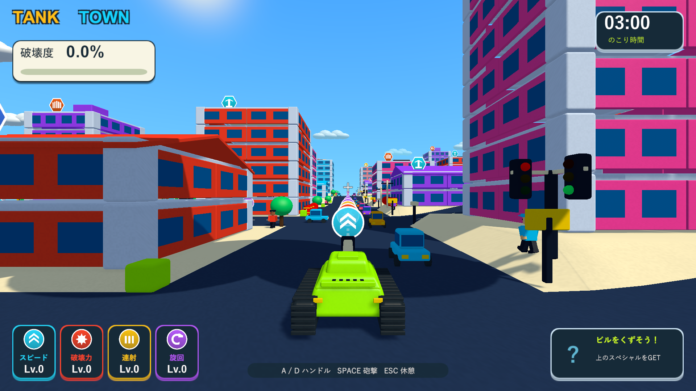
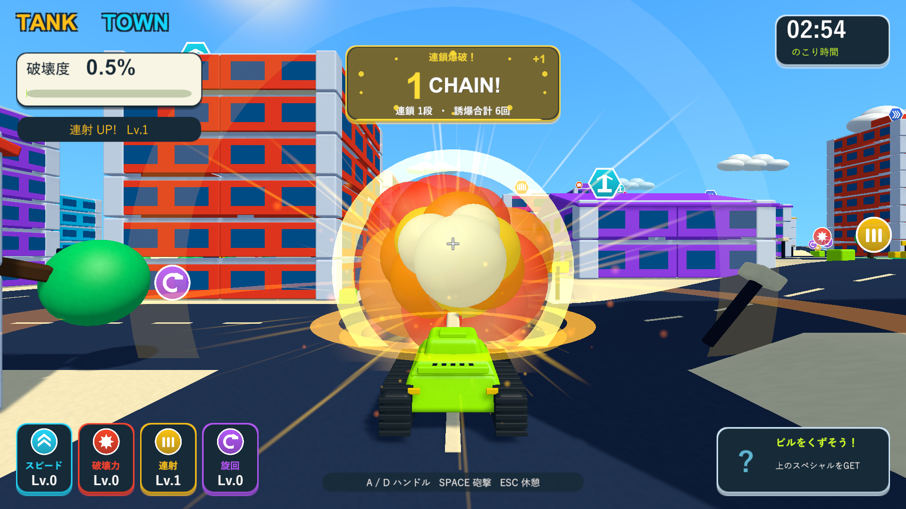
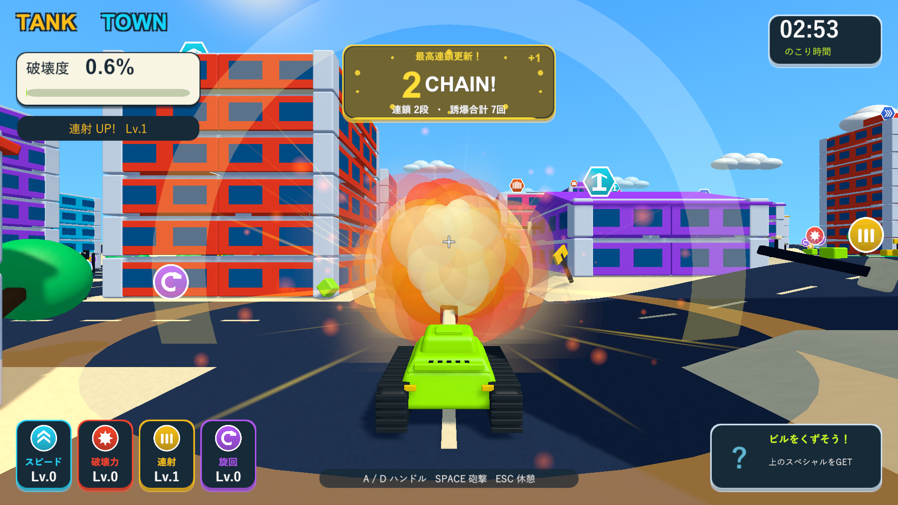
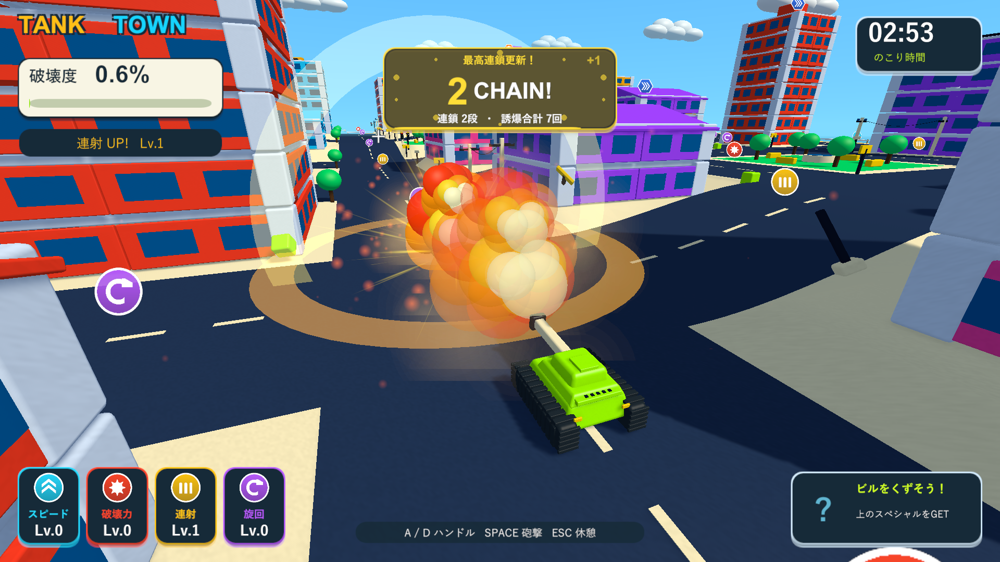
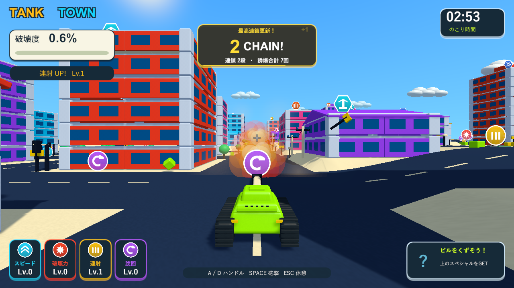

# 通行人・誘爆・チェイン表示の調整

2026-10-05。関連: [Issue #5](https://github.com/Negi310/mission2026-game/issues/5)。Unity 6000.3.19f1 / URP 17.3.0。

通行人を各街区6人から2人、街全体で216人から72人へ減らしました。車72台は継続しています。人の当たり判定はカプセル半径0.42から0.95、高さ2.35から2.8へ拡大。通常砲弾が通行人のトリガーを無視していた処理も修正し、砲弾・ミサイルの進行経路で建物と通行人のうち近い接触を採用します。取得用トリガーは射撃を遮りません。退避中は人の当たり判定を消し、歩道へ戻ると再び有効にします。人そのものの破壊度加点や戦車への押し返しはありません。

誘爆の火球・衝撃波を倍率0.65に抑えました。車の爆風半径は14から10、衝撃力の倍率は2.1から1.6です。これらを合わせると、車の火球は以前の約46%のサイズになります。燃料タンクの点火距離3、爆風半径24・衝撃力3倍、通常砲撃の局所破壊、スペシャルの性能は継続しています。燃料や破片の誘爆も演出のサイズを抑えています。

チェイン用のカードを追加し、数字のカウントアップ・ポップ、加算数字、光のアクセント、残り表示時間のバー、最高段数更新を表示します。浅い枝が後から通知されても、表示中は最大段数を維持します。下段の誘爆回数はラウンド累計です。最初の1段にも表示を出します。最後の通知から2秒で消え、一時停止で演出時間も止まります。リスポーン・エリア端の案内を優先し、結果画面では非表示にします。[段数と回数の仕様](chain-system.md)。

| 検証 | 結果 | 記録 |
| --- | --- | --- |
| 変更箇所のPlayMode | 7/7成功、8.42秒。実砲弾の横ずれ0.8で人へ接触、歩行中の人への追尾命中、抑えた車の爆風、数字の増加・深い枝の保持・累計・停止・消去 | Logs/chain-polish-focused.xml |
| 全PlayMode | 97/97成功、132.93秒。破壊・支持・燃料・破片・カメラ・操作・アイテム・UI・音を含む | Logs/chain-polish-tests.xml |
| Windows Development Build | 成功 | Logs/chain-polish-build.log |
| Windows実画面 | 成功。通行人72人、通常砲撃の接触1回、車2台の誘爆、最大2段、誘爆累計7回。結果画面まで終了 | Logs/chain-polish-player.log |

ネイティブUnityゲームのため、ブラウザーの代わりにWindowsプレイヤーの実描画で画面を確認しています。街は72人、通行人への通常砲撃の接触1回、車2台の誘爆と1から2への表示更新を確認しました。累計7回には、前半の砲撃で発生した破片による誘爆も含みます。破片の物理衝突による累計は実行ごとに変わります。HUDは1920×1080と1280×720で数値・文字が収まり、中心の道路を隠さない配置です。

診断では戦車と車2台の配置・経路を設定し、ほかの爆発物と通行人を一時的に無効にしています。車2台は砲撃時に停止させ、通常の砲撃入力・物理飛散・導火時間から誘爆します。人と火球の近接画像は診断用カメラです。1280×720の確認前には、通常カメラと照準が更新される描画フレームを待っています。3分間の手動プレイ全体の難易度確定を目的とした確認ではありません。

検証用の分離プロジェクトと作業元・レビュー用worktreeで、コード・シェーダー・設定・音源・メタデータ137ファイルのSHA256一致を確認しました。検証済みビルドを`Builds/TankTown`と`Builds/TankTown-LocalBlast`へコピーし、両方の実行ファイル・ランタイムDLL・resources.assetsが検証元と一致することを確認しています。

