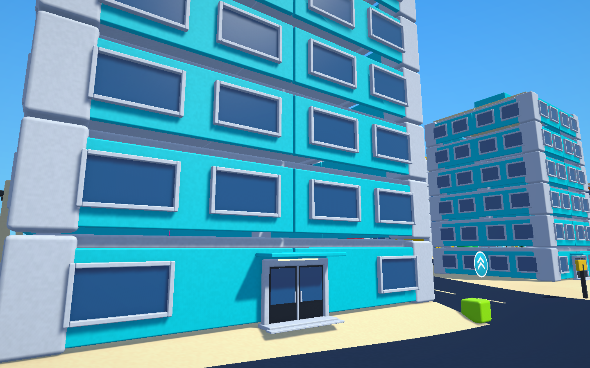
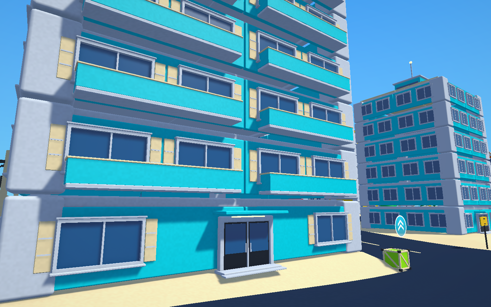
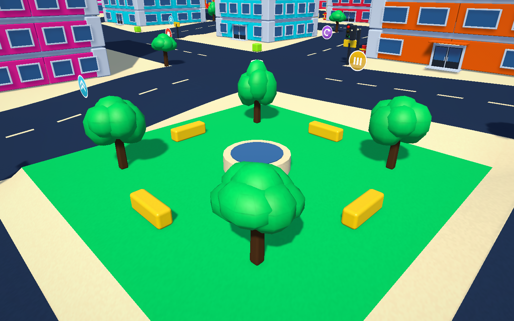
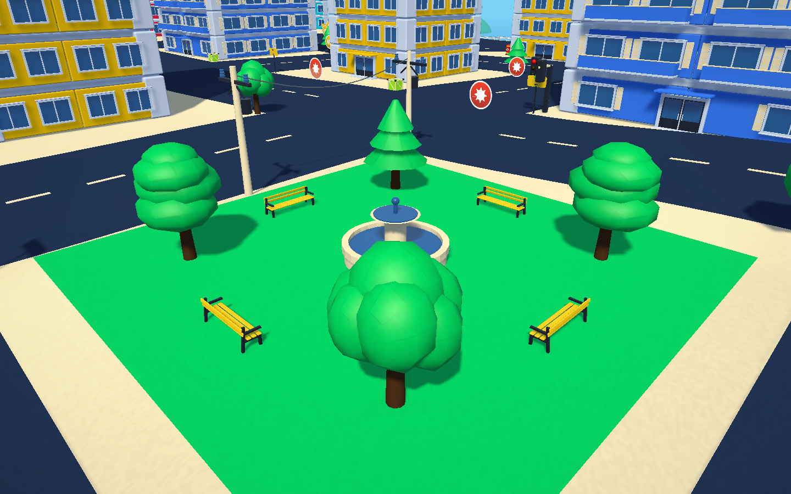
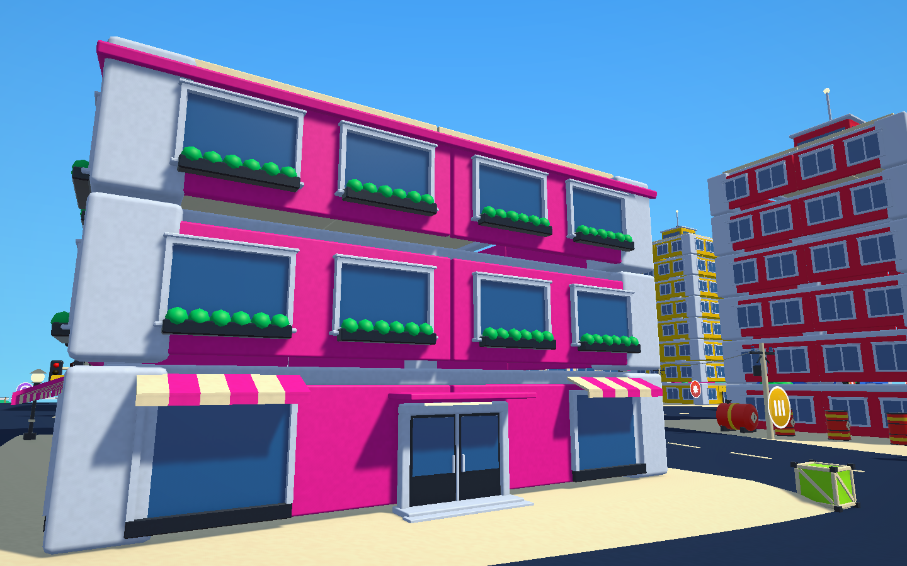
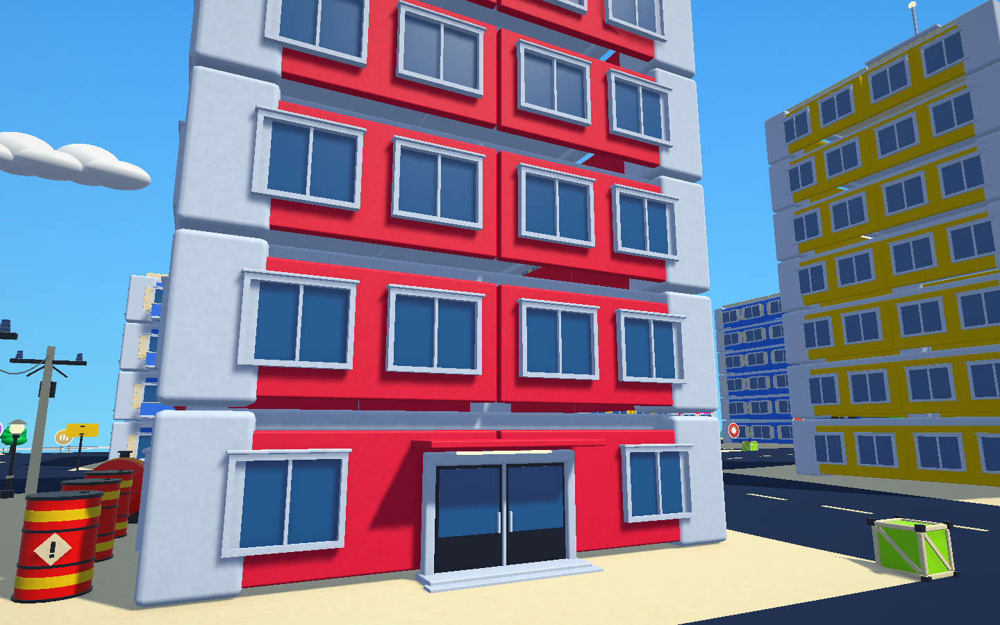
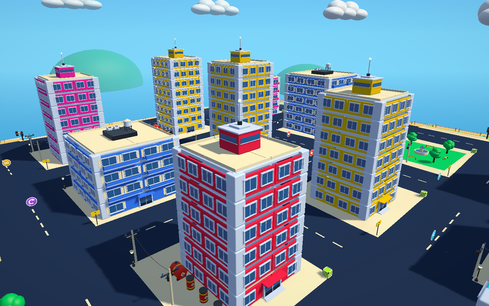
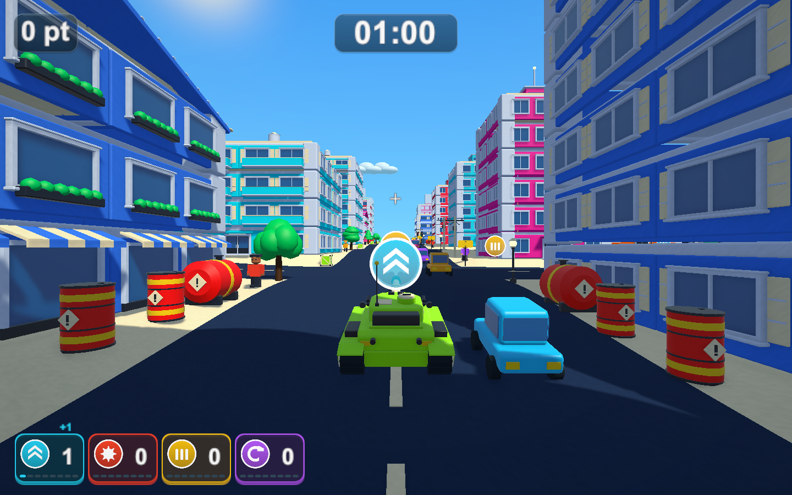

# ビル群の街の建物の飾りと小物をBlenderの部品へ置き換え

2026-10-22

## 変更内容

通常の街と大きな街で、建物の窓などの飾りと、街路・公園の小物をBlenderのスクリプト（`scripts/blender/models/city_kit.py`）で作った部品に置き換えました。お菓子の街と遊園地は従来のままです。

|変更前|変更後|
|---|---|
|||
|||

- 高層ビル: 縦の方立て1本の2枚窓、頂部のガラス帯・笠木・尖塔・航空障害灯。
- 集合住宅: 2枚窓と雨戸、2階以上の正面と背面のバルコニー（手すり壁は建物の色）、屋上の室外機と給水タンク。
- 商店: 1階の1枚ガラスのショーウインドウとしま模様の日よけ、2階以上の1枚窓と窓辺の花台、切妻屋根の瓦の筋。

最初は窓を6〜4枚に区切っていましたが、遊んだ感想で細かすぎて落ち着かないとの指摘があり、どの窓も2枚以下にしました。
- 小物: 街灯、道路標識、3種類の木（丸い木・針葉樹・細長い木）、木箱、ベンチ、二段の噴水、ドラム缶、燃料タンク、海岸のガードレール、電柱。

## 仕組み

建物の柱・梁・床・外壁パネル・屋上の部材は従来どおり箱のままで、当たり判定・耐久・支持・破片への分裂・倒壊は変えていません。窓などの飾りは部材の子として置くため、壊れた外壁の破片に付いて飛びます。小物も当たり判定と壊れ方は従来のままで、見た目だけを置き換えました。

- FBXは `Assets/TankTown/Resources/Models/CityKit.fbx` です。部品ごとに、1マテリアルずつのメッシュ `<部品名>|<オブジェクト名>` を並べています。`TownModelKit` がこれを読み、マテリアルを名前で共通のトイ風マテリアル（建物の色・ドラム缶の赤などは置く場所の色）へ置き換えます。
- 建物は近景でマテリアルごとに1つのメッシュへまとめて描くため、部品は1メッシュ1マテリアルにしています。まとめる処理でメッシュを読むので、FBXの読み込み設定でRead/Writeを有効にしています。
- 遠景の簡略表示は部品ごとに箱を描きます。部品のメッシュは単位の箱ではないので、各メッシュの範囲に合わせた箱を使います（`TownModelKit.DistantShape`）。
- 部品はメートル単位で作り、親の部材の拡大を打ち消して置きます。窓・バルコニー・屋上の飾りは、外壁パネルや屋上部材の寸法に合わせて伸縮します。
- テストが参照する名前（`Window`、`Deep window frame`、`Tree crown`、`Crushable fountain` など）と当たり判定は残しています。木の葉は従来と同じく縦横奥行き1の形で、頂点色の陰影と球の当たり判定を持ちます。
- 設定 `importedCityModels` をオフにするか、FBXが無い場合は従来の箱の飾りになります。

部品一式は58メッシュ・約7,900三角形です。窓1つあたりの三角形は、高層116・店先212・集合住宅296・商店の上階480で、従来（角丸の箱5個、約540）以下です。オブジェクト数は窓1つあたり2〜5個（従来2個）です。集合住宅のバルコニーは外壁パネル1枚あたり148三角形を追加します。

## Blenderの書き出しの修正

- 面取りで増えた面が元の形のマテリアルを継がず、最初のマテリアルになっていました。戦車の工具箱などの黒い部品の縁がライム色になっていたのもこのためです。面取りの面へ元のマテリアルを明示的に付けるようにし、戦車のFBXも書き出し直しました。

## 検証

Unity 6000.3.19f1の独立した検証コピーで実施しました。

- 新規の `TankTownCityKitTests` 3件: 3種類の建物の飾り・バルコニーの位置・街灯の当たり判定・噴水・ドラム缶の着色対象・木の葉、全部品がトイ風の1マテリアルでまとめて描けること、当たり判定を足さないこと、拡大された部材の上でも部品の寸法が保たれること、遠景の箱が部品の範囲と一致すること、設定をオフにすると従来の箱に戻ること。
- PlayMode全体は173件中171件が成功（426.5秒）。失敗は変更前から失敗している `TankTownMobilityTests` のレーザー2件だけです（[戦車モデルの検証](tank-model-validation.md)を参照）。
- 画面はPlayMode中にゲームのカメラをテクスチャへ描画して撮影しました（固定の時間刻み）。交通と通行人は撮影のため止めています。

## ビルドと負荷

検証コピーで `TankTownSetup.BuildWindows`（Windows x64 Development Build）が成功し、`Builds/TankTown-CityKit/TankTown.exe` へ配置しました。新しい戦車と、[爆発を早めに消す調整](short-explosion-validation.md)も含みます。窓を減らした後のビルドのRuntimeアセンブリのSHA-256は `D30A98885FA58EFD51D1439950AA8B7D2C7CFE0A5C81371447C6B4325C0C7EF5` で、検証コピーと一致しています。下の負荷の表は窓を減らす前のビルドで測ったものです。通常の `Builds/TankTown` とGitHub Releaseは変更していません。実プレイヤーの `--tank-town-smoke` と `--tank-town-performance-smoke` は終了コード0です。

`--tank-town-performance-smoke`（大きな街・シード2026・1920×1080・同じPC）で、変更前のビルド（`Builds/TankTown-SmokeLod`）と比べました。各区間は数秒の単回計測で、継続したFPSを保証するものではありません。

|区間|変更前の平均 / p95|変更後の平均 / p95|描画三角形 前→後|描画呼び出し 前→後|
|---|---|---|---|---|
|タイトル|6.9 / 7.7ms|7.0 / 8.0ms|164万→164万|2,601→2,590|
|街路・診断用地図あり|16.8 / 23.9ms|14.5 / 17.4ms|562万→461万|9,668→9,985|
|街路・地図なし|17.5 / 24.0ms|14.6 / 15.8ms|546万→447万|9,481→9,765|
|大量破壊・破片最大2,000|50.5 / 113.3ms|49.4 / 93.3ms|464万→388万|12,154→12,031|

窓が従来より少ない三角形になったため、街路の描画三角形は約18%減りました。描画呼び出しは部品のマテリアルが増えた分、約3%増えています。タイトルの最悪フレームが35.0→111.8msでしたが、単発で平均とp95は変わっていません。街の生成時間は測っていません。

Windowsの配布ビルドと手動での操作確認は行っていません。
