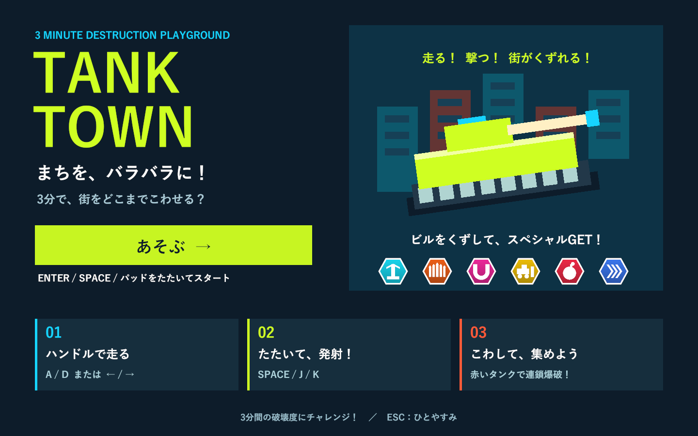
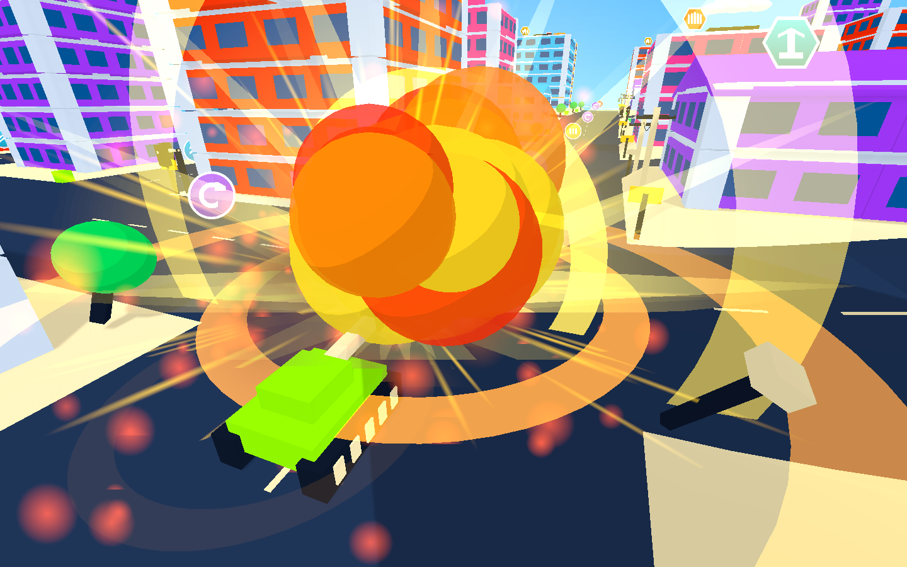
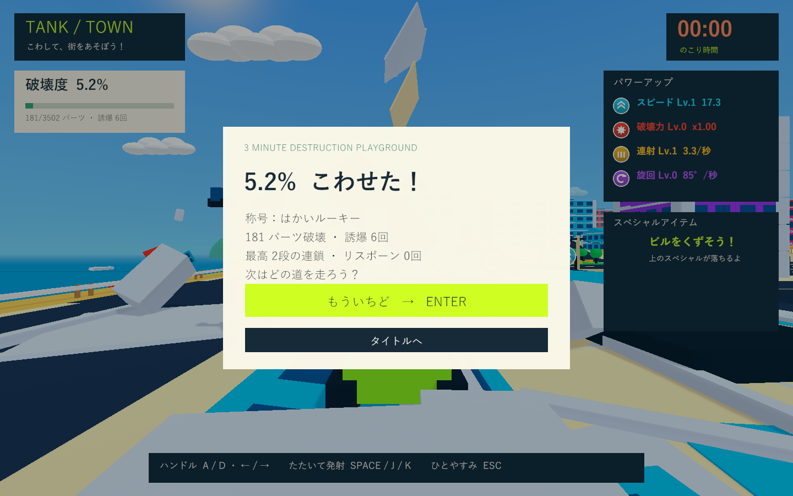

# タイトル・街の演出・連鎖爆破・落下報酬

2026-10-03。Issue #5 のローカル実装。Unity 6000.3.19f1 / URP 17.3.0。

## 実装

|要望|実装と確認対象|
|---|---|
|タイトル画面|静止した戦車イラスト、操作案内、6種のスペシャル、開始ボタン。Enter・砲撃用のキー／パッドでも開始。待機中の時間と物理を停止。停止・結果からタイトルに戻れる。|
|連鎖する爆発物|11組・44個のドラム缶と燃料タンク。0.18秒の導火時間。爆風・体当たり・落下部材で点火。大規模倒壊の破片整理でも点火済みの爆発を維持。|
|建物から落ちるスペシャル|各33棟の上階に1個。支持床の分離で重力落下し、建物の部材の60%以上を壊した後に接触回収。満杯なら地面に残る。|
|短いメガレーザー|効果を3.5秒から2秒へ変更。発動中は前進を止め、終了後に走行を再開。|
|走る車と誘爆|18台が3本の周回路を走行。赤信号と先行車で減速。実砲弾が当たると動的Rigidbodyになり、爆発が次の車を点火。|
|信号・電柱|方向別に切り替わる信号、電柱、たるんだ電線。信号・電柱は砲撃と体当たりで破壊。電線は支柱が壊れると消える。|
|空・遠景・エリア端|青空グラデーションシェーダー、16組の雲、海、10個の遠景の島、地形に沿う砂浜・崖・ガードレール。外周の砂浜を波打つ輪郭にし、海と遠景に距離フォグを適用。海へ向かうと旋回の案内を表示。|
|演出・UI|連鎖段数、取得通知、落下中の軌跡、開始案内、結果の称号・誘爆回数・最高段数。停止・結果には背景を暗くする幕。従来の大爆発と水平を保つカメラを継承し、視界を塞ぐ飛散破片も透過対象に追加。|

## 検証手順

ユーザーの作業ツリーの Unity 設定・パッケージは変更せず、既存の隔離コピー `C:/Users/fsato/.codex/tmp/tanktown-validation-20260926` を使用。ネットワーク不要の同一バージョンのローカル PackageCache を参照する構成。

PlayMode は `-batchmode -nographics -runTests -testPlatform PlayMode -testFilter TankTown.Tests`。旧機能の個別テストでは新しい交通・爆発物を停止して対象を分離し、街のテストで通常走行・車への実砲撃・信号の実停止／発進・電柱の破壊を別途確認。

最初の全体実行は58/59件成功。再挑戦で即座に時間が進む仕様に対し、旧テストが残り180秒ちょうどを要求していた1件を修正。

|実行|結果|ログ|
|---|---|---|
|全体の再実行|59/59成功、92.04秒|`Logs/city-final-tests.xml`|
|点火済み爆発物の維持・方向別信号|13/13成功、11.56秒|`Logs/city-chain-final-tests.xml`|
|実画面確認後の視界・UI・海岸修正|20/20成功、16.43秒|`Logs/city-presentation-final-tests.xml`|

重複を除いて60ケース。最後の20件には、通常の遮蔽物だけでなく分離した部材も視界を塞いでいる間は透過し、離れると元に戻る確認を含む。車への実砲撃は2台目を通常爆風の外側に置き、最初の車の爆発で点火することを確認。報酬は上階の床だけの破壊では取得できず、大部分の倒壊後は地面へ落下して接触回収できることを確認。

Windows Development Build は `TankTown.Editor.TankTownSetup.BuildWindows`。D3D11 の実プレイヤーで `--tank-town-city-smoke` と `--tank-town-title-wide-smoke` を実行。隠れたウィンドウでは通常のバックバッファが更新されないため、URP の StandardRequest で実カメラと Canvas を RenderTexture に描画して保存する。

実画面で発見したタイトルの文字重なりを直し、飛散破片を視界の透過対象に追加。距離フォグの必要なシェーダーバリアントが省かれないよう、実行時に加えて専用シーンにも線形フォグを保存した。自動ストリッピングはビルド内のシーンで使用されるモードを参照する。[Unity 6000.3 の Graphics 設定](https://docs.unity.com/en-us/engine/6000.3/manual/unity-editor/editor-settings-reference/comp-manager-group/class-graphics-settings)。

診断用の車・戦車の配置、全景・報酬用カメラ、基礎部材の追加分離、時間送りを含む。実物理による落下、実砲弾、取得トリガー、通常の武器発動を使用する。3分間の手動プレイや実機コントローラーの体感評価は含まない。

## 最終ビルドの実画面

1440×900の13画面と、1920×1080のタイトル・通常HUDの2画面を実プレイヤーで確認。文字の重なり・見切れを修正済み。最終ログは `Logs/city-atmosphere-player.log`、`Logs/city-wide-player.log`。画像は `Builds/TankTown/Captures/city-*.png`。

最終診断値: 車18台、信号17基、実砲弾から車2台の誘爆、燃料を合わせて誘爆6回、最高2段。落下報酬は地面から0.650の高さで静止し、取得トリガーへの接触で回収成功。メガビームの停止時間は2.000秒。結果への遷移を確認。診断での破壊は181/3502部材。

ビルド成功。最終ビルド／プレイヤーのログにゲーム例外・C#コンパイル・シェーダーエラーなし。`Builds/TankTown` に配置済みで、Runtime DLL の SHA-256 が検証コピーと一致: `85435272FF86EB1A91C5478DAF47F2A37460C23A4DC779B4D4D702754495EA55`。ローカルの別レビュー用作業ツリーに変更をまとめ、ユーザーの累積変更を持つメインの Git インデックスは変更していない。

## 実装上の制約

交通は固定の周回路と簡単な車間距離・信号制御。経路探索や渋滞解消AIではない。普通の破片は280個まで、寿命9秒。点火済みの爆発物は短い導火時間を終えるまでこの整理対象から外れ、爆発後に自分で消える。崖の先は従来の復帰ルールを使う。

ネイティブ Unity ゲームのため、画面・遷移の確認対象はブラウザではなく Windows プレイヤー。formatter/lint 専用設定はなく、Unity コンパイル・テスト・Git 差分チェックで確認する。
