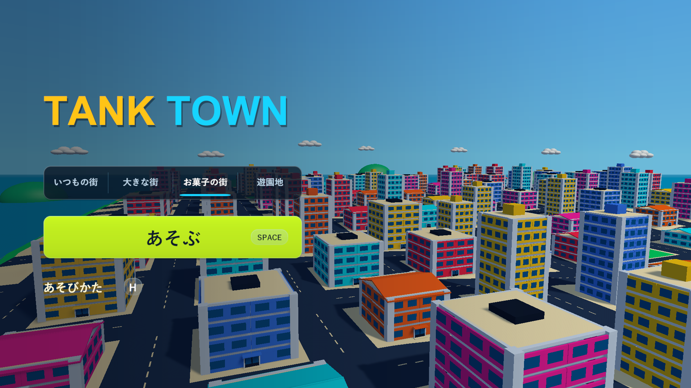

# タイトル画面の整理

2026-10-16。承認済みの画面案に合わせ、ロゴ・4つの街選択・開始・遊び方を左側にまとめました。ロゴは黄色と水色の1行表示にし、大きな囲み枠、キャッチコピー、説明文、右上の案内、右下のスペシャル一覧を外しています。操作とアイテムの説明は既存の遊び方に残しています。

街選択は名前だけのタブにし、選択中の街を水色の下線で示します。開始ボタンはライム色の淡いグラデーション、細い縁、柔らかい影で強調し、Spaceは小さなキー表示へ分けました。遊び方は文字とHの小さなキー表示にしています。ホバー・キーボードのフォーカス・押下の色も設定しています。

背景は従来どおり大型街の軽いモデルを屋根近くからゆっくり巡回します。左側を暗くする画像は128×1の小さなテクスチャを起動時に作り、画面全体へ伸ばすため、縦横比を変えても端が途切れません。選択時の街の再生成、ゲーム本体の難易度、制限時間、ステージ内容は変更していません。追加したテクスチャとSpriteはHUDの破棄時に解放します。

## 確認

- Unity 6000.3.19f1のWindows x64 Development Build成功。`Logs/clean-title-final-build.log`。
- 既存PlayModeの開始・遊び方・結果・再挑戦、街選択、HUD表示と再読み込みの9/9件が成功（34.27秒）。選択表示の期待値は、以前のチェック文字からタブの下線へ更新しました。`Logs/clean-title-final-tests.xml`。
- Windows実ビルドの`--tank-town-round-flow-smoke --tank-town-title-layout`で、数字1〜4による選択と下線、マウスのRaycastとクリック、選択中にWorldを再生成しないこと、1920×1080・1280×720・1440×900・1280×1024の文字の収まりと画面内表示を確認しました。20画面を保存して診断を完了。H/Esc、Space開始、3/2/1/GO、結果のスコア、Spaceでの新しいラウンドと通常砲撃も含みます。`Logs/clean-title-final-player.log`。
- [実画面の比較](title-screen-review.html)は4つの街の選択、3つの追加解像度、遊び方の8枚を掲載。Chromeで全画像、以前／現在の切り替え、1920/1280/720/390px幅で横にはみ出さないこと、原寸リンクとページエラーがないことを確認しました。`Logs/clean-title-browser.log`。

実ビルドの診断はシードを固定し、仮想キーボード入力・UIのRaycast・結果確認用の破壊処理を使っています。長時間の手動プレイや実機コントローラーの確認を表すものではありません。ブラウザは実画面の比較ページの確認です。

READMEのタイトル画像・画面構成を更新しました。運用手順の変更はないため、AGENTSとスキルの更新は不要です。

ローカルの新しいビルドは`Builds/TankTown-CleanTitle/TankTown.exe`です。共通の`Builds/TankTown`、`Builds/TankTown-Amusement`、`Builds/TankTown-GameplayUI`も同じ内容へ更新しました。GitHubの既存v0.1.0配布物は変更していません。

