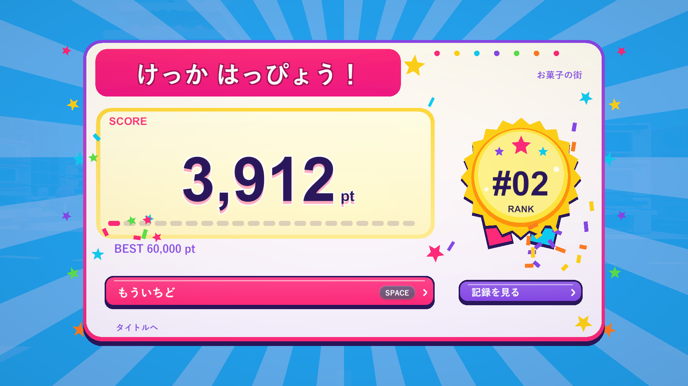
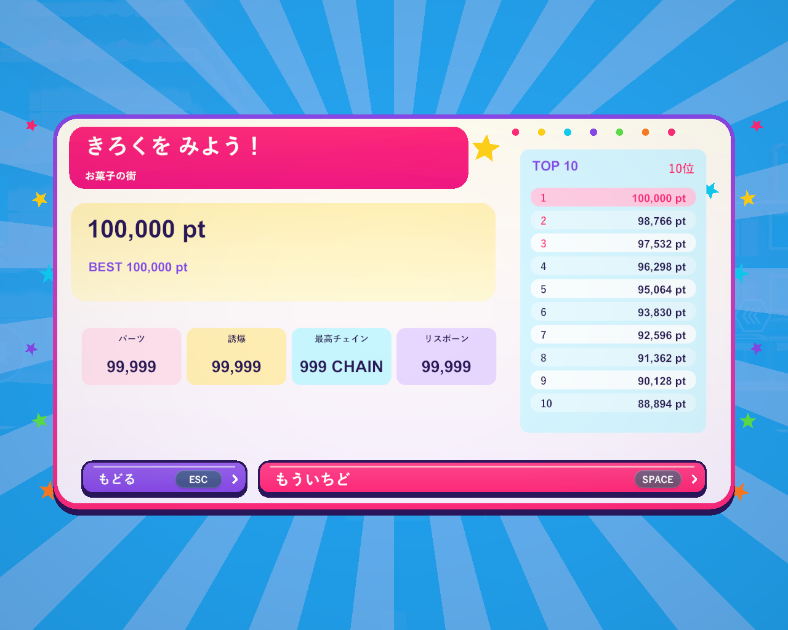

# カラフルなリザルト（2026-10-27）

子供向けの賑やかなリザルトに変更しました。水色の放射背景、ピンクの見出し、クリーム色のスコア欄、黄色いメダル、紫のボタンに、6色の星・紙吹雪・メーターを組み合わせています。「けっか はっぴょう！」と「ベスト こうしん！」は日本語フォント、大きな数字は丸みのある表示フォントを使います。

パネルは0.48秒で弾んで登場。0.95秒のスコア集計中は数字が小さく弾み、確定時に拡大・紙吹雪・4音の短いファンファーレを加えます。メダルは登場時だけ小さくスイング。紙吹雪は有限で、数字・見出し・ボタンの領域を避けます。詳細画面では非表示にし、周囲の星だけがゆっくり動きます。装飾はUnity UIの頂点で描き、画像素材や物理オブジェクトを増やしていません。

カメラや画面全体の揺れ、背景の回転、激しい点滅は加えていません。スコア・順位・ランキングの計算を維持し、0点の順位は「—」。記録更新でないときにも同じ明るい配色を使い、実際のBESTと順位を表示します。Spaceで集計途中・詳細画面から再挑戦でき、Tab・Esc・マウスで詳細を開閉できます。

## 検証

Unity 6000.3.19f1の関連PlayModeテスト18件が成功。正確なスコア集計、0点、ランキング、詳細の数値、実際のSpace入力による再挑戦と二重生成の防止を確認しています。その後の紙吹雪のタイミング・表示領域・詳細表示時の非表示を含む最終版はWindows x64 Development Buildで確認しました。

`--tank-town-round-flow-smoke --tank-town-menu-layout`の実行で、1920×1080・1280×720・1440×900・1280×1024の結果・詳細・最大値を確認。文字切れ・画面端の余白、100,000pt・順位11・各集計99,999・999 CHAIN・ランキング10行、マウスとTab/Escでの詳細の開閉、Spaceでの再挑戦が成功し、終了コード0でした。最大値の画像はレイアウト用の診断表示です。

通常の結果は建物の支持喪失と連鎖から得た3,912pt・485パーツ。別実行の`--tank-town-result-existing-best`では保存しない60,000ptの診断用ベストをメモリに用意し、今回3,912pt・順位2・BEST 60,000ptを確認。こちらも終了コード0。記録更新・通常・720p最大値・5:4の詳細を目視確認しました。診断ではランキングを保存せず、全ステージの長時間プレイは含みません。

通常の`Builds/TankTown/TankTown.exe`と`Builds/TankTown-ColorfulResults/TankTown.exe`を更新しました。検証用を含む3ビルドのRuntimeアセンブリのSHA-256はすべて`066FE5E4DA2B39AE3E9778AC0DF98CD2C0A493533193659EE0D75F76DC07CE8F`です。

検証コピーとC# 110ファイルが改行正規化後に一致。利用者の描画設定・撮影コード9ファイルは作業前と一致し、既存の削除3ファイルも復元していません。READMEの現在のリザルト説明を更新し、既存のAGENTS・開発手順の変更は不要と判断しました。

記録：`Logs/results-party-tests.xml`、`results-party-tests.log`、`results-party-build.log`、`results-party-{newbest,existingbest}-player.log`、`results-party-source-check.json`、`results-party-local-overlays-check.json`、`results-party-build-hashes.json`。
