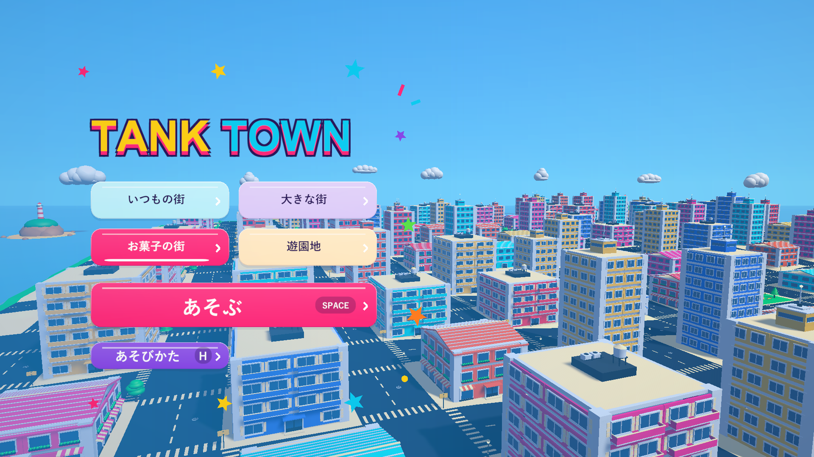
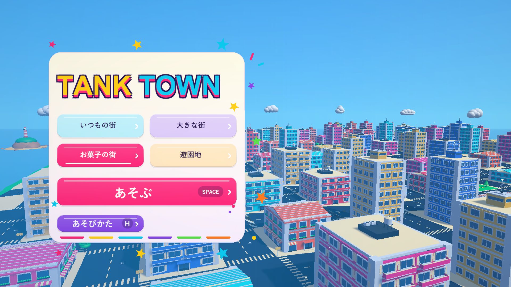
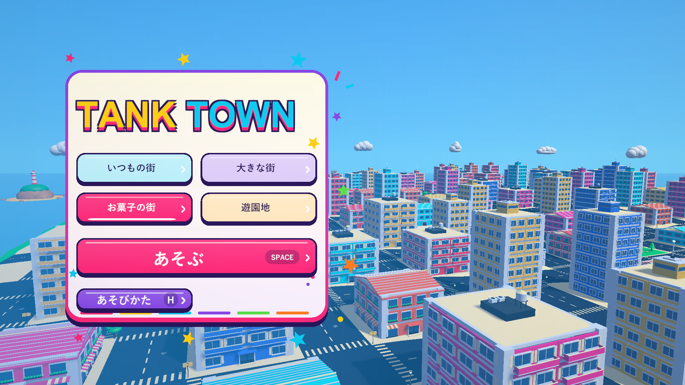
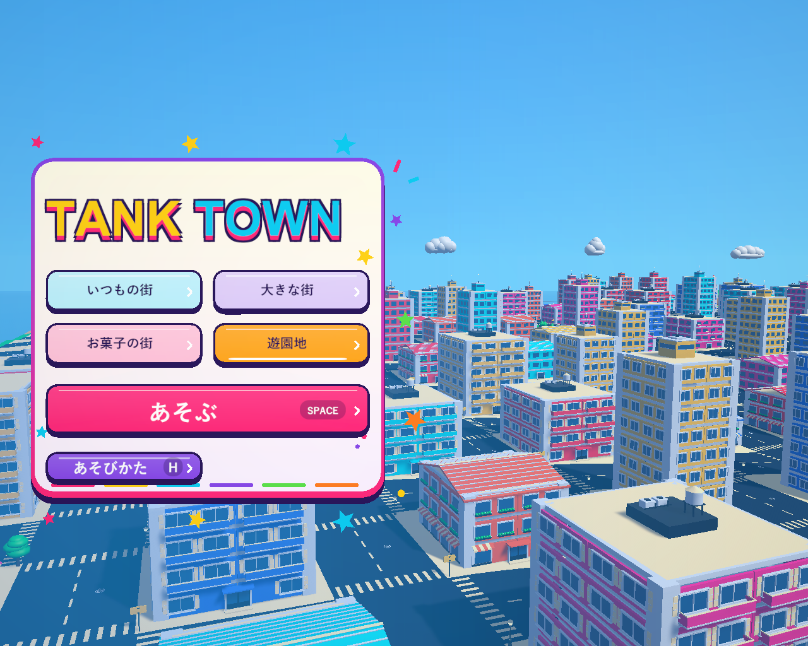

# カラフルなタイトル（2026-10-29）

リザルトと同じピンク・水色・黄色・紫を使い、ロゴとボタンを街並みに直接重ねるタイトルにしました。全体を囲んでいたベージュのパネルは削除しています。TANK TOWNは1行のまま、黄色と水色の文字に紫の縁とピンクの影を加えています。4つの街は2×2の大きなボタンにし、選択中は鮮やかな色と下線で示します。あそぶはピンク、あそびかたは紫。文字の量は従来と同じ9個で、説明やアイテム一覧は既存の遊び方にまとめています。

右側には大型街を巡回する従来の背景を広く見せ、左の色付けを明るい水色へ変更。パネルの周囲の星は最大3単位だけゆっくり上下します。リザルトと共有する頂点描画のボタン・パネルを使い、新しい画像素材や物理オブジェクトは追加していません。

外枠を細く淡くした版を経て、現在は大きなパネルの背景・縁・影・下端の飾りを生成する処理を削除しています。タイトルのボタンは細い縁・短い半透明の影を使います。ロゴ・文字・クリック範囲・ホバー・ステージ選択の処理は維持しています。

ホバーで浮く・押すと沈む動き、固定したクリック範囲、キーボードのフォーカス、非表示時のリセット、数字1〜4での街選択、H/Esc、Spaceを維持しています。タイトルでのステージ選択は背景の街を再生成しません。

## 大きなパネル削除後の確認（最新版）

タイトルの大きなベージュの背景・縁・影・下端の飾りと、未使用になった描画処理を削除しました。ロゴとボタンの間にも街並みが見えます。

Windows x64 Development Build成功。今回の表示変更はPlayModeを再実行せず、`--tank-town-round-flow-smoke --tank-town-title-layout --tank-town-title-hover`で確認し、終了コード0でした。4解像度の文字の収まり、4つの街選択、マウスクリック、ホバー・押下・復帰、遊び方、開始カウント、結果、Spaceでの再挑戦と砲撃まで成功。1920×1080の実画面でパネルがないことを目視確認しました。

通常の`Builds/TankTown/TankTown.exe`と`Builds/TankTown-OpenTitle/TankTown.exe`を更新。検証用を含む3ビルドのRuntimeアセンブリのSHA-256はすべて`28D4F083B3F4FA9D7ABD993C8B5B48DA19590438373801E7B3E54203DE344BEC`です。C# 110ファイルが検証コピーと一致し、利用者の設定・撮影コード9ファイルと既存の削除3ファイルを維持しています。

記録：`Logs/title-open-build.log`、`title-open-player.log`、`title-open-source-check.json`、`title-open-local-overlays-check.json`、`title-open-build-hashes.json`。

## 外枠を細くした版の確認（旧版）

Windows x64 Development Build成功。今回の描画だけの調整はPlayModeを再実行せず、`--tank-town-round-flow-smoke --tank-town-title-layout --tank-town-title-hover`で確認しました。終了コード0。4解像度の文字の収まり、4つの街選択と選択表示、マウスクリック、6つの操作のホバー・押下・復帰、遊び方、開始カウント、正確な結果、Spaceでの再挑戦と砲撃まで成功しました。1920×1080の実画面で枠と影が控えめになったことを目視確認しました。

通常の`Builds/TankTown/TankTown.exe`と`Builds/TankTown-SoftTitle/TankTown.exe`を更新。検証用を含む3ビルドのRuntimeアセンブリのSHA-256はすべて`F9082E51FABD803B8687FD570AA5DED5D8047D1155C68220564A7078F7FEE4B6`です。C# 110ファイルが検証コピーと一致し、利用者の設定・撮影コード9ファイルと既存の削除3ファイルを維持しています。

記録：`Logs/title-soft-build.log`、`title-soft-player.log`、`title-soft-source-check.json`、`title-soft-local-overlays-check.json`、`title-soft-build-hashes.json`。

## 初版の検証

Unity 6000.3.19f1の関連PlayModeテスト18件が成功。開始・遊び方・結果・再挑戦とランキングを確認しています。Windows x64 Development Buildも成功しました。

実ビルドの`--tank-town-round-flow-smoke --tank-town-title-layout --tank-town-title-hover --tank-town-menu-layout`は終了コード0。4つの街の数字キー選択と選択表示、実際のUI Raycastによるクリック、背景を再生成しないこと、1920×1080・1280×720・1440×900・1280×1024での文字切れと画面内への収まりを確認しました。6つの操作のホバー・押下・復帰、固定したクリック範囲、キーボードのフォーカス、非表示時のリセットも成功しています。

続けて遊び方、3/2/1/GO、結果と詳細、最大スコア100,000ptとランキング10行、Spaceでの再挑戦から通常砲撃まで確認しました。シードと診断入力を使う実行で、ランキングは保存しません。全ステージの長時間の手動プレイは含みません。タイトルの1920×1080と5:4の画面を目視確認しました。背景は選択する街にかかわらず共通の大型街です。

初版では通常の`Builds/TankTown/TankTown.exe`と`Builds/TankTown-ColorfulTitle/TankTown.exe`を更新しました。当時の3ビルドのRuntimeアセンブリのSHA-256は`9EF803872FC262D9CFAE2812001F5186C6FBF36811A0A91F50E0E48D53432930`です。

検証コピーとC# 110ファイルが改行正規化後に一致。利用者の描画設定・撮影コード9ファイルは作業前と一致し、既存の削除3ファイルも復元していません。READMEの現在の説明とタイトル画像を更新しました。既存のAGENTS・開発手順の変更は不要です。

記録：`Logs/title-party-tests.xml`、`title-party-tests.log`、`title-party-build.log`、`title-party-player.log`、`title-party-source-check.json`、`title-party-local-overlays-check.json`、`title-party-build-hashes.json`。
