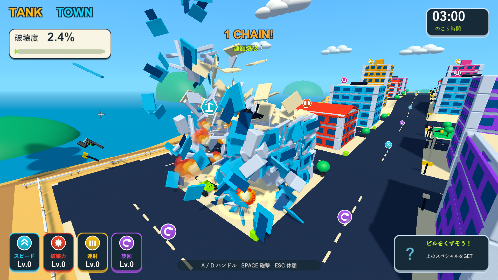

# 破片上限を720個へ拡張

2026-10-04。Issue #5。Unity 6000.3.19f1 / URP 17.3.0。

一度に多くの部材が分裂した際の早い消去を減らすため、破片の上限を360個から720個へ増やした。ScriptableObjectの既定値とResourcesの実際のSettingsへ同じ値を設定した。寿命は3.6秒、最後の0.45秒でフェードする。

破片同士の衝突省略、戦車による押しのけ、カメラ遮蔽、最大4段の衝突連鎖、0.12秒の時間窓で3回の局所爆発を引き続き使う。上限に達した場合は古い破片を消去する。

既存PlayModeで分裂・実衝突・破片上限・連鎖収束・寿命・一時停止・破壊度・落下報酬を検証する。ネイティブUnityゲームのため、画面はWindowsプレイヤーで確認する。破片診断は実砲撃の着弾後・飛散中・約3秒後に有効な破片数を記録する。3回の読み取りの最大値であり、全フレームのピーク値やFPS計測ではない。

|検証|結果|記録|
|---|---|---|
|既存PlayMode全体|78/78成功、95.47秒。分裂・実衝突・上限・連鎖収束・寿命・一時停止・破壊度・落下報酬を確認|`Logs/debris-budget-tests.xml`|
|Windows Development Build|終了コード0|`Logs/debris-budget-build.log`|
|実砲撃後の破片数|着弾後186個、飛散中407個、約3秒後720個。以前の上限360個を超えて保持し、新上限以内|`Logs/debris-budget-debris-player.log`|
|分裂・実接触の局所爆発|床と壁は各6個に分裂、接触爆発成功、最高4段。終了コード0|同上|
|燃料の点火距離|遠い着弾では点火せず、近い実砲撃で燃料1個が誘爆。終了コード0|`Logs/debris-budget-fuel-player.log`|
|街全体の回帰|車2台が誘爆、落下報酬の接地と接触回収成功、ビーム2.000秒、結果画面まで成功。終了コード0|`Logs/debris-budget-city-player.log`|

ネイティブプレイヤーのログにゲーム例外・シェーダーエラーはない。C#・shader・asmdef・Settings計48ファイルが主作業フォルダー・検証コピー・レビュー用ブランチで一致することをSHA-256で確認した。検証したWindows版を `Builds/TankTown` へ配置し、実行ファイルとRuntime DLLの一致も確認した。

上限が増えると、残った破片から続く衝突連鎖や破壊の広がりも変わる。大量の連鎖で720個に達すると、古い破片は寿命より早く消去される。3分間の手動プレイとFPS計測は今回の検証に含まない。

実砲撃後、407個の破片が残っている時点の画面。街を見渡すために診断用カメラを移動している。

