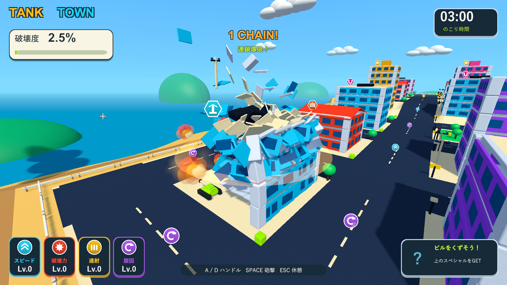
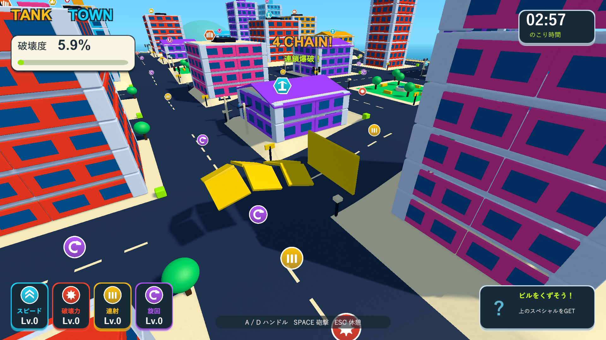
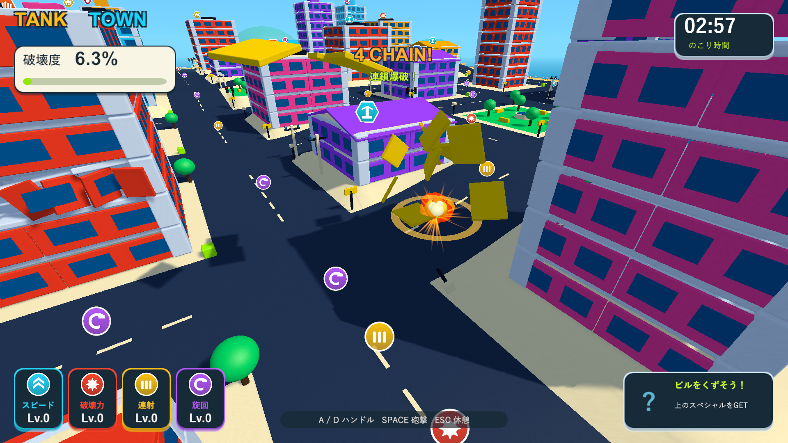
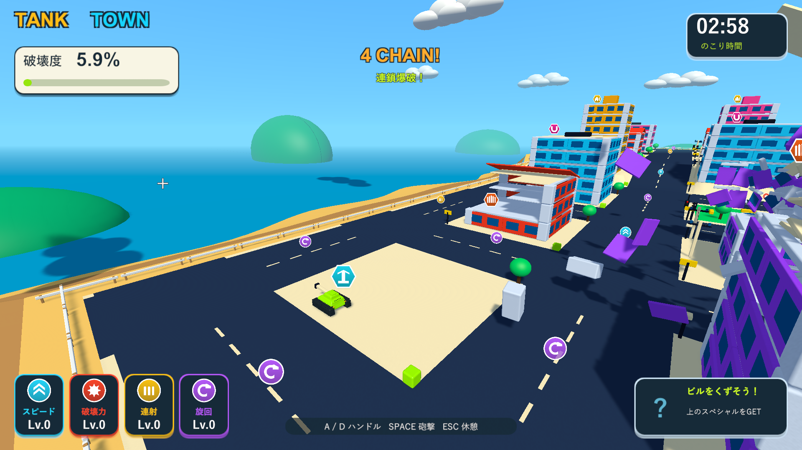

# 床の分裂と高速破片の衝突連鎖

2026-10-04。Issue #5。Unity 6000.3.19f1 / URP 17.3.0。

## 変更

大きな床・外壁・梁・屋根を、破壊時に複数の独立したRigidbodyへ分割する。3mを目安に各軸を分割し、元の1部材につき最大12個に収める。床の厚みを維持するので、大きな床全体が一枚のまま宙を飛ぶ状況を減らす。柱、小さな小物、木の複合形状、車・ドラム缶・燃料タンクはその形を維持する。

元のメッシュ・共有マテリアル・カメラ遮蔽のプロパティを再利用し、窓などの子オブジェクトは世界位置を保って近い破片へ付け替える。分裂は元の部材の破壊として一度だけ加点する。建物の支持グラフ、累積破壊率、屋上アイテムの解放条件は元の部材を参照する。倒れる方向の力は分裂した各Rigidbodyへ渡す。

新しい破片もカメラの遮蔽判定へ登録する。分裂前の部材が薄くなっていた場合はその濃さを引き継ぎ、視線から離れると各破片の濃さを戻す。既に破片へ移した窓を、元の部材のRendererキャッシュからまとめて薄くする処理も避ける。固定したkinematicの戦車では衝突による速度の書き戻しを行わない。

|項目|変更後|
|---|---|
|通常弾の衝撃力|32（以前20の1.6倍）|
|燃料の衝撃力|96（基礎32×3）。点火距離3m・爆風24mは維持|
|床破片の質量|0.65。爆発による上向きの力も増加|
|高速破片の衝突爆発|接触面へ向かう速度が12m/s以上なら接触点で半径3.5m|
|次の破片の力|強化状態を含む通常弾の衝撃力×0.9|
|連鎖制限|1破片につき1回、最大4段、0.12秒の時間窓で3回|
|物理・消去|高速の破片はContinuousDynamic。上限280個、寿命2.4秒、最後0.45秒でフェード|

高い横滑り速度だけでは爆発せず、接触面の法線方向の速度を使う。地面・戦車・既に外れた部材では炸裂しない。分裂した破片も戦車が物理的に押しのけ、車体の角速度と走行速度を復元する。普通の破片の速度は物理ステップで60m/s以内に収める。

破片の衝突爆発は燃料の点火距離を通る。接触点の近くの燃料は点火するが、局所爆風の端にある燃料は残る。燃料への低速接触や、単なる体当たりは点火しない。

連鎖の段数とHUDの通知に破片の爆発を含める。車・燃料の誘爆と破片の衝突爆発は個別に計数し、結果画面には合計を表示する。

## 検証

主作業フォルダーのUnity設定や既存の変更を保ち、隔離コピーでPlayModeとWindows Development Buildを実行した。ネイティブUnityゲームのため、画面の検証はWindowsプレイヤーを対象にした。

物理テストでは分割前後の体積・外形・材質・装飾位置・一度だけの加点、全破片の消去と一時停止、実測の飛散速度、実接触による二段目の爆発、低速・横滑り・地面・戦車への接触、燃料の点火距離、実衝突による連鎖上限、同時衝突と破片上限を確認する。以前の報酬テストは、破片の衝突連鎖が収束した後に加点が止まることを確認するよう更新する。

Windowsの破片診断は、街への実砲撃に加え、床と壁の診断用配置を含む。分裂した一枚の位置と速度を設定して接触を安定させ、局所爆発とその後の飛散を通常の物理衝突で確認する。3分間の手動プレイや性能測定は含まない。

|検証|結果|記録|
|---|---|---|
|最終ソースのPlayMode全体|78/78成功、83.57秒|`Logs/debris-final-tests.xml`|
|分裂片の遮蔽・濃さの復帰|分裂した各破片が視線を遮る間は薄くなり、離れると濃さ1へ復帰。固定カメラと共有マテリアルは維持|上記XMLと `Logs/debris-camera-test.xml`|
|最終Windows Development Build|終了コード0|`Logs/debris-final-build.log`|
|床の分裂・実衝突爆発|床と壁が各6個に分裂。実砲撃から街の破片爆発14回・205部材破壊。診断用接触からさらに2回の破片爆発。最高4段。終了コード0|`Logs/debris-debris-player.log`|
|燃料の近距離判定|遠い実砲撃では点火なし。近い実砲撃で燃料1個が誘爆、破壊数90→299。半径24・衝撃力96。終了コード0|`Logs/debris-fuel-player.log`|
|街全体の回帰|車2台の誘爆、落下報酬の接地・実接触回収、2.000秒ビーム、結果画面まで成功。終了コード0|`Logs/debris-city-player.log`|

最終プレイヤーログにゲーム例外・シェーダーエラー・kinematicへの速度書き込み警告はない。主作業フォルダー・検証コピー・レビュー用ブランチのC#・shader・asmdef・Settings計48ファイルのSHA-256一致を確認した。検証したビルドを `Builds/TankTown` へ配置し、実行ファイルとRuntime DLLの一致も確認した。

## 実画面

街への実砲撃。床や壁が小さな部材へ分かれ、複数の接触点で爆発する。

分割と接触を切り分けた診断用配置。床は薄い板に分かれ、一枚が壁へ当たると壁の破片も飛び散る。

最初に壊した建物の破片は消去され、隣の建物へ連鎖が広がる。各破片の寿命は新しく生まれた時点から2.4秒なので、隣棟から新しく飛び出した破片はまだ見える。

