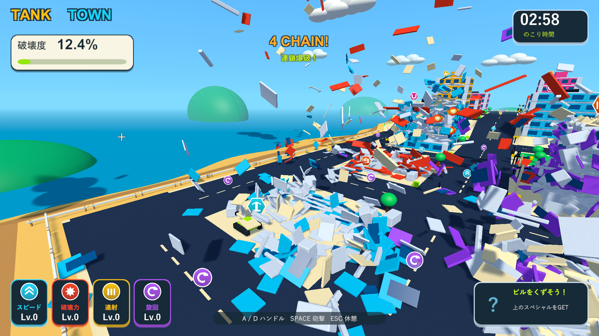
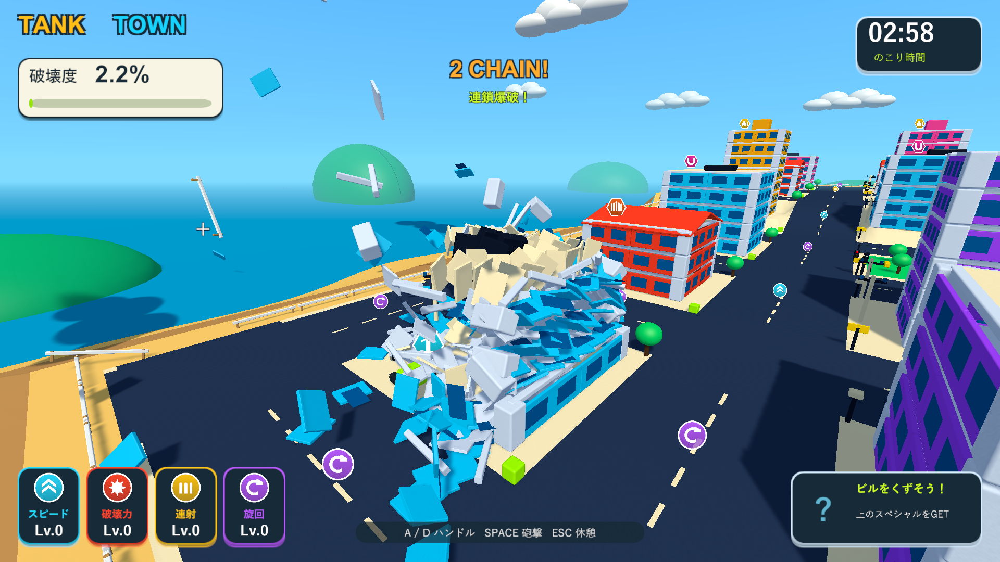

# 破片の飛散力と連鎖の広がりを調整

2026-10-04。Issue #5。Unity 6000.3.19f1 / URP 17.3.0。

一発から街の広範囲が連鎖倒壊しすぎるため、通常砲撃の衝撃力を32から16へ半減した。破片の衝突爆発は砲撃力の90%から50%へ抑え、初期値では28.8から8となる。設定の `debrisImpulseMultiplier` で倍率を調整できる。破壊力の成長はこの基礎値から増幅する。

燃料は通常の3倍の衝撃力なので96から48となる。点火距離3m・爆風半径24mはそのまま。通常砲撃の半径6.5m、局所爆発の半径3.5m、接触速度12m/s、最高4段の連鎖も同じ。破片の分裂・ランダム消去・上限2,000個・寿命3.6〜4.8秒を保つ。

PlayModeでは以前の衝撃力32と現在の衝撃力を同じ形状・相対位置の実Rigidbodyに適用し、現在の速度が低いことと飛散自体は残ることを確認する。物理衝突からの連鎖・燃料点火・車・強化・アイテム・報酬の回帰も確認する。

ネイティブUnityゲームのため画面と実砲撃はWindowsプレイヤーで確認する。破片診断では `UnityEngine.Random` を固定し、同じ街・同じ砲撃配置・60分の1秒のゲーム時間で調整前後を比較する。`--tank-town-debris-smoke --tank-town-debris-force-before` の組み合わせは以前の衝撃力32・破片爆発倍率0.9をそのプロセス内だけで復元し、設定ファイルには保存しない。記録は砲撃から約3秒までの固定された一例であり、3分間の手動プレイや難易度全体の確定は含まない。

|検証|結果|記録|
|---|---|---|
|PlayMode全体|80/80成功、98.24秒。低い飛散速度と視覚的な飛散、実衝突の連鎖、燃料、車、強化、アイテム、報酬、ランダム消去を確認|`Logs/debris-force-tests.xml`|
|Windows Development Build|終了コード0|`Logs/debris-force-build.log`|
|調整前の比較砲撃|衝撃力32・破片爆発28.8。約3秒までに連鎖爆発35回、破壊部材435個、破片1,969個|`Logs/debris-force-before-player.log`|
|調整後の比較砲撃|衝撃力16・破片爆発8。約3秒までに連鎖爆発7回、破壊部材76個、破片370個|`Logs/debris-force-after-player.log`|
|分裂と実接触|調整後も床と壁が各6個に分裂。診断用床の破片が壁へ実接触し、局所爆発を起こす。終了コード0|同上|
|燃料の点火距離|遠い着弾では点火せず、近い実砲撃で燃料1個が誘爆。半径24m、衝撃力48。終了コード0|`Logs/debris-force-fuel-player.log`|
|街全体の回帰|車2台が誘爆、落下報酬の接地と接触回収成功、ビーム2.005秒、結果画面まで成功。終了コード0|`Logs/debris-force-city-player.log`|

この比較配置では隣の建物までの破壊が減り、撃った建物から破片が飛ぶ見え方は残った。初期状態の比較なので、パワーアップ後や大型アイテムの大きな破壊とは異なる。破壊半径や柱の支持判定は変えていないため、支えを直接失わせた建物は引き続き倒壊する。

プレイヤーログにゲーム例外・シェーダーエラーはない。C#・shader・asmdef・Settings計48ファイルは主作業フォルダー・検証コピー・レビュー用ブランチでSHA-256が一致する。検証したWindows版を `Builds/TankTown` へ配置し、実行ファイルとRuntime DLLのハッシュも確認した。

調整前の同じ配置。広い範囲へ飛散と連鎖が広がり、約3秒で破壊度12.4%。

調整後。飛散と倒壊が撃った建物の付近に収まり、約3秒で破壊度2.2%。

