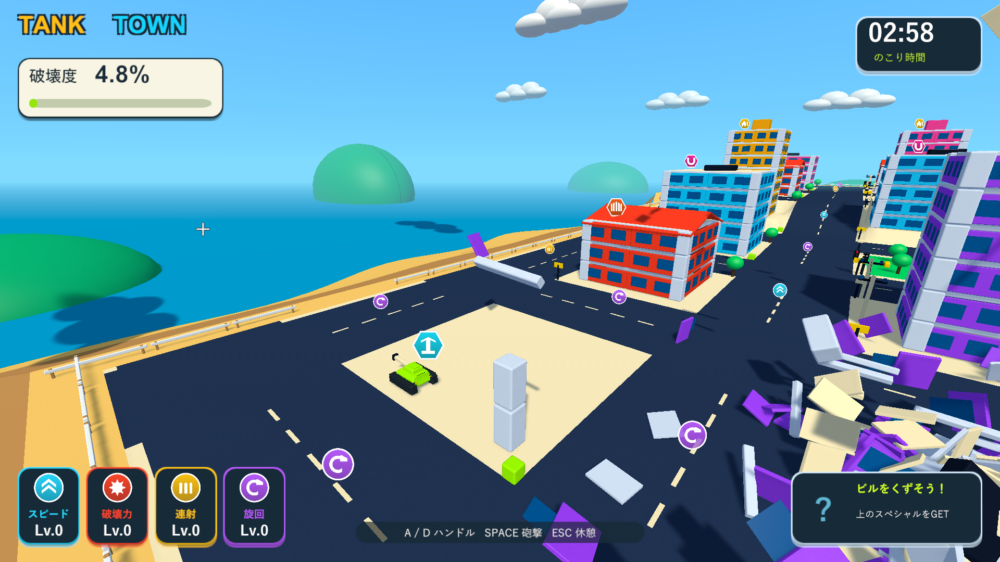

# 破片を見届ける時間の調整

2026-10-04。Issue #5。Unity 6000.3.19f1 / URP 17.3.0。

飛散する途中で破片が消える印象を減らすため、寿命を2.4秒から3.6秒へ延ばした。大量の分裂時には個数上限によって寿命より早く消えるため、上限も280個から360個へ増やした。ScriptableObjectの既定値とResources内の実際のSettingsを同じ値にした。

消える前の0.45秒のフェード、カメラを遮る破片の透過、戦車による押しのけ、最大4段の衝突連鎖を引き続き使う。爆炎・煙の短い表示時間も同じ。寿命はゲーム内の時間なので、一時停止中は消去も止まる。

検証は隔離コピーで行う。既存のPlayModeテストで、分裂・実衝突・連鎖の収束・個数上限・各破片の消去・停止中のフェード・破壊度・落下報酬を確認する。ネイティブUnityゲームのため、画面はWindowsプレイヤーで検証する。3分間の手動プレイやフレーム性能の計測は含まない。

|検証|結果|記録|
|---|---|---|
|既存PlayMode全体|78/78成功、97.74秒。分裂片の寿命・フェード・一時停止・連鎖収束・個数上限・破壊度・カメラ遮蔽を確認|`Logs/debris-lifetime-tests.xml`|
|Windows Development Build|終了コード0|`Logs/debris-lifetime-build.log`|
|分裂・実接触による局所爆発|床と壁は各6個に分裂、接触爆発成功、最高4段。終了コード0|`Logs/debris-lifetime-debris-player.log`|
|燃料の点火距離|遠い着弾では点火せず、近い実砲撃で燃料1個が誘爆。終了コード0|`Logs/debris-lifetime-fuel-player.log`|
|街全体の回帰|車2台が誘爆、落下報酬の接地と接触回収成功、ビーム2.000秒、結果画面まで成功。終了コード0|`Logs/debris-lifetime-city-player.log`|

ネイティブプレイヤーのログにゲーム例外・シェーダーエラーはない。C#・shader・asmdef・Settings計48ファイルが主作業フォルダー・検証コピー・レビュー用ブランチで一致することをSHA-256で確認した。検証したWindows版を `Builds/TankTown` へ配置し、実行ファイルとRuntime DLLの一致も確認した。

砲撃から約3秒後の実画面。寿命と上限の両方を増やして、飛んだ破片が残る時間を調整した。大量の連鎖で上限360個に達すると、古い破片は寿命より早く消去される。

