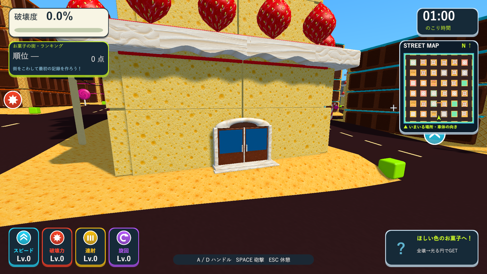
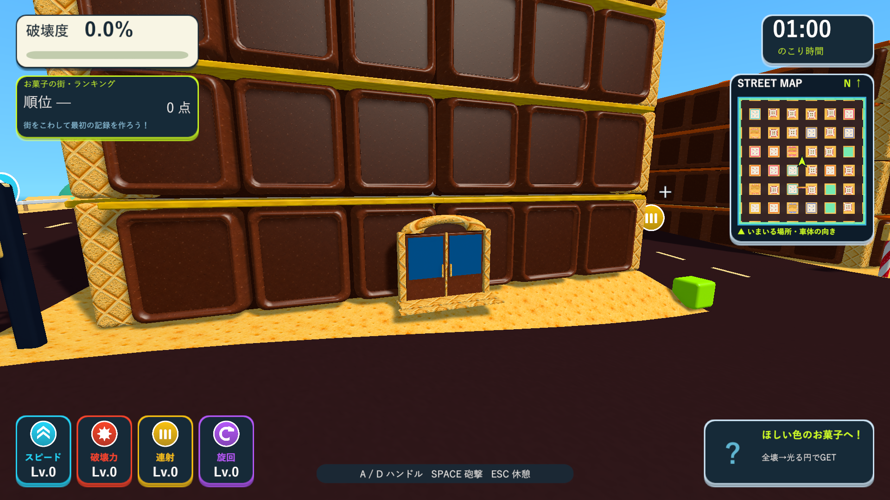

# 全種類の建物への入口追加

2026-10-10。Issue #5。全ステージの家とビルに、道路側の1階の中央へ入口を追加しました。

|ステージ|入口を追加した棟数|建物の種類|
|---|---:|---|
|いつもの街|33|高層ビル・集合住宅・低層店舗|
|大きな街|132|高層ビル・集合住宅・低層店舗|
|お菓子の街|33|ケーキ・板チョコ・ビスケット|

両開きの扉にガラス、中央の枠、2つの取っ手、敷居と段差を付けています。通常の建物はひさし付き、お菓子の家はクリームまたはウエハースのアーチ付きです。既に通り抜ける開口を持つドーナツゲートは、その開口を入口として維持しています。タイトルの軽量な大型街の表示モデルにも、入口を既存の材質別メッシュへ焼き込みました。

入口は閉じた扉の表示モデルで、建物内へ移動する機能は追加していません。追加の当たり判定やRigidbody、部材の加点はありません。既存の外壁へ取り付けるので、外壁が割れるとその破片へ付いて飛びます。近景では建物の材質別メッシュへまとめ、遠景では既存の簡略表示を使います。

## 検証

Unity 6000.3.19f1の分離した検証プロジェクトで、PlayModeの入口・お菓子の建物・テクスチャ・描画最適化のテスト計14/14件が成功しました。結果は`Logs/entrances-tests.xml`、ログは`Logs/entrances-tests.log`です。

入口の検証は3ステージの全198棟を対象に、入口が1つずつあること、地面の高さ・正面中央・道路側にあること、取っ手が2つあること、余計な当たり判定がないことを確認します。各ステージの3種類の建物で外壁を実際に分離し、入口が物理破片へ付き、破壊度が外壁1枚分だけ増え、総部材数が変わらないことも確認します。既存の部分破壊、全壊後の報酬、ドーナツの支持と倒壊、素材と描画の検証も成功しました。

Windows x64 Development Buildは`Logs/entrances-final-build.log`で成功しました。`--tank-town-entrance-smoke`を3ステージで実行し、各3画面、計9画面を1920×1080で描画しました。Unityネイティブゲームなので、Skillのブラウザ確認に相当する実画面の確認はD3D11 Windowsプレイヤーで実施しています。診断では戦車を停止し、カメラを各入口へ向け、爆発物と通行人を無効にします。通常プレイの全行程の確認を代替するものではありません。

各プレイヤーはexit 0、通常の街33棟・大型街132棟・お菓子の街33棟で入口数が一致しました。ログは`Logs/entrances-Town-player.log`、`Logs/entrances-BigCity-player.log`、`Logs/entrances-CandyTown-player.log`です。

検証したビルドを`Builds/TankTown-Entrances`と、既存の`TankTown-CandyDetails`、`TankTown-CandyTextures`、`TankTown-FastShell`、`TankTown`、`TankTown-LocalBlast`へ反映しました。6か所すべてで、実行ファイル・Runtime DLL・resources.assets・テクスチャresS・音声resourceのSHA-256が一致しました。Runtime DLLは`926AE83685131BA745AC79FD7E06A6AE256042A9A5C4DC56481E53EC7F3F9D85`です。メイン・検証・レビュー用プロジェクトのソース・素材・meta計227ファイルも一致しています。

[ビスケットの家](images/tank-town-entrance-CandyTown-2.png)、[通常のビル](images/tank-town-entrance-Town-0.png)、[集合住宅](images/tank-town-entrance-Town-1.png)、[店舗](images/tank-town-entrance-Town-2.png)、[大型街のビル](images/tank-town-entrance-BigCity-0.png)、[大型街の集合住宅](images/tank-town-entrance-BigCity-1.png)、[大型街の店舗](images/tank-town-entrance-BigCity-2.png)。
