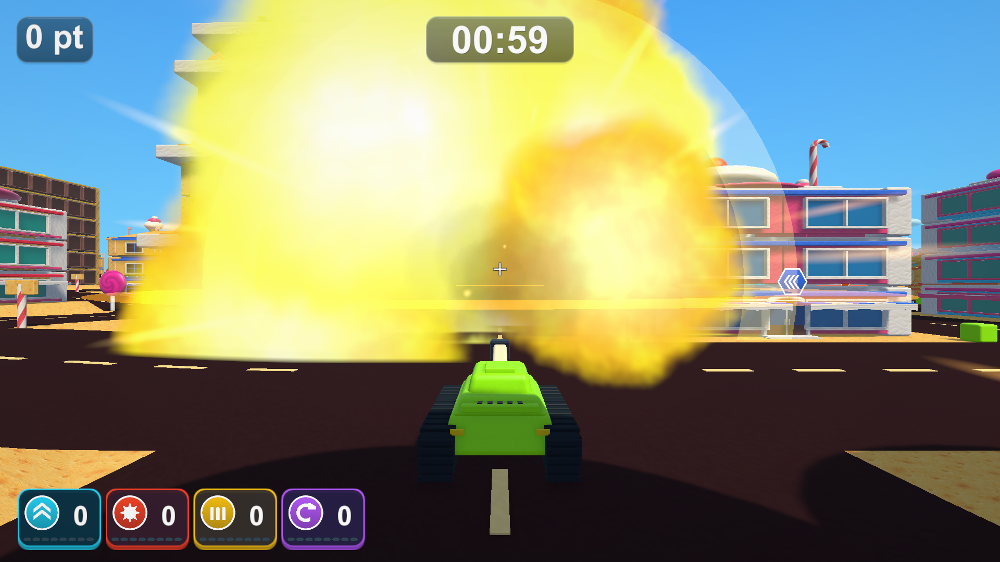
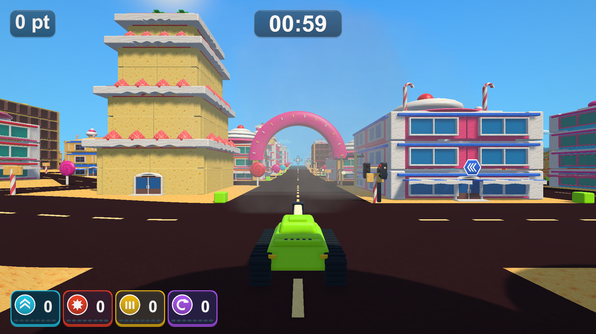

# 大きく長い爆発と光・音の強化

2026-10-19 / [Issue #35](https://github.com/Negi310/mission2026-game/issues/35) / [前段階の記録](https://github.com/Negi310/mission2026-game/blob/7c9f8d4/docs/expanded-explosion-validation.md)

前回の拡大からさらに、通常砲撃・車・燃料の誘爆・巨大爆弾・自爆・破片の再炸裂に共通する爆炎を大きく長くしました。破壊判定・ダメージ・破片の寿命、アイテム終了前の点滅、カメラの安定性は維持しています。

|表現|前回|今回|
|---|---|---|
|爆炎の基準サイズ（初回ParticleSystem版比）|1.8倍|2.8倍、前回から約1.56倍|
|巨大爆発の演出半径の上限|58|86|
|爆炎の粒子寿命|0.48〜1.10秒|0.85〜1.85秒|
|煙の粒子寿命|0.85〜1.75秒|1.45〜2.85秒、0.45秒遅れて発生|
|火花の粒子寿命|0.45〜1.15秒|0.80〜2.10秒、太く長い形状|
|爆発全体の再利用まで|2.4秒|3.8秒|
|通常砲撃の衝撃波|サイズ3.6倍・0.70秒|サイズ5.1倍・1.05秒、別方向の波も追加|
|車の衝撃波|サイズ3.8倍・0.75秒|サイズ5.1倍・1.05秒、別方向の波も追加|
|巨大爆発の衝撃波|サイズ4.3倍・0.95秒|サイズ5.6倍・1.25秒|

炎は広がった形と明るさを長く保ち、0.14秒後の追加噴出で厚みを出します。煙は少し遅れて大きく広がり、炎の後にも残ります。通常砲撃と車にも水平・縦方向の二重の衝撃波を加え、放射状の光、閃光、周囲を照らす光も拡大・延長しました。建物が崩れる時の粉塵と、破片が炸裂した時の火花も強めています。基準サイズは生成時の倍率で、画面上の大きさは経過時間・距離・粒子の動きによって変わります。

爆発は最大16組、補助演出64個、局所光4か所を維持しています。粒子の同時数や物理演算は増やしていません。

## 閃光の追加調整（Issue #37）

[Issue #37](https://github.com/Negi310/mission2026-game/issues/37)で、閃光と放射状の光のRGB強度を前回の45%、表示時間を2.4倍へ変更しました。周囲を照らす光も同じ比率で弱め、消滅までの上限を0.62→1.5秒に延ばしています。通常着弾の閃光は0.28→0.672秒、放射状の光は0.52→1.248秒、周囲への照明は0.56→1.344秒です。弱い光が長く引くようにし、爆炎・煙・衝撃波・音・破壊判定と、全体3.8秒の寿命は維持しています。

## 音

提供済みのMP3を使い、着弾・誘爆・大爆発の基準ピッチをそれぞれ0.92・0.95・0.86に下げました。各音は±3%で変化します。基準音量は着弾0.38→0.58、誘爆0.30→0.42、大爆発0.60→0.82です。距離減衰も調整し、遠くの爆発の存在感を残します。連鎖音の間引きを35ms→26msにしました。

12音の固定枠、発射・大爆発の専用枠、全体の音量合計0.9以下の制御は維持します。新しい音源や無制限の重ね再生は追加しません。

## 増強時の実画面（Issue #35）

通常砲撃の約0.5秒後：

約2.5秒後の煙の余韻：

## 増強時の検証（Issue #35）

Unity 6000.3.19f1の専用コピーでPlayModeの関連15件が成功しました（23.89秒）。通常・巨大爆発が2.45秒後も残り、その後に粒子・補助演出が消えること、40発同時生成の上限・一時停止・消滅・再利用、終了予告・造形、音源の読み込み・割り当て・ミックス・ポーズ・終了を確認しています。C#の変更6ファイルは検証コピーと改行正規化後一致しています。Windows x64 Development Buildも成功しています。

Town・CandyTown・BigCity・AmusementParkの実プレイヤー診断がすべて終了コード0で完了しました。計67枚を撮影し、通常砲撃・車・巨大爆発の広がり、約2.5秒後の余韻、16組の再利用・消滅、壁の実際の破壊と3種類の終了予告を確認しました。

音声の実プレイヤー診断も終了コード0です。発射2回・着弾101回・誘爆1回・大爆発1回、12音の上限、ポーズ・再開・結果での停止を確認しました。AudioListenerの実出力ピークは0.575でした。これは自動診断の出力測定で、手動の聴感評価ではありません。

撮影はシード2026・固定時間刻みです。通常プレイ画面の撮影後、近景・VFXの確認では交通・爆発物・通行人を非表示にして演出を直接呼び出しています。上の写真は通常砲撃の約0.5秒後・約2.5秒後です。壁への実砲撃も別に確認しています。画像加工はしていません。

ローカルの `Builds/TankTown-LoudExplosion/TankTown.exe` が今回のビルドです。通常の起動先 `Builds/TankTown`、`Builds/TankTown-Amusement`、`Builds/TankTown-GameplayUI` にも反映し、RuntimeアセンブリのSHA-256一致を確認しました。GitHub Release v0.1.1は変更していません。

記録は作業フォルダーの `Logs/loud-explosion-tests.xml`、`loud-explosion-build.log`、`loud-explosion-*-player.log`、`loud-explosion-source-check.json`、`loud-explosion-build-hashes.json` です。長時間の手動プレイや継続FPSの測定は含みません。README・音の仕様・検証記録を更新しました。開発手順の変更はなく、AGENTS・スキルの更新は不要です。

## 閃光調整の検証（Issue #37）

既存のPlayMode関連11件が成功しました（19.49秒）。Windows x64 Development Build成功、Town・CandyTownの実プレイヤー診断は両方とも終了コード0です。出始めの閃光と約0.9秒後の余韻を含む36枚を撮影し、前ビルドとの比較で周囲の照明が弱まったことを確認しました。爆発の消滅・再利用、壁の分離、アイテム終了予告も通っています。変更したC# 3ファイルは検証コピーと一致しています。

撮影条件は上記と同じで、固定配置・固定時間刻み、VFX確認時の交通等の非表示と演出の直接呼び出しを使います。画像加工はしていません。最新キャプチャは `Builds/TankTown-SoftFlash/Captures/Polish-{Town,CandyTown}` の `05-flash.png`・`06b-afterglow.png` などです。

最新ビルドは `Builds/TankTown-SoftFlash/TankTown.exe` で、通常の3つの起動先にも反映しました。RuntimeアセンブリのSHA-256一致を確認しています。記録は `Logs/soft-flash-tests.xml`、`soft-flash-build.log`、`soft-flash-{town,candy}-player.log`、`soft-flash-source-check.json`、`soft-flash-build-hashes.json` です。音のコードとGitHub Releaseは変更していません。
