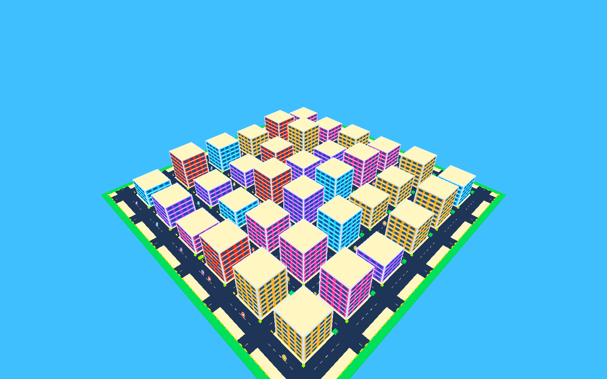
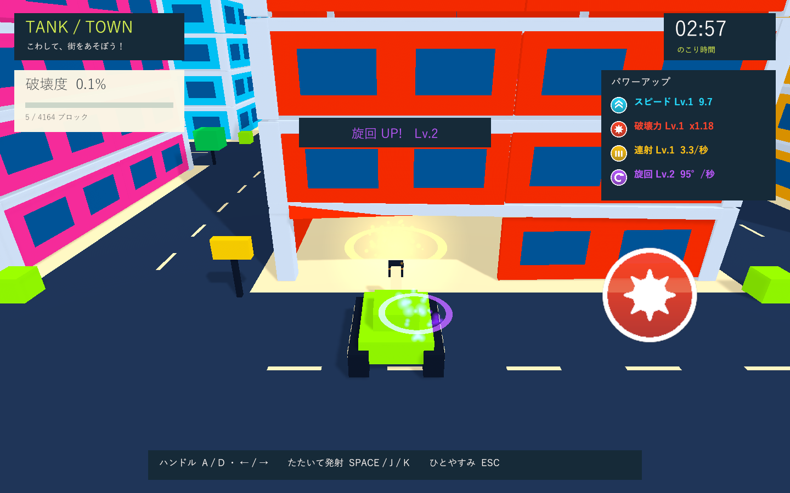
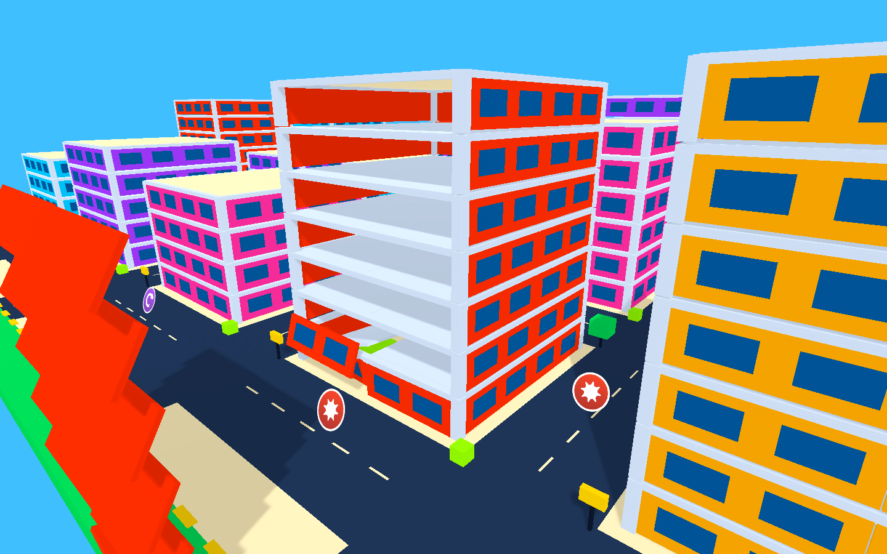

# 街の拡張・構造破壊・強化アイテムの検証

実施日: 2026-10-01。関連: GitHub Issue #3。

## 環境と対象

Windows / Unity 6000.3.19f1 / URP 17.3.0 / Input System 1.19.0 / UGUI 2.0.0 / Test Framework 1.6.0。作業用とは別の検証コピーを使用。必要なパッケージは作業用プロジェクトに存在する同一バージョンのローカルキャッシュを参照し、元のmanifestは変更していません。エディター補助パッケージ全体の検証とは区別します。

画面はNVIDIA GeForce GTX 1660 Ti、Direct3D 11で、実際のWindows Development PlayerのカメラとHUDを1440×900へ描画して確認しました。非表示起動では音声出力が無効です。

## 自動テスト

最終PlayMode: **12件成功・0件失敗、12.73秒**。最終XMLは `Logs/expansion-final-tests.xml`。

|確認|内容|
|---|---|
|前進・旋回|入力反映後のRigidbodyの移動と回転|
|支持喪失・加点|基礎の柱を失うと骨組みが物理崩落し、同じ部材を二重加点しない|
|空洞の室内|建物中心の部屋に隠れた立方体のColliderが存在しない|
|外壁と骨組み|外壁を剥がしても支持のある柱・梁・床は残る|
|圧入力・クールタイム|左右の解除と再入力、短い間隔の入力拒否|
|実射撃・体当たり|移動する砲弾の命中、小物の物理接触による破壊|
|大型建物への衝突|爆発、1回の時間ペナルティ、安全地点への復帰|
|飛来する破片|戦車との衝突が有効。逆方向から20の速度で飛来する破片を押し返し、戦車は前進を継続して爆発しない|
|アイテムのTrigger|4種類それぞれの実接触で取得し、二重取得を防ぐ。速度・衝撃力・射撃間隔・旋回に反映|
|強化した砲撃|元の射撃間隔以内に2発目を受け付ける。元の爆風範囲外にある小物が強化後の爆風で壊れる|
|成長の寿命|上限8レベル、射撃間隔の下限、復帰後の維持、再挑戦での初期化|
|ゲームループ|一時停止、時間切れ後の加点禁止、結果、街とタイマーのリセット|

最初の検証で見つかったMaterialPropertyBlockの生成時期の問題を修正しました。画面検証では移動直後の補間されたTransformにカメラが追従して壁を通る問題があり、即時位置はRigidbodyの姿勢を使い、復帰時のTransformも同期するように修正しています。

## ビルド・描画・崩落

Windows x64 Development Build: **成功**。最終ログは `Logs/expansion-build-final.log`。実行ファイルは `Builds/TankTown/TankTown.exe`。

開始、街の全景、アイテム取得、着弾、骨組み、復帰案内、結果の7画面を確認。UIの日本語・数値・取得色・アイコンを確認し、見切れやピンクのエラーシェーダーはありません。骨組みの診断画面では、外壁を直接分離して吹き飛ばしています。

スモークでは全36棟の基礎を順次分離し、実際のPhysX更新を伴う大規模崩落も実行しました。部材4020/4164、破壊度96.5%、復帰1回、同時に有効な破片の最大280個。各種強化レベルの取得もログに記録しています。上限を超えた破片は即時に無効化してから破棄します。

```text
SMOKE COMPLETE: blocks=4020/4164, crashes=1, state=Results, debrisPeak=280,
speedLevel=1, powerLevel=1, rapidLevel=2, handlingLevel=2
```

ゲームの例外とシェーダーエラーは実行ログにありません。`git diff --check` も成功。C#コンパイルはPlayModeとWindowsビルドで検証しました。専用のformatter/lint設定はないため別のツールは追加していません。ブラウザ製品ではないためWindowsプレイヤーで描画検証しています。

## 制限と次の確認

- 支持は柱・梁・床の接続グラフによる簡易判定。荷重、曲げ、接合部の強度や連続した変形は計算しません。
- 破片同士の衝突は省略し、上限と寿命で消します。戦車・地面・未破壊建物との衝突はあります。
- スモークは時間切れを早送りしています。3分間の実時間プレイ、目標PCでの通常ウィンドウのフレーム時間、子供による操作感、スピーカーでの音量は未検証です。
- 実機ハンドル・圧センサーの通信方式と左右の役割は未定。成長係数・配置数・射撃間隔は後から調整できます。







