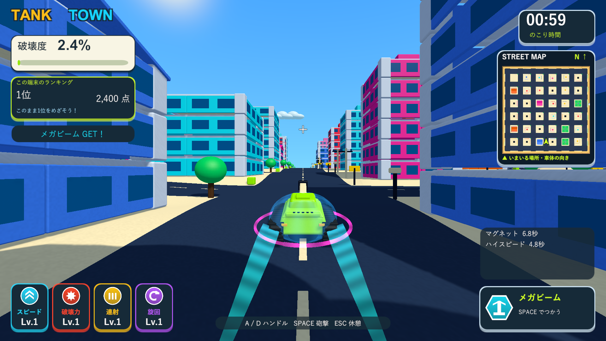
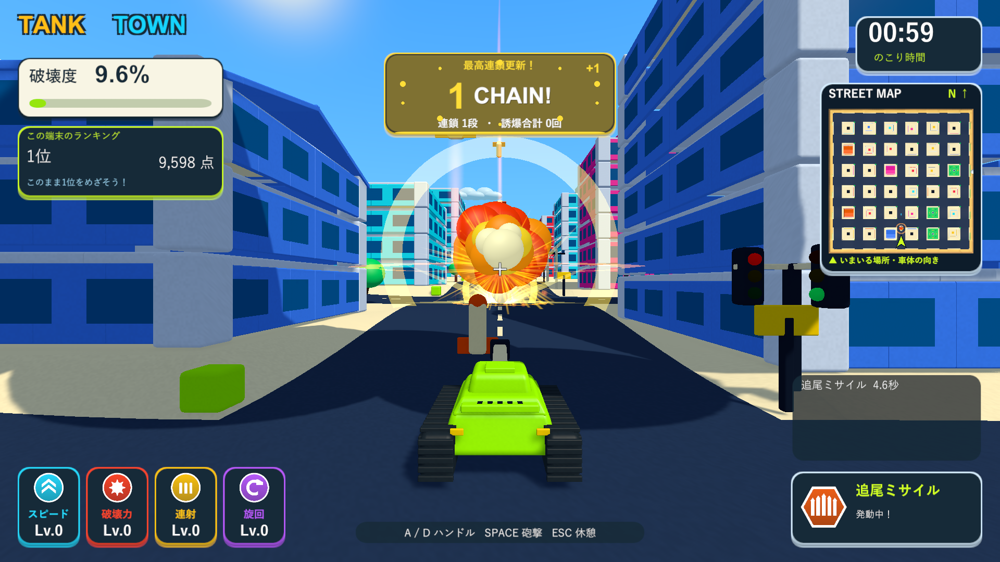
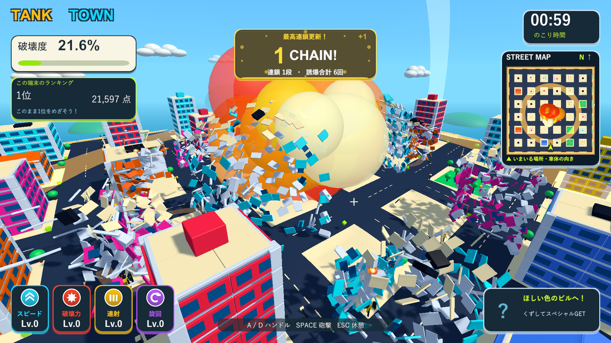

# マグネット・巨大爆弾・ミサイル誘爆の強化

2026-10-05。[Issue #5](https://github.com/Negi310/mission2026-game/issues/5)。

## 変更

| 項目 | 変更前 | 現在 |
| --- | --- | --- |
| マグネットの半径 | 22 | 50 |
| 吸引速度 | 24固定 | 最低120、巡航速度×各効果倍率と実速度の大きい方の3倍 |
| 吸引するもの | 能力強化のみ | 能力強化・解放済みスペシャル |
| 巨大爆弾の投げる速度 | 38、砲身の上下角も反映 | 水平方向90・上向き6 |
| 巨大爆弾の起爆 | 1.5秒の導火時間 | 地面への初接触、詰まった場合だけ6秒で起爆 |
| 巨大爆弾の半径 | 30 | 60 |
| 巨大爆弾の衝撃力 | パワーアップ後の基準×4 | 同じ基準×12 |
| ミサイルが優先する対象 | 前方視界の車 | 前方視界の車・ドラム缶・燃料タンク |
| ミサイルからの誘爆 | 通常と同じ | 衝撃力2.8倍・半径√2.8（約1.67倍） |

マグネットの残り時間は8秒です。範囲は戦車の位置を中心とする3Dの距離で判定し、屋上から落下中の解放済み報酬も引き寄せます。報酬の落下速度を止め、一時的に動的Rigidbodyと固体の衝突を止めて瓦礫を通過させます。吸引が0.08秒以上途切れると重力・衝突へ戻します。建物60%破壊による解放、能力強化の上限、武器保持枠1個の条件は維持します。保持枠が埋まっている武器は回収せず、近くへ吸引された状態で残ります。

巨大爆弾は直径8・質量30の物理オブジェクトです。地面またはまだ立っている建物への接触で即起爆し、飛散後の破片には再起爆しません。爆破と同時に発動中の武器枠を解放して次の保持武器を使えるようにします。投げる速度を砲身の上下角から分離し、軽い弧を描いて遠くまで投げます。フィールド端での戻しと6秒の安全タイマーは残し、場外や地形への詰まりで武器枠を残し続けないようにします。

この記録の初回検証は地面への着弾を対象にしています。現行版では壁・柱・床の最初の物理接触でも同じ半径60・基準衝撃力12倍で爆発します。`--tank-town-extreme-specials-smoke --tank-town-bomb-structure-check` のネイティブ診断で実際の建物の壁への接触を確認します。

ミサイルは従来通り90以内・前方±50度・画面内・視線が遮られない対象から選びます。車と爆発物を同じ優先度にし、距離と既に追尾中のミサイル数で分散させます。通行人はそれらがいない場合の対象です。点火済み・破壊済みの車や爆発済みのものからは選び直します。強化倍率はミサイルの着弾処理中だけ付け、点火した爆発物に記録して0.18秒の導火時間を挟んで伝播します。同じ2.8倍を引き継ぎ、段数ごとに倍率を掛け続けません。通常の砲撃・体当たり・誘爆は元の倍率1のままです。燃料タンクは引き続き表面から3以内での炸裂が必要です。火球・衝撃波も拡大した半径に合わせますが、演出や破片の寿命は増やしません。

## 検証

Unity 6000.3.19f1の分離プロジェクトで追加の吸引・追尾・誘爆テスト4/4（3.69秒）、全PlayModeテスト123/123（156.71秒）が成功しました。高速走行中の強化・武器・自動発動アイテムの回収、範囲外のアイテムが動かないこと、建物の解放条件、満杯の枠でも報酬を消さず吸引後に物理を戻すことを確認しました。ミサイルは視界内の燃料タンクへ実際に追尾・接触し、別の爆発物へ同じ強化倍率を伝えます。通常起点の爆発は強化されないことも確認しています。巨大爆弾は実際の物理衝突で壁を押し壊し、地面の初接触で爆破し、45離れた対象へ爆風が届きました。空中で以前の1.5秒を超えても飛行が続き、停止・再開・6秒の最終爆破も確認しました。

証跡は `Logs/extreme-specials-focused-tests.xml` / `.log`、`Logs/extreme-specials-full-tests.xml` / `.log` です。既存の移動・砲撃・倒壊・車・通行人・カメラ・ランキング・ミニマップ・画面遷移も全体テストで成功しました。

Windows x64 Development Buildが成功しました（`Logs/extreme-specials-build.log`）。Skillの画面確認はネイティブUnityゲームのためブラウザではなくD3D11実プレイヤーで行いました。`--tank-town-extreme-specials-smoke` はexit 0で完了し、1920×1080で吸引・回収・爆発物への追尾・強化誘爆・遠投・地面での大爆発・破壊後の7画面を撮影しました。実測の吸引速度120に対して戦車速度26.2、強化4種類と解放済みメガビームの回収を確認しました。燃料から車へ威力2.8が引き継がれ、巨大爆弾の水平速度90、約0.45秒での移動39.5、地面接触での起爆、破壊915部材を確認しました。大量倒壊時の飛散破片は既存の上限2,000で制御され、プレイヤーはPlaying状態を継続して正常終了しました（`Logs/extreme-specials-player.log`）。

診断では吸引する強化の位置、解放済み報酬の落下位置、燃料と車の位置・経路を設定し、他のアイテムや爆発物・通行人を無効化して各能力を確認しています。巨大爆弾の遠投・爆発画像だけは範囲が分かる診断用カメラで、通常プレイのカメラは変更していません。診断は記録保存を無効にし、プレイヤーのランキングやベストを変更しません。確認範囲は自動テストと実描画の診断で、異なる端末での長時間の性能・難易度測定は行っていません。

作業元・検証プロジェクト・レビュー用worktreeのコード・設定・シェーダー・音源・メタデータ164ファイルがSHA256で一致しました。検証済みビルドを `Builds/TankTown` と `Builds/TankTown-LocalBlast` へ反映し、両方のEXE・TankTown.Runtime.dll・resources.assetsのSHA256一致を確認しました（`Logs/extreme-specials-hashes.json`）。

