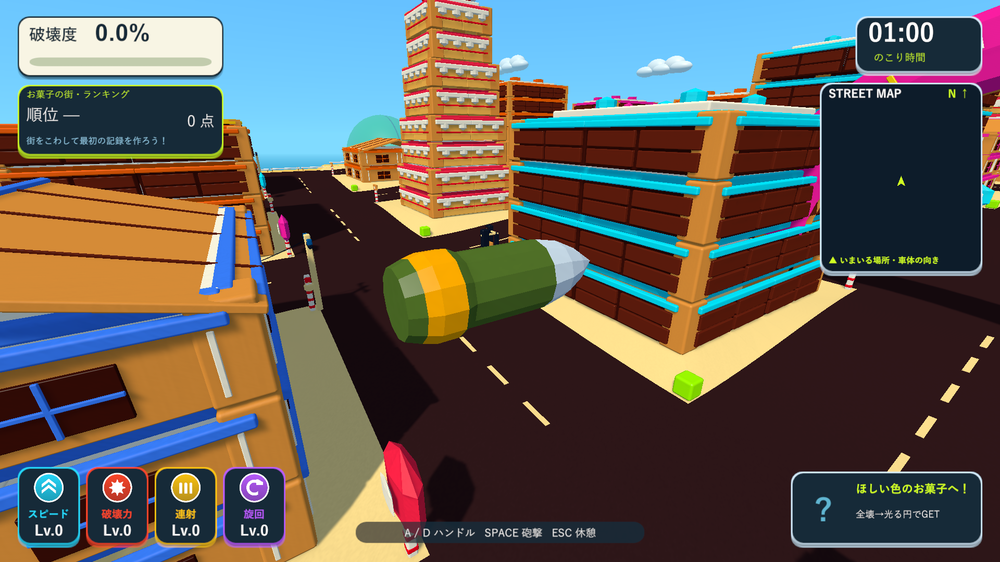
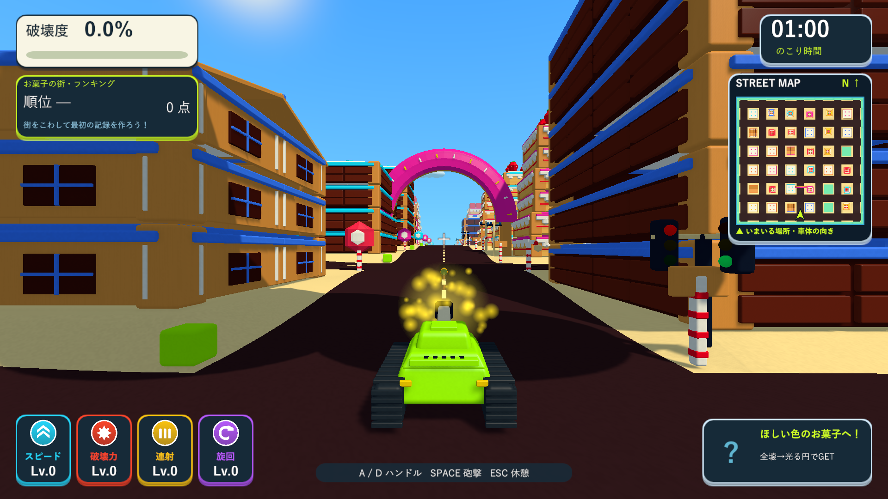
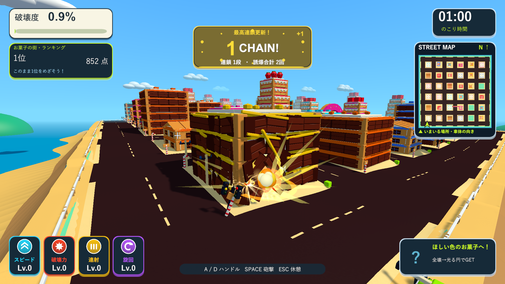

# 砲弾の形状と弾速の調整

2026-10-08。Issue #5。

## 変更

- 丸い球を、銀色の尖った先端・緑の細長い弾体・尾部の金色の帯を持つローポリ砲弾へ変更。長さ1.25、最大直径0.46、12角の断面です。発射時の砲口方向に向いて飛びます。
- 形状は1つの共有メッシュ、材質は金属の3種類を使います。発射のたびにメッシュ・材質・物理コライダーを生成せず、Worldの終了時に共有メッシュを破棄します。
- 弾速を52から120へ変更（約2.3倍）。`TankTownSettings.shellSpeed`で調整できます。30の距離を約0.25秒で進みます。最大飛行時間3秒を維持し、障害物に当たらない場合の到達距離の目安は約156から約360へ伸びます。
- 軌跡の幅を0.65から0.26、表示時間を0.18秒から0.075秒へ短縮。金色から淡いオレンジへ消える線で、弾体の形を隠しにくくしています。
- 1フレームの移動区間全体を半径0.25のSphereCastで調べます。構造物と通行人を別々に調べ、近い命中位置で爆発する処理を継承。爆風・破壊力・射撃間隔は既存値を維持しています。

## 検証

分離したUnity 6000.3.19f1プロジェクトでPlayMode 57/57件成功（`Logs/fast-shell-tests.xml`）。実際の発射での方向・共有形状・ポーズ、設定された高速移動、20fps相当で1フレームの移動先より手前にある厚さ0.08の壁への命中を新規テストで確認しました。既存の車への実砲撃と誘爆、砲塔・砲身の方向、通常の戦車・アイテム・お菓子の街の部分破壊も成功しています。

Windows x64 Development Buildは`Logs/fast-shell-final-build.log`で成功。ネイティブUnityの画面確認はSkillのブラウザ確認に相当するD3D11のWindowsプレイヤー実描画で実施しました。最終`Logs/fast-shell-final-player.log`はexit 0で完了し、実測弾速120.0、約20の飛行距離での着弾0.167秒、チョコの建物の部分破壊を確認しました。

1920×1080の3画面を保存し、先端・弾体・金色の帯、実飛行と細い軌跡、着弾を確認しました。形状の画面は実際と同じ共有モデルを診断用の位置に置いた拡大表示です。飛行と破壊には通常の砲撃を使用し、診断用のカメラ・配置を使います。ランキングは保存しません。

作業開始時は通常版が起動中だったため別の更新版フォルダーも用意しました。配布時には終了していることを確認し、検証済み実行版を`Builds/TankTown-FastShell`、`Builds/TankTown`、`Builds/TankTown-LocalBlast`の3か所へ反映しています。各配布先の実行ファイル・Runtime DLL・resources.assetsのSHA-256と、メイン・検証・レビュー用ブランチのソース、設定、音声、meta計196ファイルの一致を確認しました。

- Runtime DLL：`D653EDDB8091D7E571BE32360208FE2E3E06D6CF2C90496BB155E07EF114A540`
- resources.assets：`02E4ADF65E5742FDE15B3CED6169BB0989914250B28B4EE04C247829B4DC2D4A`

