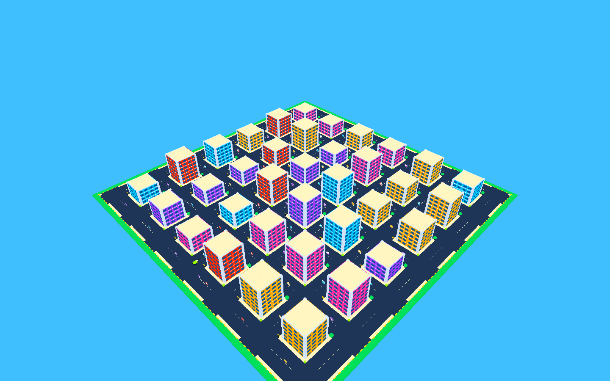
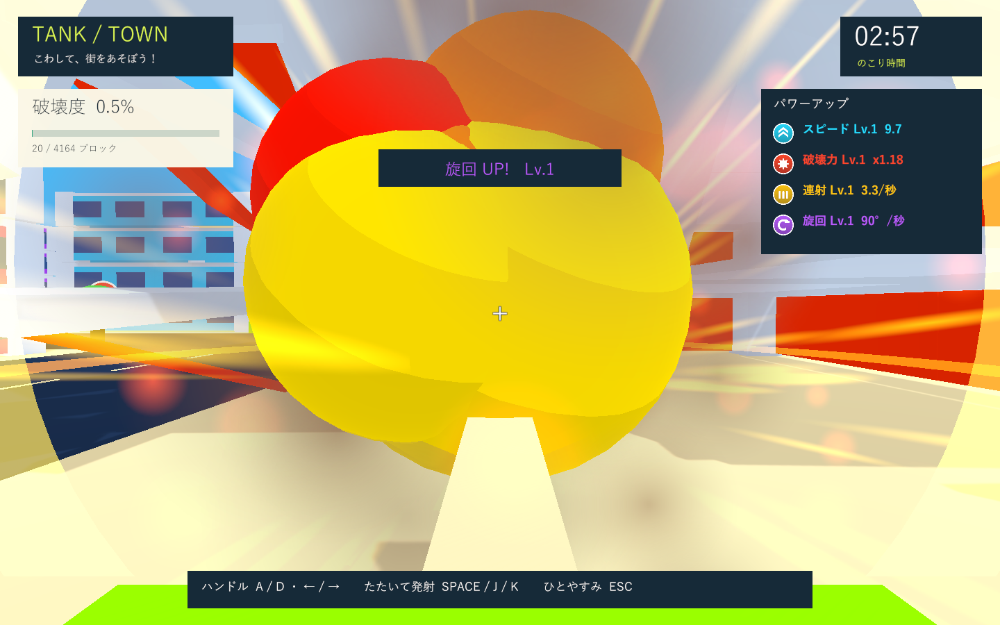
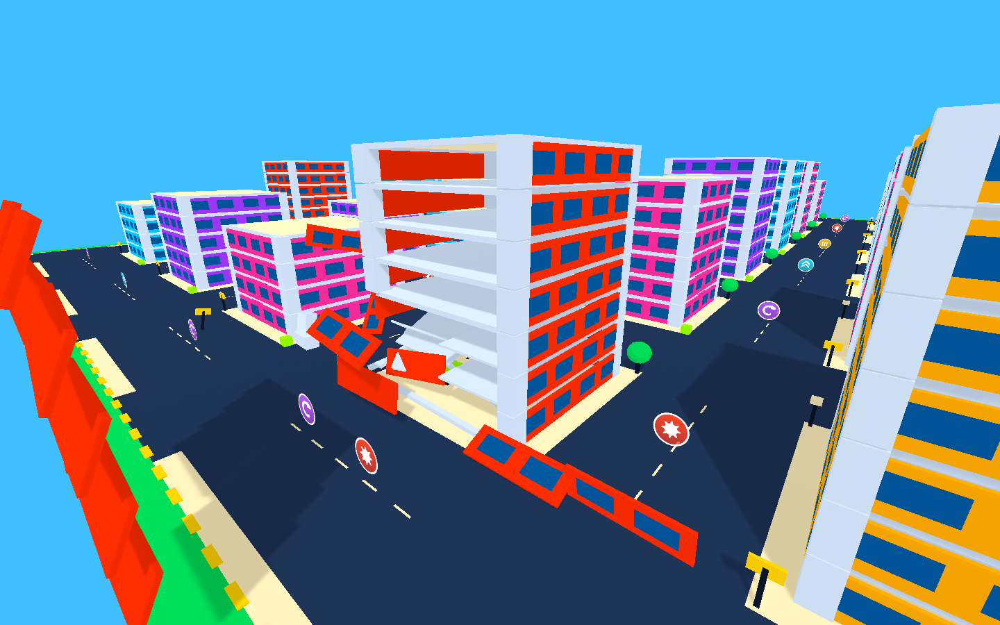

# 操作・支持バランス・大爆発の検証

実施日: 2026-10-01。関連: GitHub Issue #5。街と強化アイテムの拡張（#3 / #4）に続く変更です。

## 環境

Windows / Unity 6000.3.19f1 / URP 17.3.0 / Input System 1.19.0 / UGUI 2.0.0 / Test Framework 1.6.0。作業中のUnityとは独立した検証コピーを使用。必要なパッケージは同じバージョンのローカルキャッシュを参照し、作業用manifestは変更していません。エディター補助パッケージ全体は検証対象に含めていません。

画面は実際のWindows x64 Development PlayerをDirect3D 11 / NVIDIA GeForce GTX 1660 Tiで起動し、ゲームカメラとHUDを1440×900へ描画して確認しています。ブラウザ用の製品ではないため、Windowsプレイヤーで画面を検証しました。

## 変更と確認

|変更|確認した挙動|
|---|---|
|柱幅0.8 → 1.8|外壁に当たった半径6.5の爆風で近くの柱も分離する。室内の空洞は維持|
|爆風半径3.8 → 6.5、基本衝撃力12 → 20|砲弾の実命中と、強化後の爆風範囲・射撃間隔を検証|
|階ごとの支持バランス|柱・梁・床の接続に加え、上に残った部材の重心が柱断面の支持範囲に収まるかを判定|
|一本の柱だけ残る場合|重心を支えられず、残る上部もRigidbodyになって倒壊|
|三本／片側二本／対角二本|三本では安定、片側二本では倒壊。対角二本は中心荷重なら安定し、床や外壁の喪失で重心が支持範囲を外れると倒壊|
|上階の支持不足|基礎が残っていても、支持不足の階より上を倒壊させる|
|道路幅10 → 16|街区間隔32 → 40、全体268×268。建物と道路が重ならないよう寸法を制限|
|FPS寄りのカメラ|戦車から高さ1.6・前方0.25、視野角72度。近距離に移し、砲塔が画面を埋めないよう前へ調整。照準は砲撃方向に追従|
|破片による勝手な旋回|全軸の物理回転を固定し、入力の旋回だけMoveRotationで反映。車体の中心から外れた飛来破片で向きが変わらず、入力旋回は動く|
|木・看板の初接触|幹と葉、支柱と上部を複合Colliderにする。葉だけに接触しても木全体を分離し、戦車から押しのける|
|大爆発|立体火球、伸びる火花、二重衝撃波、閃光、煙、倒壊粉塵。近距離で火球が視界を埋めすぎない大きさと寿命に調整|

倒壊の瞬間には偏った荷重側へ初速と回転を加え、以後はPhysXによって飛散・落下します。接続グラフ、体積による重心、柱断面の凸包を使う簡易モデルであり、実建築の曲げ・荷重限界・接合部の変形は計算しません。

## 自動検証とビルド

PlayMode: **19件成功・0件失敗、18.66秒**。XMLは `Logs/feel-tests.xml`。前進・入力旋回、圧入力とクールタイム、実砲撃、小物への体当たり、大型建物への衝突と復帰、空洞の室内、外壁と骨組み、二重加点防止、アイテム・強化・上限・再挑戦、停止と時間切れに加え、上記の支持バランス・太い柱への爆風・偏った破片・葉への接触・近距離カメラを検証しました。

Windows x64 Development Build: **成功**。ログは `Logs/feel-build.log`、実行ファイルは `Builds/TankTown/TankTown.exe`。

## 実画面と崩落負荷

`--tank-town-smoke` により開始、街の全景、強化取得、砲口、大爆発、骨組み、復帰、結果の8画面を生成します。骨組みの診断画面では外壁を直接分離して室内を確認しています。崩落負荷では各棟の片側二本の基礎柱を分離し、支持バランスによる36棟の倒壊を実際の物理更新とともに連続発生させます。同時に有効な破片は最大280個。上限を超えた破片は無効化してから破棄します。

最終実行ログは `Logs/feel-player.log`。破壊部材4021/4164、破壊度96.6%、復帰1回、36棟の倒壊、破片の最大280個を確認しました。ゲーム例外、C#コンパイルエラー、シェーダーエラーはありません。

    SMOKE COMPLETE: blocks=4021/4164, crashes=1, state=Results, debrisPeak=280,
    speedLevel=1, powerLevel=1, rapidLevel=2, handlingLevel=1, collapsedBuildings=36

開始・取得・砲口・大爆発・骨組み・復帰・結果の表示と、街全体の描画を確認しました。非表示プレイヤーでは画面描画要求時だけHUDをカメラ描画に切り替え、手前の破片でHUDが隠れない距離に置いています。通常プレイのHUDはScreenSpaceOverlayです。全景の撮影時だけ遠方クリップを広げ、36棟が見えるようにしています。

## 未検証の項目

- 実時間3分間の手動プレイ、子供の操作感、通常ウィンドウでのフレーム時間とスピーカーの音量。スモークは時間切れを早送りします。非表示起動では音声出力が無効です。
- ハンドル・圧センサーの実機入力。まずキーボードで試す方針のため、通信方式と左右の役割は引き続き未定です。
