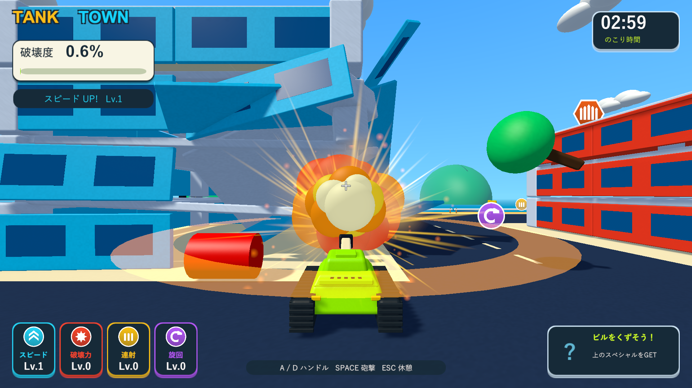
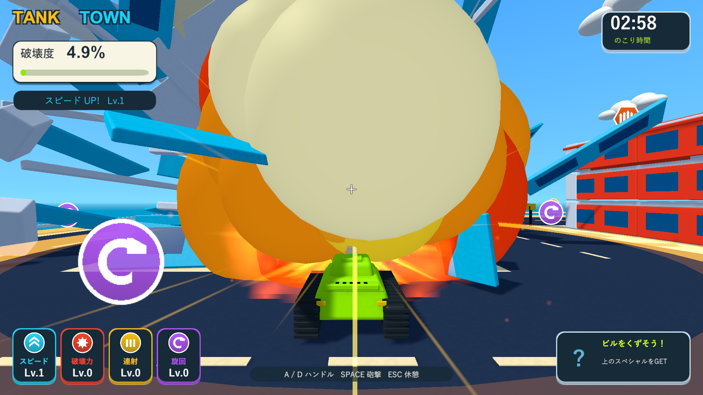
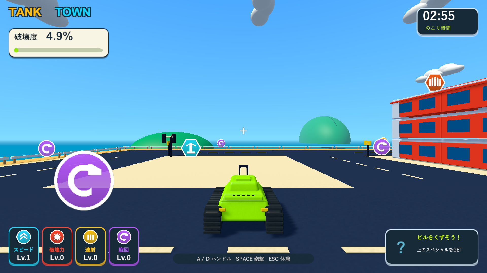

# 燃料タンクを狙う近距離誘爆

2026-10-04。Issue #5。Unity 6000.3.19f1 / URP 17.3.0。

## 調整

燃料タンクを点火する距離を、爆発の中心からタンクのCollider表面まで3とした。通常弾・強化された弾・車やドラム缶の誘爆・燃料の誘爆・ミサイル・ギガント爆弾の爆発に同じ距離判定を使う。爆風が届いても、中心がこの距離を超えていればタンクは壊さず残す。次の近い着弾で狙い直せる。

燃料は体当たり・落下破片・ビームでは点火しない。体当たりやビームで直接壊した場合は通常の破片として消える。車とドラム缶は引き続き接触や爆風で点火する。燃料の質量を4にして、0.18秒の導火線中にタンクが遠くまで飛んでから爆発する状況を抑えた。

|対象|以前|調整後|
|---|---|---|
|燃料の点火|広い破壊範囲のどこかに入るだけで点火|爆発中心とタンク表面の距離が3以内|
|燃料の破壊半径|12|24|
|燃料の衝撃力|27（基礎20×1.35）|60（基礎20×3）|
|通常弾・車・ドラム缶の演出|通常も大きな爆炎|爆炎を縮小し、燃料の大爆発と差を付ける|
|燃料の演出|通常の着弾と共通|ギガント爆弾と共通の強い火花・煙・衝撃波。燃料用の大きさで描画|

点火距離は強化アイテムの爆風拡大とは独立している。連鎖の世代と破壊度の計算を維持し、点火後の燃料・車・ドラム缶は通常の破片上限に巻き込まず、導火線を完了する。爆炎0.6秒・煙最大0.9秒・破片2.4秒の短い余韻を維持する。

## 検証

隔離コピーでPlayModeとWindows Development Buildを検証した。ネイティブUnityゲームのため、画面はWindowsプレイヤーで確認した。

新しいケースは、最大強化時でも遠い炸裂が燃料を点火しないこと、境界の内側で点火すること、実砲弾が燃料のColliderに当たって誘爆すること、18離れた構造物を破壊して吹き飛ばすこと、落下破片と体当たりでは燃料を点火しないことを確認する。

Windowsの燃料診断は、配置を固定した戦車で支柱と燃料タンクを順に実砲撃した。対象以外の爆発物を無効化し、通常カメラとHUDで5画面を保存した。短い爆炎を安定して撮るため、診断の時間を60fpsの描画ステップへ固定した。撮影サイズもウィンドウと同じ1920×1080にしてHUDの欠けを避けた。全体の車の連鎖・物理落下報酬は既存の街の診断で確認した。3分間の手動プレイ・性能測定は含まない。

|検証|結果|記録|
|---|---|---|
|PlayMode全体|70/70成功、81.13秒|`Logs/fuel-tests.xml`|
|最終Windows Development Build|終了コード0|`Logs/fuel-final-build.log`|
|近距離・遠距離の実砲撃|遠い着弾で点火なし。通常砲撃20パーツ、続く燃料爆発で150パーツ追加破壊。終了コード0|`Logs/fuel-final-player.log`|
|街の連鎖・落下アイテム|車2台が誘爆、最高3段連鎖、物理回収成功、ビーム2.000秒。終了コード0|`Logs/fuel-city-player.log`|

プレイヤーログにゲーム例外・シェーダーエラーはない。検証したWindows版をワークスペースの `Builds/TankTown` へ配置し、実行ファイルとRuntime DLLの一致をSHA-256で確認した。

## 実画面

