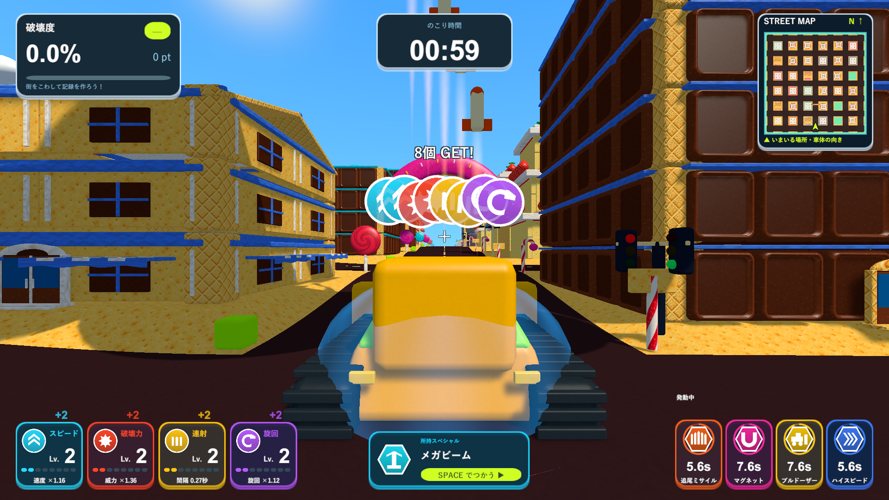
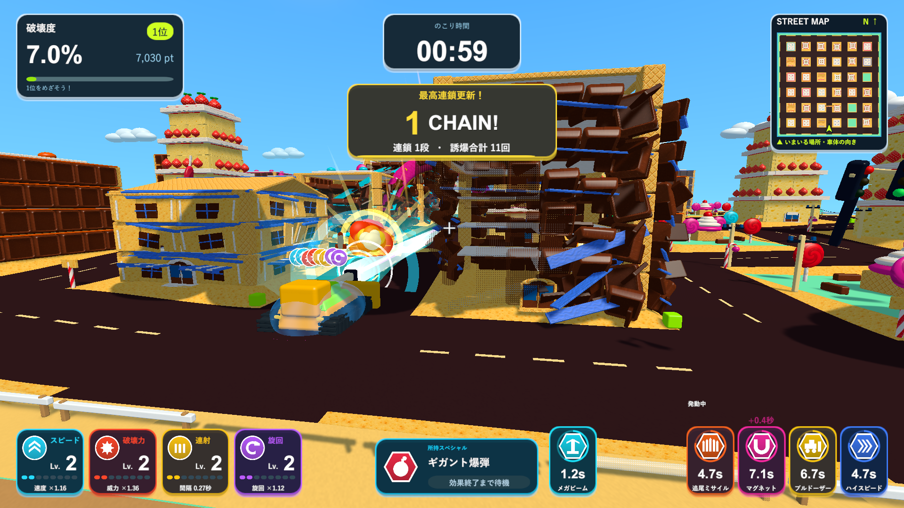

# プレイ画面UIの実装と検証

現在のUIは、2026-10-13の[小さめで質感のある表示](refined-hud-validation.md)を反映しています。以下は2026-10-10時点の実装記録です。通常プレイのミニマップ・破壊率・暫定順位・説明文は外し、ポイント、時間、アイコンと数値を中心にしています。

2026-10-10。比較したUI案をUnityの実際のHUDへ反映しました。追加の指定に合わせ、Spaceで使う武器と自動発動の効果を分けています。

## 表示

|場所|内容|
|---|---|
|左上|破壊度・得点・現在順位を1枚にまとめ、次の順位までの点数を小さく表示|
|上中央|残り時間。チェインとエリア端の案内はその下|
|右上|北が上の実際の街のミニマップ|
|左下|4種類の強化。大きなレベル数字、レベルゲージ、能力の実値、種類別の取得数|
|戦車の真下|レーザー・巨大爆弾の所持枠。使える間だけSpaceの表示を明るくする|
|所持枠の右横|使用中のレーザーの円ゲージと秒数、または巨大爆弾の「飛行中」|
|右下|ミサイル・マグネット・ブルドーザー・ハイスピードの横長カード。最大4枚を横へ展開|

常設の画面下の操作案内は削除しました。空の所持枠には「ビルを全壊でゲット」「光る円に入ろう」を表示します。フィールドの丸い強化アイコン・六角形のスペシャルアイコンと同じ画像をHUDに使います。

強化は取得時に実際の能力へ即座に反映され、レベルの表示は0.16秒ずつ全段階を通って追いつきます。同時取得でも各種類が独立して動き、「+2」などを表示します。戦車上の既存のアイコンは同じ一列に重なり、まとめて拾った場合は「8個 GET!」のような取得数をその上へ添えます。取得の通知でチェインは増えません。

自動発動の各カードは幅78、カード間8（Canvas基準）で、右下から左へ広がります。比較案の細いカードより横幅を広げ、アイテム名を1行で表示します。円ゲージが残り時間に応じて減り、最後の4分の1だけアイコンを控えめに脈動させます。再取得は残り時間を初期値へ戻す既存ルールのままで、表示する「+秒」は実際に増えた時間です。効果終了時にカードが消えます。

所持枠は発動中の効果へ切り替えません。レーザー使用中に爆弾を拾っても、爆弾の名前と「効果終了まで待機」を保ち、レーザーの終了後にSpaceの表示を戻します。爆弾は接触で爆発するため、効果の固定秒数を表示しません。

カウントと取得時のポップは停止中に進みません。カメラの移動・視野角・振動を追加していません。

## 確認方法

Unity 6000.3.19f1。普段のプロジェクトを閉じたり書き換えたりせず、別コピーでPlayModeテストとWindows x64 Development Buildを実行します。

`--tank-town-hud-smoke`はシード2026のお菓子の街で、空のHUD、数字の変化途中、8個取得、所持と4効果の同時表示、1280×720、1440×900、時間の更新、使用中のレーザーと待機する爆弾、レーザー終了、爆弾の飛行状態、停止、全効果の終了を撮影します。`--hud-town`・`--hud-big`を追加すると通常の街・大きい街を同じ手順で確認できます。

取得は診断用に配置した通常の強化アイテムの取得処理を使います。スペシャルは診断用にReceiveを呼びます。爆発物と通行人は無効にし、戦車を停止させて通常カメラとレーザー専用カメラを描画します。記録は保存しません。手動プレイ全体の代わりではありません。

## 検証結果

取得フィードバック・アイテム・画面表示のPlayModeテストは24/24成功しました（`Logs/gameplay-ui-tests.xml`）。中央タイマーと連鎖の配置、数字・所持・効果の最終調整後は11/11成功しました（`Logs/gameplay-ui-layout-tests.xml`）。重複する8テストを除き、27種類を確認しています。実際のアイテムルールを変えていないこと、一時停止で数字が止まること、まとめて取っても全段階へ追いつくこと、再取得の正しい秒数、爆弾の飛行表示、終了での消去を確認しました。

Windows x64 Development Buildが成功しました（`Logs/gameplay-ui-build.log`）。D3D11のWindowsプレイヤーで3ステージそれぞれ13画面、合計39画面を撮影し、全ての診断が完了しました。ログは`Logs/gameplay-ui-candy-player.log`・`Logs/gameplay-ui-town-player.log`・`Logs/gameplay-ui-big-player.log`です。各撮影時に表示範囲、スペシャルの枠同士の非重複、自動効果の文字の収まりを確認します。

[実装したUIの画像一覧](ui-proposal/native-review.html)で、通常画面・取得・時間更新・レーザー・飛行中・停止・終了・各ステージを拡大して比較できます。14枚の画像の読み込み、ステージ選択、拡大、1920・1280・720px幅での一覧ページの表示をChromeで確認しました（`Logs/gameplay-ui-browser.log`、確認スクリプト`docs/ui-proposal/verify-native-review.cjs`）。これは実画面を確認するページのブラウザ検証で、Unityの機能は上のPlayMode・プレイヤー診断で確認しています。

更新版は`Builds/TankTown-GameplayUI/TankTown.exe`です。ソース237ファイルは作業プロジェクト・検証用コピー・レビュー用ブランチで一致しました。更新版と既存の7つの起動用フォルダについて、実行ファイル・Runtime DLL・リソース3ファイルの計40件が検証したビルドと一致しました。結果は`Logs/gameplay-ui-source-hashes.txt`・`Logs/gameplay-ui-delivery-hashes.txt`へ記録しています。
