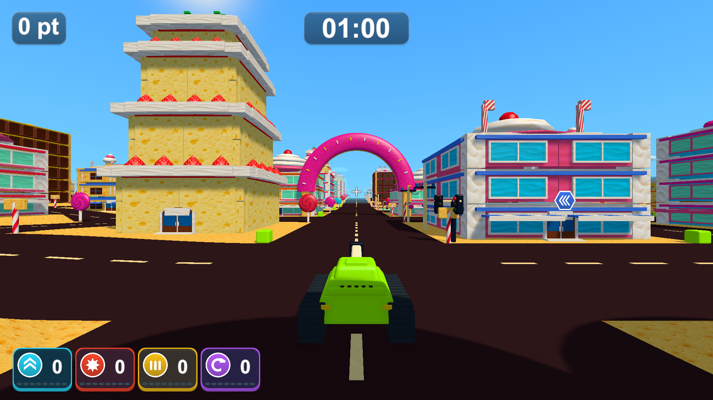

# ptと時間の上下余白

2026-10-13。文字の中央揃えがフォントの行全体の高さを使い、実際の文字が下寄りに見えていたため、描画される文字の範囲に合わせて縦位置を補正しました。時間は「00:00」、ptは小文字の下端を含む「0 pt」を基準にし、数値が変わっても同じ位置を保ちます。画面の倍率が変わる場合はその倍率で補正します。枠のデザイン・文字サイズ・横の余白は変えていません。

- Unity 6000.3.19f1のWindows x64 Development Build成功（`Logs/header-text-centering-build.log`）。実プレイヤーは16画面を撮影して終了コード0（`Logs/header-text-centering-player.log`）。
- 保存した画像の白い文字の範囲を調べ、通常・所持と4効果・数値が増えた場面と、1920×1080・1280×720・1440×900・1280×1024で上下の余白を測りました。12件の差は0.21〜2.00pxで、文字のアンチエイリアスとピクセルの丸めの範囲です（`Logs/header-text-centering-pixel-check.json`）。
- 表示範囲と強化表示、再挑戦時のリソース解放を確認する既存PlayModeテスト2/2成功（`Logs/header-text-centering-tests.xml`）。測定用のTextGeneratorはHUDの破棄時に解放します。
- Chromeで比較画像15枚、最新の調整前後と場面の切り替え、各画面幅、原寸リンクとエラーがないことを確認（`Logs/header-text-centering-browser.log`）。[実画面の比較](minimal-hud-review.html)の「最新」で確認できます。

ローカルの更新版は`Builds/TankTown-TextCentered/TankTown.exe`です。共通の起動用ビルドは、起動中でなければ同じ内容へ更新します。既存のGitHub v0.1.0配布物は変更していません。

