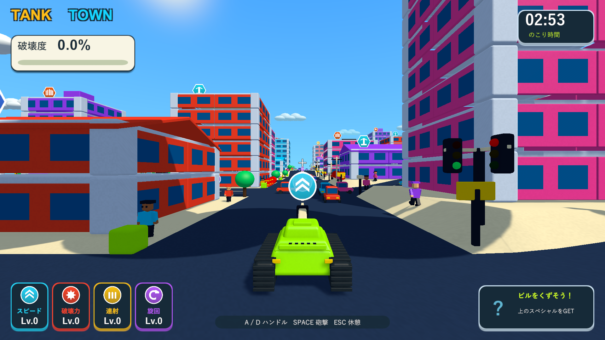
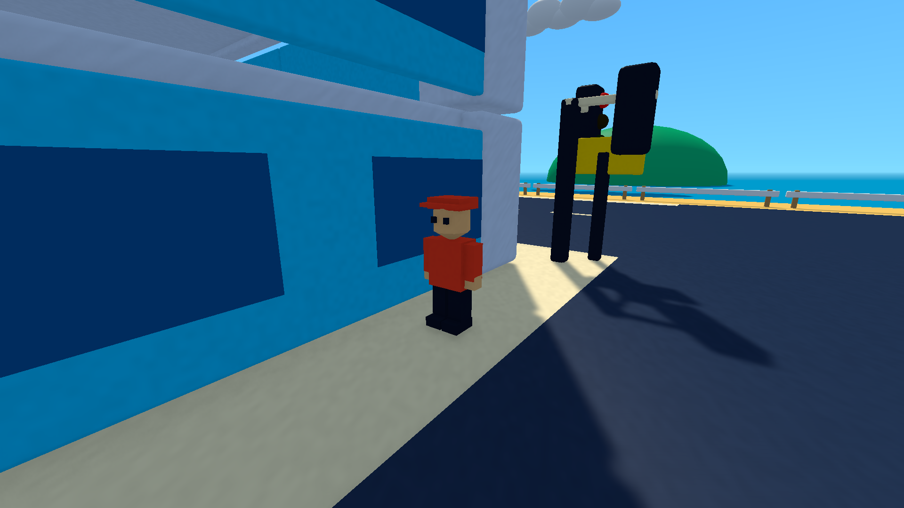
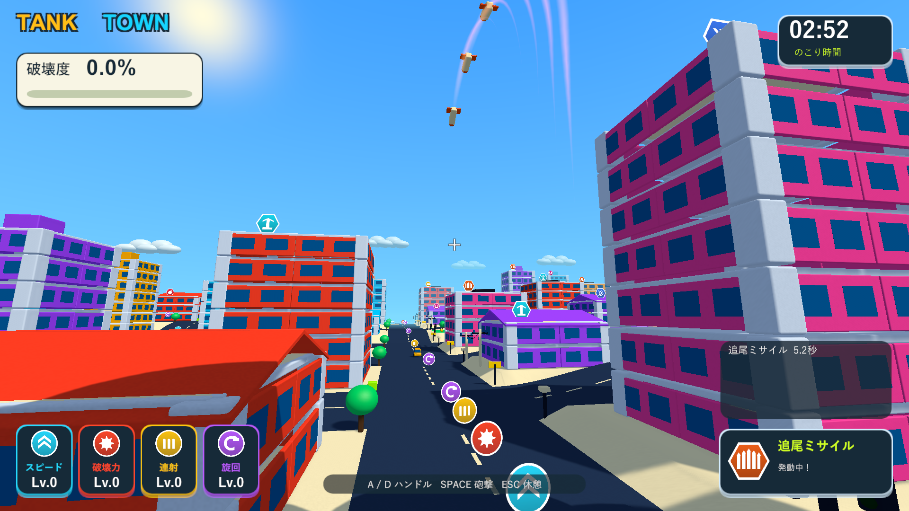
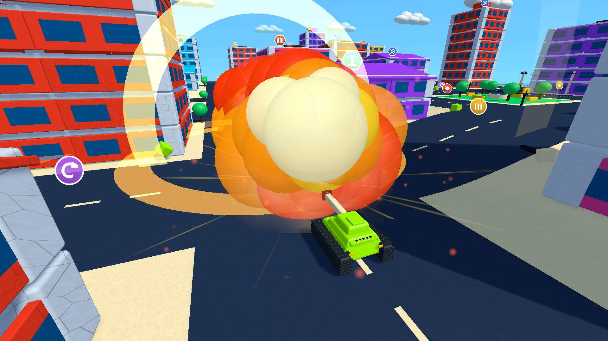
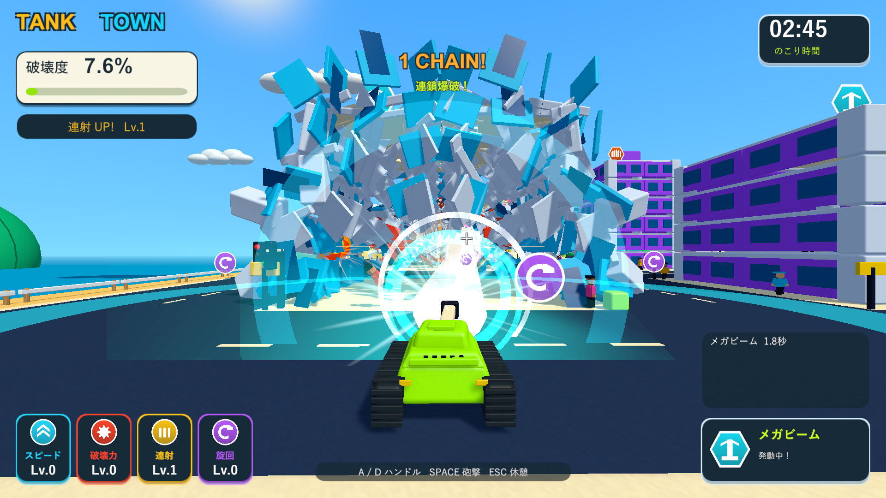

# 追尾ミサイル・通行人・交通量・拡大レーザー

2026-10-05。関連: [Issue #5](https://github.com/Negi310/mission2026-game/issues/5)。Unity 6000.3.19f1 / URP 17.3.0。

ミサイルを固定位置への繰り返し爆撃から、移動オブジェクトへの追尾へ変更しました。5発が上昇してから現在の対象位置へ曲がり、命中後は6秒の効果時間内で再発射します。戦車から90以内の走行車を優先し、複数の対象へ分散します。破壊・無効化された対象からは別の対象へ切り替えます。車がいない場合は歩行中の通行人、対象がなければ前方の地面へ向かいます。途中の建物や地面に当たれば、その接触位置で炸裂します。

走行車は18台から72台へ増加。顔・服・手足を持つ通行人216人を、街全体の歩道へ配置しました。通行人は腕と脚を振って歩き、爆風や車体の接触でコミカルに転がった後、歩道へ戻ります。戦車への押し返しや破壊度への加点はありません。車と服・肌のマテリアルを共有し、遠い通行人の手足アニメーションは省略します。

車の爆発半径を9.5から14、衝撃力の倍率を1.35から2.1へ上げました。二重の大きな火球、火花・光の筋・煙、水平と垂直の衝撃波を加えています。燃料タンクの近距離点火条件、通常砲撃の局所破壊、ユーザー提供音源の割り当ては維持しています。

レーザーは2秒のまま、長さ70から105、半径5から9へ拡大しました。白い芯と縁がなじむ水色の光、2本のらせん、砲口のエネルギーリング、実際に部材へ当たった位置の火花と衝撃波を表示します。照射中の砲塔旋回速度は通常の18%（37.8度/秒）で、ハンドルの切り返しも重く動きます。前進停止と、水平を保つ滑らかなカメラ追従は継続しています。

| 検証 | 結果 | 記録 |
| --- | --- | --- |
| 新しいPlayModeテスト | 4/4成功。歩行・停止・退避・無加点、車の移動への追尾・再選択・物理命中、旧範囲外への車の爆風、レーザーの遠方・横方向の破壊と遅い旋回 | Logs/homing-crowds-focused.xml |
| 全PlayModeテスト | 94/94成功、152.32秒。既存の破壊・支持・燃料・操作・カメラ・アイテム・UI・音を含む | Logs/homing-crowds-tests.xml |
| Windows Development Build | 成功 | Logs/homing-crowds-build.log |
| Windows実画面・動作 | 8画面。移動位置への追尾と再選択・追尾命中1回、実砲撃から車2台の誘爆、レーザー189部材へのヒット、結果で武器消去 | Logs/homing-crowds-player.log |

同じ0.15秒の操舵で、通常の砲塔は22.00度、レーザー中は4.94度へ回転しました。レーザー中の車体速度は0.1未満で、前進停止も確認しています。

| 1920×1080の描画付き短時間計測 | 平均 | 最大フレーム時間 | 描画フレーム数 |
| --- | --- | --- | --- |
| 車18台・通行人なし | 124.9fps | 10.9ms | 375 |
| 車72台・通行人216人 | 78.3fps | 16.8ms | 236 |
| レーザー照射・建物倒壊中 | 49.6fps | 25.6ms | 50 |

Windows / Direct3D 11 / NVIDIA GeForce GTX 1660 Tiで計測。隠れたウィンドウの描画省略を避けるため、通常のカメラとHUDをRenderTextureへ毎フレーム描画し、1ピクセルの読戻しでGPU完了を待っています。画像の保存・PNG圧縮は計測に含めません。最初の2条件は0.8秒の準備後に3秒、レーザーは0.1秒の準備後に1秒を測定しました。レーザーの計測時は追尾・車の誘爆の診断用に他の車を無効にしているため、車72台と全演出を重ねた最大負荷の値ではありません。GPU同期を含むこのPCでの短い比較で、3分間の手動走行や全場面で60fpsを保証する計測ではありません。

Windowsプレイヤーの実描画を使い、通行人の近接表示、街の交通量、追尾ミサイル、車の大爆発、通常カメラからのレーザーを確認しました。ネイティブUnityゲームのため、画面検証はブラウザーではなくWindowsプレイヤーを対象にしています。

プレイヤーログにゲーム例外・シェーダーエラーはありません。全PlayModeテストの後、レーザーの光の縁をなじませるシェーダーと描画設定のみ仕上げ、最終ビルドの実描画で再確認しています。

確認済みビルドを`Builds/TankTown`と`Builds/TankTown-LocalBlast`へ反映しました。EXE・Runtime DLL・resources.assetsが検証ビルドとSHA256で一致しています。133ソース/アセットファイルも作業・検証・レビューの3コピーで一致しています。

通行人と爆発の近接画面、ミサイルの軌道は診断用カメラです。追尾の確認では実際の車モデルの経路を設定し、最初の対象を無効にして再選択を確認しました。車の誘爆では戦車を近くへ配置し、通常砲撃入力で発射します。他の爆発物を一時的に無効化して、対象による効果を切り分けています。レーザーは建物の前へ移動して通常カメラで撮影しました。アイテムの取得・保持・上階からの落下は既存のPlayModeテストで確認しています。

