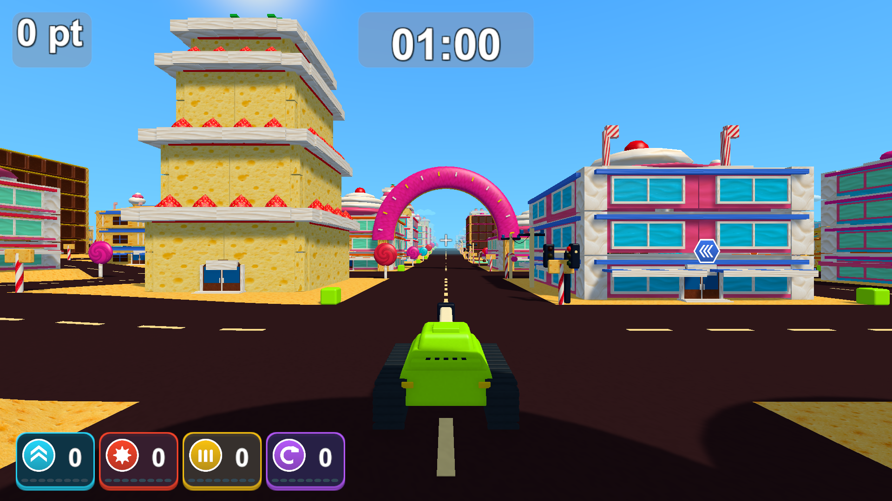
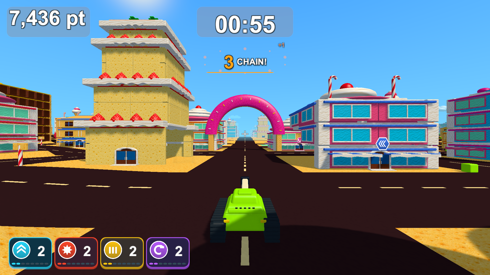

# pt・時間の淡い背景と枠なしのチェイン

2026-10-13。ptと時間に、透明度を高くした濃色の角丸背景と細い縁を付けました。ptの背景幅は数字の長さに合わせて変わります。数字のサイズは維持し、文字の縁取りを少し細くしています。見出しや文章は追加していません。

チェインは背景カード・太い枠・長方形のフラッシュを外し、数字とCHAIN!の縁取りと影で読みやすさを保ちます。カウントアップ・色の変化・火花・短いゲージ・終了時のフェードは維持しています。[実画面の調整前後](minimal-hud-review.html)は「最新：通常」「最新：チェイン」で比較できます。

- 表示の範囲と強化・チェインのカウント、一時停止と終了、ポイントと結果保存に関する既存PlayModeテスト3/3成功（`Logs/hud-soft-frames-tests.xml`）。
- Unity 6000.3.19f1のWindows x64 Development Build成功（`Logs/hud-soft-frames-build.log`）。お菓子の街・遊園地の実プレイヤーはそれぞれ16画面を撮影し、終了コード0（`Logs/hud-soft-frames-candy-player.log`、`Logs/hud-soft-frames-amusement-player.log`）。1920×1080、1280×720、1440×900、1280×1024で、文字やUIの範囲、非重複、取得・待機・飛行・効果終了・チェインを確認しました。
- Chromeで比較ページの画像9枚、最新の枠の調整前後、場面選択、1920/1280/720/390px幅、原寸リンクとエラーがないことを確認（`Logs/hud-soft-frames-browser.log`）。Unityの画像を閲覧するページのブラウザ検証です。

ローカルの更新版は`Builds/TankTown-HudSoftFrames/TankTown.exe`です。起動中のフォルダを上書きせず、新しいフォルダを用意しています。共通の起動用フォルダは、起動中でなければ同じビルドへ更新します。GitHubの既存v0.1.0配布物は変更していません。

