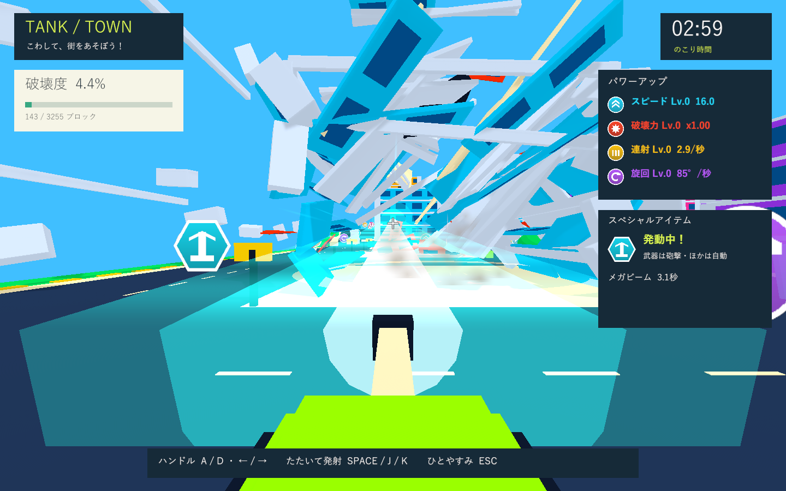
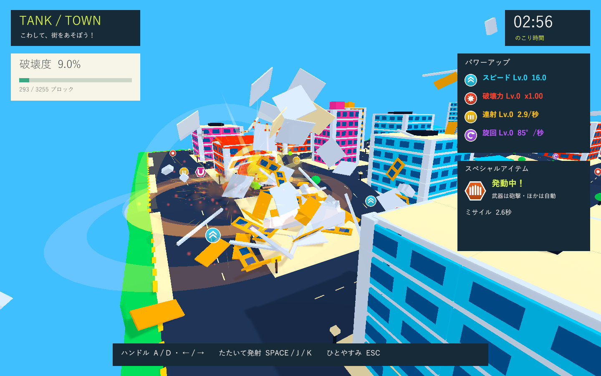
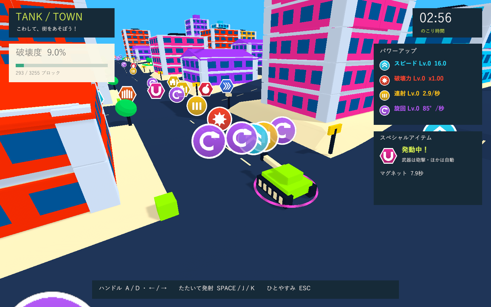
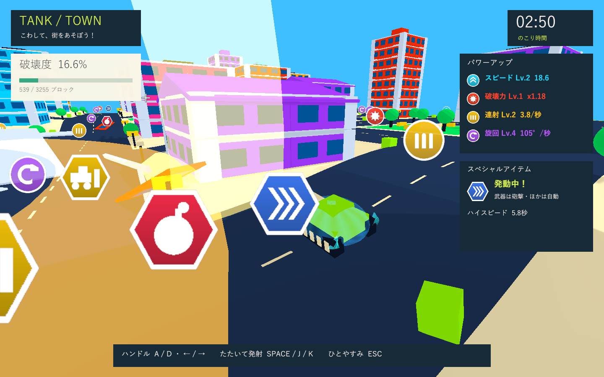

# スペシャルアイテム・戦車操舵の検証

実施日: 2026-10-02。Issue #5 の続き。ユーザー指定の6種類を実装し、発動方法は「武器は拾って砲撃、補助効果は取得時に自動」としました。

## 変更

- メガビーム、5発の継続ミサイル、マグネット、巨大ブルドーザー、物理ギガント爆弾、無敵ハイスピード。武器1枠と、併用できる自動効果3種を分けて管理。
- 24個の六角形2Dビルボードと、保持武器・効果名・残り秒数のHUD。強化アイテムは従来の76個を維持。
- 砲塔が先に向き、0.2秒後から車体が曲がる操舵。砲弾・照準・カメラは砲塔へ追従。基本速度16・加速度10、砲身の上向き4度、接地・慣性・破片の押し返しを維持。
- アイテムの攻撃も部材の分離、支持喪失と重心による倒壊、Rigidbodyの飛散、破片上限280と重複加点防止を共有。巨大化で当たり判定と接地幅・カメラを更新。

## PlayMode

**39件成功、0件失敗、74.62秒**。XMLは `Logs/items-final-tests.xml`、ログは `Logs/items-final-tests.log`。

新規10件では、実際のアイテム接触とパッド入力、保持枠と自動効果の分離、砲塔が先に曲がる時間差と実弾方向、ビームの破壊・停止・再発進、5発の上昇と繰り返し爆撃、磁石の近距離回収、ブルドーザーの大型当たり判定と衝突破壊、爆弾の実際の接触破壊と遅延大爆発、高速・無敵・境界復帰を確認しました。効果の併用・自然終了・停止・結果画面での後始末も確認しています。

既存29件も成功。道路・急な道路脇・頂上・下り・強化8レベルでの地形追従、加速と操舵の慣性、空洞の建物、支持と重心のバランス、柱幅と爆風、体当たり、木・小物・破片との衝突、強化、左右圧入力、復帰と時間ペナルティ、ラウンド初期化を含みます。砲身テストは新しい砲塔階層に合わせて参照先を更新し、仰角と実弾の検証は維持しました。

最初の38件はすべて成功。描画診断の追加時にポーズ復帰メソッドのアクセス修飾によるコンパイルエラーがあり、同一アセンブリ内で使えるよう修正。その後、自然終了のテストを追加した39件の実行でコンパイル・テストとも成功しています。

## Windows描画

Windows x64 Development Build: **成功**。最終ログは `Logs/items-release-build.log`。

Direct3D 11 / NVIDIA GeForce GTX 1660 Tiで、アイテムの14画面と通常プレイの9画面を1440×900で描画しました。専用エネルギーシェーダーのビーム・磁場・青いシールド、5体の上昇、着弾と飛散、黄色い巨大車体、爆弾の接触・大爆発、残り時間と結果のHUDを確認しました。ゲーム例外・シェーダーエラー・C#コンパイルエラーは最終ビルド・実行ログにありません。

    ITEMS SMOKE COMPLETE: blocks=581/3255, crashes=0,
    turretLead=12.60, earlyHull=0.00, hullFollow=17.85,
    beamTravel=0.000, beamHits=68, missiles=5, missileStrikes=10,
    magnetCollected=9, dozerScale=2.30, dozerCrashes=0,
    bombContacts=5, bombBlastBlocks=109, dashSpeed=35.20, dashCrashes=0,
    state=Results

砲塔が12.6度回った時点で車体は0度、遅れて車体が17.85度へ旋回。ビーム中は水平移動0。爆弾は爆発前に5回構造物へ接触し、爆発では追加109部材を分離。巨大化・高速中の衝突爆発は0回でした。物理的な飛散と最終破壊数は実行ごとに変動します。ログは `Logs/items-release-player.log`。

通常プレイの回帰描画も成功。通常砲撃・復帰・登坂、33棟の連続倒壊、破片上限280、最終破壊度94.8%を確認しました。登坂後は高さ4.50・実速度17.28、砲身の仰角4度。ログは `Logs/items-regression-player.log`。

    SMOKE COMPLETE: blocks=3085/3255, crashes=1, state=Results,
    debrisPeak=280, collapsedBuildings=33, parks=3,
    hillHeight=4.50, hillSpeed=17.28, cannonElevation=4.00

診断はアイテムを直接付与して建物前へ移動し、通常の砲撃入力と物理演算を使います。アイコンの表示用配置と磁石の回収対象も調整し、無関係なスペシャルの接触判定を停止します。ミサイル・爆弾は無敵にせず、衝突復帰が起きた場合は終了を待って次の診断へ進みます。実際の取得判定はPlayModeで別に確認しています。高速の画面は車体が破片に隠れる前に撮影し、その後の1.6秒時点で走行速度・衝突を測定します。時間切れは早送りし、非表示プレイヤーの音声出力は無効です。

確認済みのWindows版と23画面は `Builds/TankTown` へ反映。検証コピーと配置先の `TankTown.Runtime.dll` のSHA-256一致を確認済みです。

    695E0C4D94E11CAE6EB2E5F092C3AE80DEBD6CDBF5EFB09FA378ADE3F93E4602

Unity 6000.3.19f1 / URP 17.3.0。独立した検証コピーを使用し、作業中のUnityとプロジェクト設定は変更していません。同じバージョンのローカルパッケージキャッシュを参照しています。formatter/lint専用設定はなく、C#コンパイル・PlayMode・ビルド・Git差分チェックを実施しました。

実時間3分間の手動プレイ、子供の操作感、通常ウィンドウのフレーム時間・音量、実機入力は未検証です。速度・範囲・効果時間と出現配置は試作用の値です。
