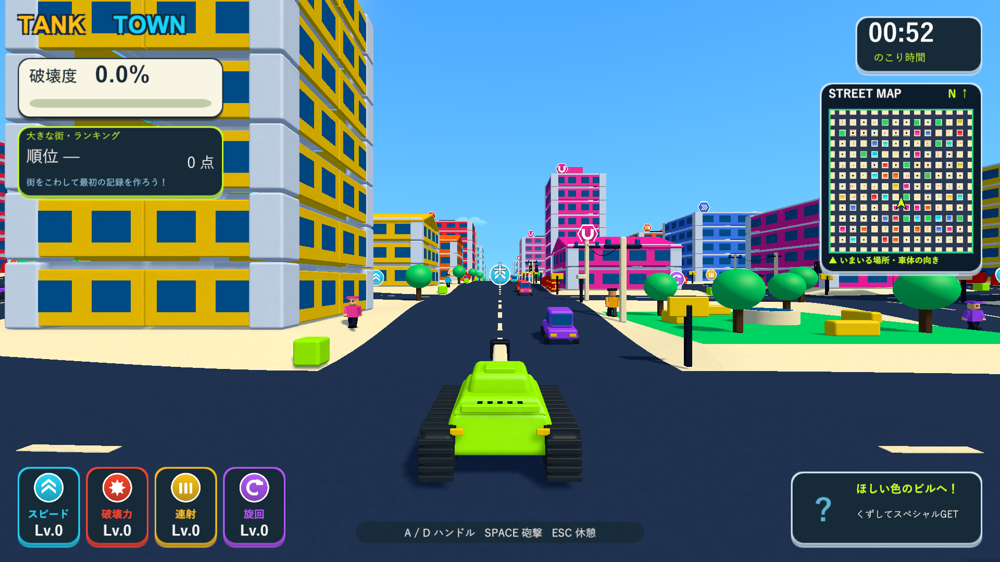

# 大型街のパフォーマンス改善

2026-10-06。Issue #5。536×536・132棟の大型街と従来の街を維持し、描画・交通検索・破片の物理処理を軽くしました。

2026-10-07追記：近景・車・固定面の描画、物理の広域検索、破壊時の一時データ、破片の更新をさらに最適化しました。タイトル背景の固定化と選択時のロード廃止も実装しています。[最新の変更・比較計測](performance-title-validation.md)。

## 変更

- 建物から100〜115mの距離を境に、遠景を材質ごとにまとめた少ない三角形のメッシュへ切り替えます。近くでは従来の壁・柱・梁・床・窓を描きます。すべての距離で元のColliderと支持判定を維持し、壊れた部材のRendererを復帰させて物理破片にします。
- ミニマップは専用レイヤー12の軽い建物メッシュ、道路、地面を描きます。建物が変わったときだけメッシュを作り直し、近い建物の更新は地図の再描画までまとめます。カメラの移動だけではメッシュを再生成しません。プレイヤー矢印は毎フレーム更新します。
- 車は物理ステップごとに共有する空間グリッドから近くの車・信号を調べます。全車が全車と全信号を走査する処理を廃止しました。信号の表示色もフェーズが変わったときだけ更新します。
- ビルボードはカメラ参照を再検索せず、見えているアイコンだけ浮遊の位置を更新します。向きは常にカメラへ合わせ、最初の表示でも屋根に埋まらない高さを設定します。
- 地面を64mの区画へ分割してColliderの範囲を局所化します。接続箇所の高さは連続しています。破片はSpeculativeの連続衝突を使い、十分遅くなったものだけ通常の衝突へ切り替えます。破片のソルバーは2回、落ち着いた破片は早めにスリープします。不要なカメラ透明度の上書きも減らしました。
- 大型街は物理更新30Hz・追いつき処理は最大0.1秒です。車体・カメラの補間を維持し、終了時に元の物理設定へ戻します。ラウンドの60秒は実時間で計測し、開始演出・ロード・ポーズの時間を含めません。

破片の上限2,000、寿命3.6〜4.8秒、ランダムな上限消去、砲撃・誘爆の威力、建物の寸法と密度、アイテムの併用を維持します。遠景の細かな丸みとミニマップの装飾は省略します。

## 同条件の測定

Unity 6000.3.19f1 / Windows x64 Development Build / D3D11 / GTX 1660 Ti。シード2026、1920×1080、同じカメラ位置、同じ巨大爆弾の位置・威力で比較しました。非表示のプレイヤーは画面描画を省略する場合があるため、実カメラとHUDをRenderTextureへ明示描画し、1ピクセルの読戻しでGPUの完了を待ちます。通常の手動プレイのFPS保証ではなく、同じ診断条件での比較です。

|場面|改善前の平均fps|改善後の平均fps|改善前の95%フレーム時間|改善後の95%フレーム時間|
|---|---:|---:|---:|---:|
|タイトル|25.7|66.6|48.7ms|16.6ms|
|通常画面＋ミニマップ|28.9|86.8|64.5ms|13.4ms|
|通常画面・地図の再描画なし|33.4|86.2|37.1ms|13.4ms|
|巨大爆弾後の大量倒壊|4.4|20.5|372.3ms|115.8ms|

大量倒壊の測定でも破片は2,000個です。最悪フレームは372.3→132.9ms。倒壊中は物理衝突の展開によって変動し、他の改善後測定では平均16〜18fpsでした。通常画面と地図の遅れは大きく改善しましたが、2,000個が動く大爆発中の負荷と瞬間的な停止は残ります。元・現行とも14,981部材、建物132棟で、範囲を縮小した比較ではありません。

測定コードは`TankTownPerformanceSmoke`、引数は`--tank-town-performance-smoke`です。ログ・数値は`Logs/performance-baseline-player.log`・`performance-baseline-results.json`、`performance-delivery-player.log`・`performance-delivery-results.json`です。撮影・JSON保存は測定区間の外に行います。

## 動作の検証

分離プロジェクトで表示・交通・地形・破壊・ステージの関連テスト41/41を実施しました。物理方式を変えた際に接触面の角を起点にした燃料判定が失敗したため、接触面の中心へ起点を揃えました。修正後の破片・連鎖・点火境界10/10、カメラと表示7/7、実時間の計測とステージ・開始・再挑戦12/12、最後の地図更新とランキング11/11が成功しています。ロード時間が最初のプレイ時間に加算されないことも修正・再確認しました。

ログは`Logs/performance-tests.xml`、`performance-debris-final-tests.xml`、`performance-camera-tests.xml`、`performance-clock-final-tests.xml`、`performance-map-final-tests.xml`です。最終ビルドは`Logs/performance-delivery-build.log`。

ネイティブUnityゲームなので、Skillの画面確認はWindowsプレイヤーの実描画で実施しました。最終の`--tank-town-extreme-specials-smoke --tank-town-stages-check`はexit 0で完了し、数字キーとSpaceによるステージ選択、ミサイルの自動取得発射・レーザー／爆弾との併用、結果・再挑戦・従来の街への帰還を確認しました。5発の取得順序に依存せず、時間差で発射されるミサイルの飛行を検証します。ログは`Logs/performance-stages-player.log`。診断では記録保存を無効にし、プレイヤーのランキングを変更しません。通常画面の測定では車・通行人を維持し、武器の併用確認では対象外のアイテム・爆発物などを無効化します。

検証・主作業・レビューのソース172ファイルはSHA-256が一致しました。`Builds/TankTown`と`Builds/TankTown-LocalBlast`へ最終ビルドを配置し、両方の実行ファイル・Runtime DLL・resources.assetsが検証ビルドと一致しました。Runtime DLLのSHA-256は`A403D86946A0AAF915F440A745E64DD43CAADD42F8E582BE0855BD3721AF0054`です。

