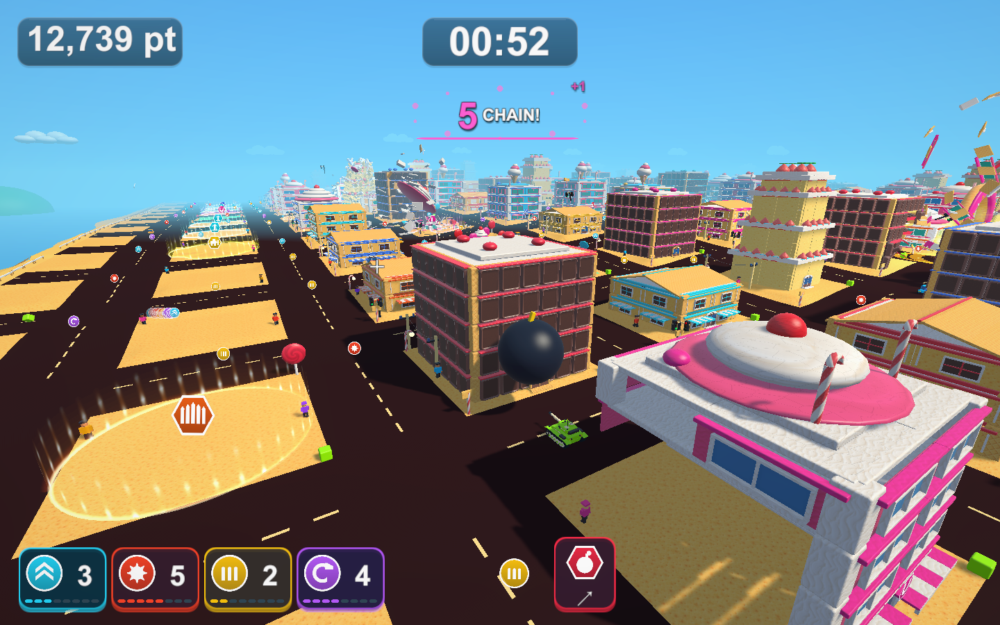
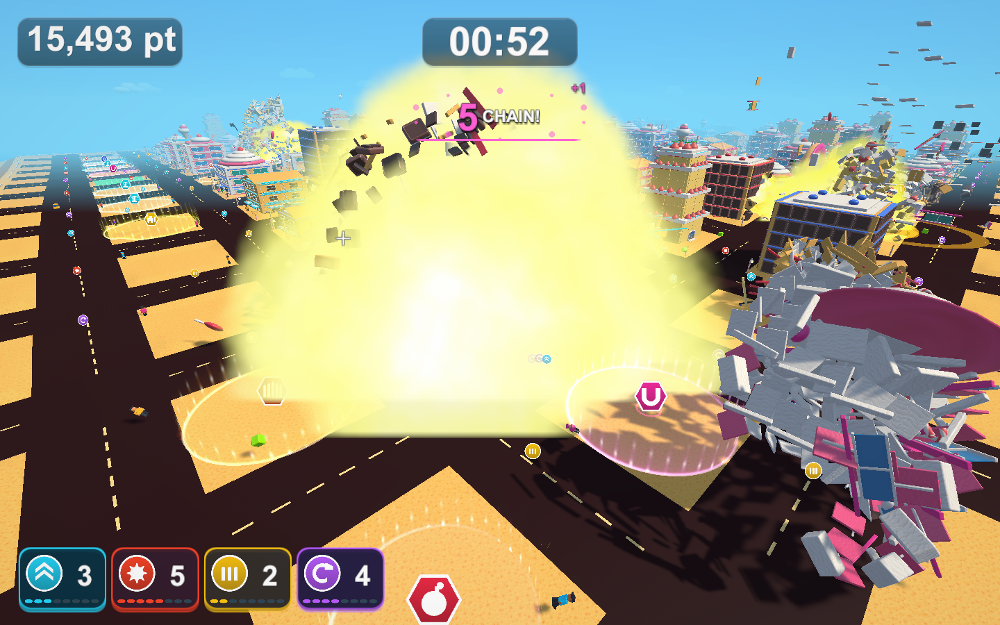

# レーザーのテストと巨大爆弾の診断の修正

2026-10-22 / [Issue #45](https://github.com/Negi310/mission2026-game/issues/45)

v0.2.0の検証で、変更と関係なく失敗していた3件を調べました。どれもBlenderモデルの導入前（9c28f56、`Builds/TankTown-SmokeLod`）から同じ値で失敗していました。3件とも、後から入った仕様の変更に確認の側が追従していなかったのが原因です。ゲームの動きは変えず、テストと診断を現在の仕様に合わせました。

## 原因と判断

|確認|失敗の内容|原因|直した側|
|---|---|---|---|
|`LaserCrossesTheCityDiagonal...`|対角の的にレーザーが当たらない|的の位置を、発射前の砲身（通常の4度）の向きで決めていた。2026-10-08からレーザー中は砲身を1度へ下げる（[記録](area-glow-laser-validation.md)）。対角の約346m先では、的がレーザーの中心より約18m上に浮き、半径9の範囲から外れていた|テスト|
|`LaserReachesWideDistantTargets...`|レーザー中のカメラの上向きが真上から1.76度ずれる|2026-10-08からレーザー中は斜め後方から見下ろす専用カメラへ移る（[記録](beam-camera-dozer-validation.md)、README）。テストは見下ろす角度（俯角）も「傾き」として数えていた。仕様で禁止しているのは横傾き（ロール）|テスト|
|`--tank-town-items-smoke`|巨大爆弾の撮影でNullReferenceException、終了しない|診断は、爆弾が6秒の時限で爆発していた頃（2026-10-02）の手順のまま。2026-10-05から、建物や地面に触れた瞬間に爆発して消える。投げてから1.15秒後には爆弾が消えており、その位置を読んでいた|診断|

テストはどちらも2026-10-05に作られ、10-08の仰角とカメラの変更時は関連するアイテム・円形報酬・カメラのテストだけを実行していたため、この2件の失敗に気づいていませんでした。

READMEの仕様（射程400・半径9で街の対角線より長い、仰角1度、レーザー中は見下ろす専用視点で横傾き・揺れ・視野角の変更なし、爆弾は着地・接触で爆発）はそのまま正しいと判断しました。

## 変更

- 対角のテスト: 先にレーザーを発射し、実際に下がった砲口の位置と向きから、対角の的と射程外の的を置きます。レーザーは0.12秒ごとに範囲を壊すため、0.2秒待ってから判定します。描画の長さと、対角を覆うことの確認はそのままです。
- カメラのテスト: レーザー中の確認を、カメラのテスト（`TankTownCameraTests`）と同じ横傾き（`eulerAngles.z`）の確認に変えました。見下ろす角度6〜10度はカメラのテストが確認しています。
- 診断: 爆弾を投げた同じフレームで、発射位置の爆弾を撮影します。その後は爆発するまで待ち、消えた後も残る爆弾の記録（`Detonated`・`Contacts`・`DetonationPoint`）だけを読みます。爆発の0.12秒後に全体を撮影します。爆発しなかった場合は終了コード1で止めます。破壊数は投げる前から数えます。

## 検証

Unity 6000.3.19f1の独立した検証コピー（`D:\GitHub\mission2026-game-validation\issue-45`）で実施しました。変更した2ファイルは、作業ブランチと検証コピーでSHA-256が一致しています。

- `TankTownMobilityTests` 5件がすべて成功。
- PlayMode全体は173件すべて成功（467.4秒、`Logs/issue45-playmode-tests-3.xml`）。
- Windows x64 Development Build成功（`Logs/issue45-build.log`）。実プレイヤーの `--tank-town-items-smoke`（`-batchmode -force-d3d11`）は終了コード0で最後まで進み、14画面を保存しました。ログに例外はありません（`Logs/issue45-items-player.log`）。

```text
ITEMS SMOKE COMPLETE: blocks=2390/12199, crashes=0, turretLead=13.85, earlyHull=0.00,
hullFollow=62.90, beamTravel=0.000, beamHits=596, missiles=5, missileStrikes=10,
magnetCollected=13, dozerScale=2.30, dozerCrashes=0, bombContacts=1, bombBlastBlocks=336,
dashSpeed=35.93, dashCrashes=0, state=Results
```

爆弾は建物への1回目の接触で爆発し（`bombContacts=1`）、投げてからの破壊は336部材でした。物理的な飛散と破壊数は実行ごとに変わります。





### 実時間に依存するテスト

PlayMode全体の1回目は171件、2回目は172件の成功でした。今回変更していない `TankTownTests` の次の2件が失敗しています。

- `PauseAndTimeoutFreezeGameplayAndRestartResetsCity`: 再挑戦後の残り時間が59.46秒・59.38秒（期待は59.5〜60秒）。
- `ElevatedCannonLaunchesAlongTheVisibleBarrel`: 発射の次のフレームで砲弾が上昇していない（1回目のみ）。

どちらも実時間の経過やフレームの長さに依存するテストです。この2回の実行中は、別のプロジェクトのUnityが同じPCで動いていました。2件だけを実行し直すと成功し、そのUnityが終了した後の3回目では173件すべてが成功しました。以前の全体実行（約3.0秒）より、失敗した回のこのテストは3.7〜4.4秒かかっており、PCの負荷による失敗と判断しています。今回の変更では扱っていません。

変更はテストと、開発ビルドだけに入る診断（`TankTownSmokeCapture`）です。ゲームの動き・設定・README、`Builds/` の実行版、GitHub Releaseは変更していません。
