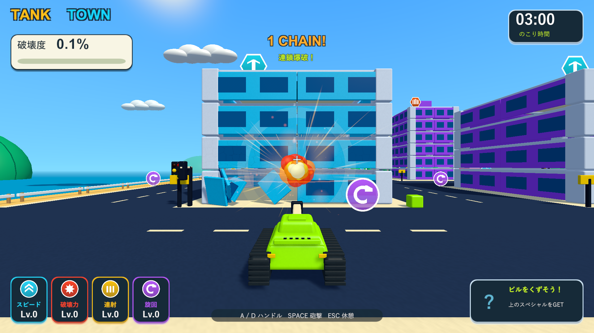
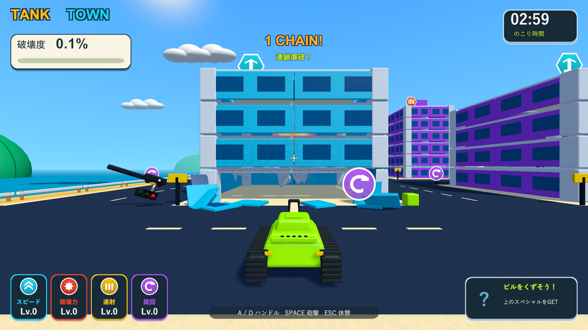
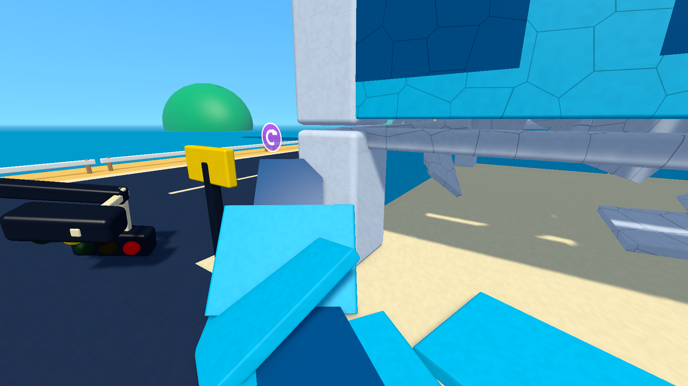

# 直撃1発と周囲のひびによる局所破壊

この記録は爆風半径4の初回調整です。現行仕様は[局所破壊を強めた調整](stronger-local-blast-validation.md)を参照してください。

2026-10-05。関連: [Issue #5](https://github.com/Negi310/mission2026-game/issues/5)。Unity 6000.3.19f1 / URP 17.3.0。

## 変更

通常の砲弾が直接当たった建築部材は、残りの耐久力に関係なく1発で分離します。SphereCastの命中Colliderから部材を特定し、爆風の対象と区別します。壁・床などの大きな部材は、従来の分割処理で複数の物理破片になります。

周囲の部材には初期半径4の範囲で損傷を与えます。着弾点からColliderの最も近い表面までの距離に対して、中心で最大、外縁で0となる線形減衰を使います。初期の最大ダメージは1、周辺部材の耐久力は3です。壊れずに損傷した部材はひびと黒ずみを表示し、連射で損傷が蓄積すると分離します。破壊力の強化は範囲とダメージに反映します。

一律に半径10まで柱・梁・床へ衝撃を伝えていた処理と、Settingsの`structureBlastRadius`を削除しました。直撃と周辺損傷を同じ着弾処理で解決した後、支持関係と重心を調べます。支持を失った部材やバランスが崩れた建物は、その時点で倒壊します。砲撃回数による倒壊のロックはありません。

燃料の誘爆・ギガント爆弾の大規模な範囲威力、ビームと車両による直接破壊、小物の即時破壊は継続します。燃料は表面から3以内の着弾で点火し、半径24・衝撃力36で大爆発します。複合Colliderへの二重ダメージ、停止中の損傷、同じ破片の繰り返し爆発を防ぐ処理と、カメラの遮蔽透過・破片のフェード・提供された音源も保持しています。

## 検証

分離した検証プロジェクトでPlayModeテストを実行し、Windows Development Buildの実描画と実砲撃で確認しました。ゲームはUnityのネイティブ実行版なので、画面検証もWindowsプレイヤーを使います。

| 検証 | 結果 | 記録 |
| --- | --- | --- |
| PlayMode | 90/90成功、108.03秒。3種類への実砲撃、柱の直撃、距離減衰、強化、ひびと遮蔽透過、複合Collider、燃料・破片・既存アイテム・停止・復帰・再挑戦を確認 | Logs/local-blast-tests.xml |
| Windows Development Build | 成功 | Logs/local-blast-build.log |
| 局所破壊の実砲撃 | 各建物の正面へ3発撃っても全壊しない。左前の柱へ1発撃つと柱が分離するが建物は立ち、右前の柱へ追加の1発で支持を失って全壊・報酬解放 | Logs/local-blast-durability-player.log |
| 燃料 | 遠い着弾では点火せず、近い砲撃で1個が大爆発。破壊部材が2から200へ増加 | Logs/local-blast-fuel-player.log |
| 街の回帰 | 車18台・信号17か所、実砲撃で車2台が誘爆、連鎖6回・最大4段。屋上報酬の落下・接触回収、2.000秒のビーム、結果画面まで成功 | Logs/local-blast-city-player.log |

| 実砲撃の対象 | 正面1発目 | 正面2発目 | 正面3発目 | 左前の柱を直撃 | 右前の柱も直撃 |
| --- | --- | --- | --- | --- | --- |
| 集合住宅 | 1/81部材 | 2/81部材 | 4/81部材 | 7/81部材・全壊なし | 81/81部材・倒壊 |
| 高層ビル | 1/141部材 | 3/141部材 | 5/141部材 | 7/141部材・全壊なし | 141/141部材・倒壊 |
| 店舗 | 1/62部材 | 2/62部材 | 3/62部材 | 6/62部材・全壊なし | 62/62部材・倒壊 |

部材数は分離済みの累計です。正面砲撃では離れた支柱が残り、次の弾ができた穴を通って別の部材へ当たります。全壊後の部材数には支持喪失による分離も含みます。プレイヤーログにゲーム例外・シェーダーエラーはありません。

確認済みの修正版は`Builds/TankTown-LocalBlast/TankTown.exe`へ出力しました。従来の実行版が起動中のため別フォルダーへ保存し、起動中のプロセスは終了していません。検証用ビルドと配布先のEXE・Runtime DLL・resources.assetsのSHA256一致、および作業・検証・レビューの3コピーで125ソース/アセットファイルの一致を確認しています。

`--tank-town-durability-smoke`は3種類の各1棟に、正面3発・左右の支柱各1発の計5発を実際に発射します。戦車の位置と高さを固定し、爆発物と走行車を無効にして通常砲撃の挙動を切り分けます。19画面を1920×1080で保存し、近接画面だけ診断用カメラへ切り替えます。3分間の手動プレイ全体の難易度確定は含みません。
