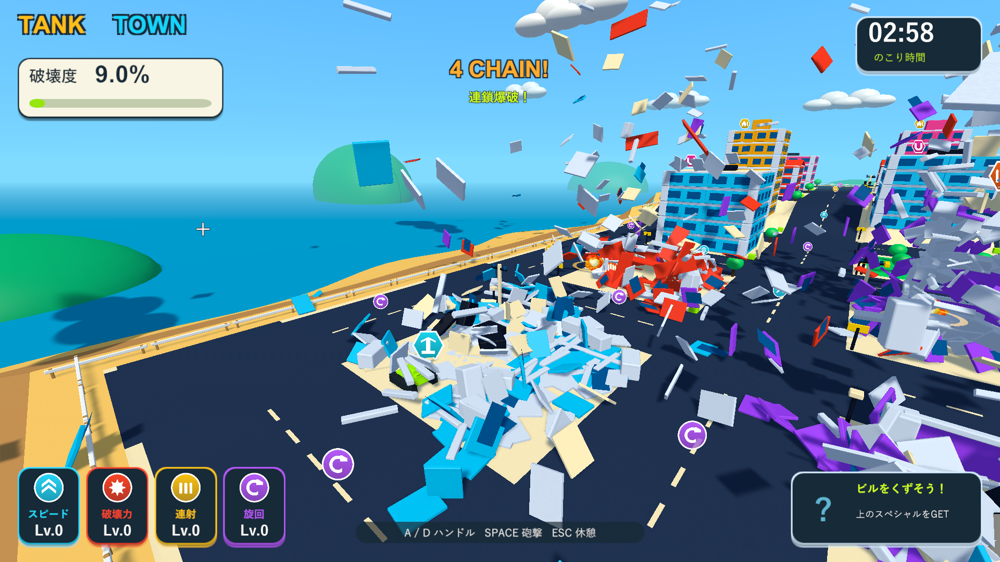

# 大量倒壊で残せる破片数を拡張

2026-10-04。Issue #5。Unity 6000.3.19f1 / URP 17.3.0。

上限720個では実砲撃から約3秒で上限に達し、寿命より前に消去される破片が多かった。上限を4,000個へ増やし、Resources設定とScriptableObjectの既定値を揃えた。寿命は3.6秒、最後の0.45秒でフェードする。

既存の上限テストは街全体を同時に倒壊させ、4,000個に達してから古い破片が消去されることを確認する。消去後の報酬・点火済み爆発物の保護を調べる2つのテストは診断用に128個へ設定し、終了時は必ず元へ戻す。設定上限が変わっても、実際に消去を発生させて確認できるようにした。

ネイティブUnityゲームのため、Windows版で砲撃・分裂・実接触の連鎖・燃料点火・車の誘爆・落下報酬・ビーム・結果画面を確認する。破片数は砲撃後の3時点の読み取りであり、全フレームのピーク値ではない。3分間の手動プレイとFPS測定は今回の検証に含まない。

|検証|結果|記録|
|---|---|---|
|PlayMode全体|78/78成功、99.09秒。街全体の同時倒壊で有効な破片が4,000個となり、上限超過分の消去を確認|`Logs/massive-debris-tests.xml`|
|Windows Development Build|終了コード0|`Logs/massive-debris-build.log`|
|実砲撃後の破片数|着弾後368個、飛散中408個、約3秒後1,447個。以前の720個を超えて保持し、4,000個の上限には達していない|`Logs/massive-debris-debris-player.log`|
|分裂・実接触の連鎖|床と壁は各6個に分裂。接触後の爆発を確認、最高4段。終了コード0|同上|
|燃料の点火距離|遠い着弾では点火せず、近い実砲撃で燃料1個が誘爆。終了コード0|`Logs/massive-debris-fuel-player.log`|
|街全体の回帰|車2台が誘爆、落下報酬の接地と接触回収成功、ビーム2.000秒、結果画面まで成功。終了コード0|`Logs/massive-debris-city-player.log`|

プレイヤーログにゲーム例外・シェーダーエラーはない。C#・shader・asmdef・Settings計48ファイルは主作業フォルダー・検証コピー・レビュー用ブランチでSHA-256が一致する。検証済みWindows版を `Builds/TankTown` へ配置し、実行ファイルとRuntime DLLのハッシュも確認した。

保持される破片が増えるため、衝突連鎖と破壊の広がりも変わる。上限4,000個に到達した場合は古い破片から消去する。通常の寿命3.6秒による消去は続く。

約3秒後に1,447個の破片が残る実画面。見渡すために診断用カメラを移動している。

