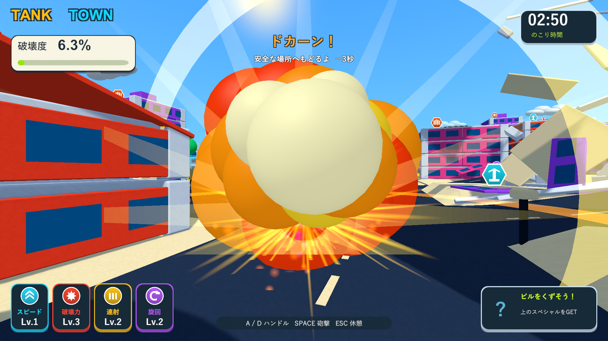
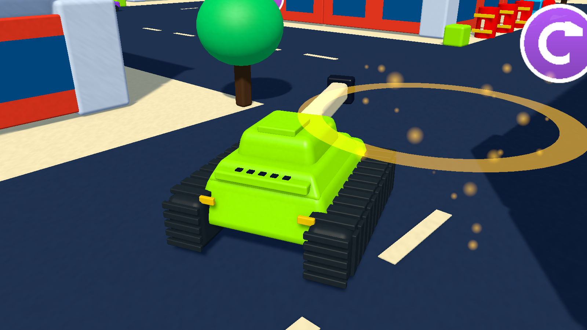

# 「ドカーン！」の文字表示と控えめな質感

2026-10-04。Issue #5。Unity 6000.3.19f1 / URP 17.3.0。

## 変更

復帰の見出しと説明が同じ欄で折り返され、太い縁取りが重なっていた。「ドカーン！」を34pxの見出し、復帰の説明と時間ペナルティを19pxの別行へ分けた。両方に日本語フォントを使い、縁取りを2px・1pxに抑えた。既存の連鎖表示は同じ欄で見出しと説明を表示する。

建物・道路は細かな粒子感のあるマットな面、戦車と車は塗装、金属は細い方向性のある粒子と鋭い光沢、履帯とタイヤは粗いゴム、窓は滑らかなガラスにした。木の幹には控えめな木目、葉と芝生には弱い粒子感を設定する。彩度の高い配色と前回の陰影を維持する。

専用シェーダーの滑らかなノイズを使い、UVのない角丸部材にも質感を付ける。粒子は物体の座標へ固定し、破片が回転しても模様が滑らない。物体の大きさに応じて密度を一定にし、距離と画素の大きさで薄くして遠景のちらつきを抑える。部材ごとの毎フレーム処理やマテリアルの複製は追加しない。

## 検証

メインのUnity設定・パッケージ・Gitインデックスを維持し、隔離コピーでPlayModeとWindows Development Buildを検証した。ネイティブUnityゲームのため、画面検証はWindowsプレイヤーを使用した。

新しいケースでは実際に戦車を爆発させ、時間ペナルティ、日本語フォント、見出しと説明の寸法・非重複を確認した。66件すべて成功（85.38秒）、Windows Development Buildは終了コード0。Windows診断は通常HUDの3解像度、復帰表示の1920×1080・1280×720、材質の近接表示、実砲撃と倒壊、復帰後の再開を確認した。プレイヤーは終了コード0で、実砲撃による破壊222/3502、復帰後の再開、最高2段連鎖を記録した。

復帰表示（1920×1080）:

材質の近接画面:

復帰を複数解像度で撮る間だけ時間を止めた。3分間の手動プレイや性能測定は含まない。
