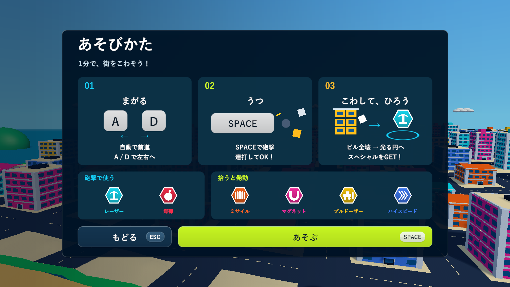
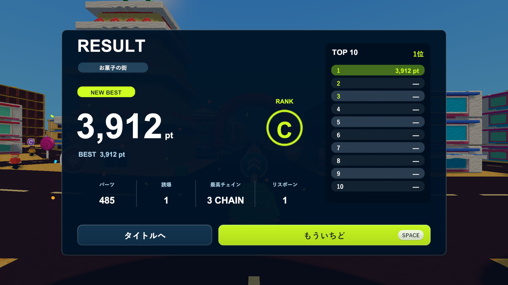

# 遊び方・リザルトと文字の余白

2026-10-16。[生成案と実装後の比較](menu-redesign-review.html)。実際のタイトル・遊び方・結果のスクリーンショットを参照し、内蔵image_genで2つの画面案を生成しました。画像は[遊び方](images/tank-town-howto-concept.png)と[リザルト](images/tank-town-results-concept.png)、使用した全文のプロンプトは[こちら](ui-proposal/menu-redesign-prompts.txt)です。生成画像を背景に貼り付ける方式ではなく、実際に操作できるUnity UIで配置と配色を反映しています。

遊び方は濃紺のパネルに、曲がる・撃つ・壊して拾うの3ステップを配置しました。大きなA/D・Spaceキー、砲弾とブロック、建物と報酬円の簡単な図を添えています。スペシャルは「砲撃で使う」2種類と「拾うと発動」4種類へ分け、説明文を短くしました。Hで開く、Escで戻る、Spaceで始める操作は従来どおりです。

リザルトはポイントを大きく見せ、ベスト・ランク・4種類の成績・TOP 10・再挑戦とタイトル復帰に整理しています。破壊率と換算式の重複表示を外し、ランキングもptへ統一しました。スコア計算、記録保存、ステージごとの記録、同点の扱い、0.95秒のカウントアップ、Spaceでの再挑戦は維持しています。紙吹雪は24枚の短い表示にしています。

メニュー全体でCanvasの各辺に32ずつ安全余白を確保し、画面比率を変えた際にタイトルの左端が近づきすぎる問題を修正しました。新しいパネルの主な内側余白は54、ランキングの文字も左右に余白を取っています。ボタンは内側の表示だけがホバー・押下で動き、クリック範囲は固定です。遊び方と結果の操作にも同じ動きを付けました。

## 検証

- Unity 6000.3.19f1のWindows x64 Development Build成功（`Logs/menu-redesign-final-build.log`）。
- 既存PlayModeの開始・遊び方・結果・再挑戦、街選択、記録保存と表示、HUDと再読み込みの10/10件が成功、35.66秒（`Logs/menu-redesign-final-tests.xml`）。表示の期待値だけを、ptと短い成績表示へ更新しています。
- Windows実プレイヤーはタイトルの4つの選択、6操作のホバー、開始と結果、再挑戦を確認しました。遊び方・結果・最大値について1920×1080、1280×720、1440×900、1280×1024で文字の収まりと画面端の余白を検査し、35画面を保存して診断を完了（`Logs/menu-redesign-final-player.log`）。
- 最大値の検査はUIの文字だけを100,000 pt・10行のランキング・長い数値に差し替えたものです。実際の成績や保存データではなく、検査後に元へ戻します。通常の結果は実際のラウンドの値です。
- Chromeで生成案2枚・実画面10枚、遊び方・結果・タイトルの以前／現在の切り替え、4つのページ幅、原寸リンクとエラーがないことを確認しました（`Logs/menu-redesign-browser.log`）。これは画像比較ページの検証です。
- 検証用の隔離プロジェクトとレビュー対象のC#・シェーダー91ファイルが改行を除いて一致（`Logs/menu-redesign-source-check.json`）。実画面の診断はシード2026、仮想キーとUIイベント、結果確認用の破壊・数値表示を使っています。長時間の手動プレイや実機コントローラーの体感確認は含みません。

README、タイトル比較ページと以前の検証記録に最新の案内を追加しました。運用手順の変更はないためAGENTSやスキルの更新は不要です。

更新版は`Builds/TankTown-MenuRedesign/TankTown.exe`です。共通の`Builds/TankTown`、`Builds/TankTown-Amusement`、`Builds/TankTown-GameplayUI`も更新しました。既存GitHubリリースは変更していません。

