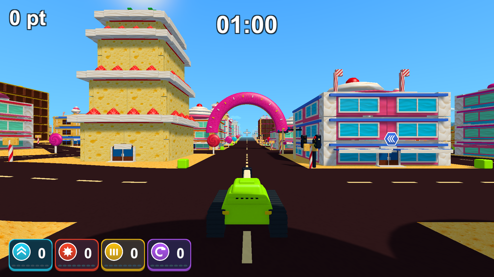
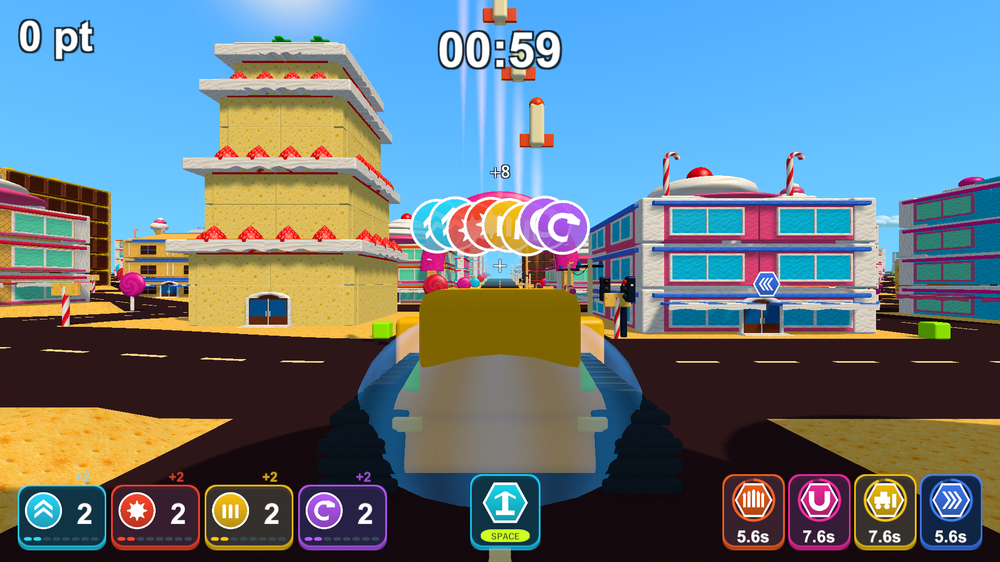

# 数字とアイコン中心のプレイ画面

2026-10-13。[以前と現在のUnity実画面](minimal-hud-review.html)。プレイ中は左上にポイントだけを表示し、破壊率・順位・説明文・進捗バーを外しました。時間は枠と見出しを外して上中央の数字だけにしています。ポイントを46から64、時間を54から74のフォントサイズへ拡大し、太い縁取りと影で街や明るい空の上でも読めるようにしました。

左下の強化は種類の名前・実際の倍率や秒数を外し、フィールドと同じアイコン・レベル・レベルゲージを表示します。アイコンを50から60、数字を38から44へ拡大し、カードを132×92にしています。取得のカウントアップ・取得数の通知・戦車上のアイコンの移動と重なりを維持し、まとめた取得数は「+8」のように表示します。

スペシャルも見出し・種類名・文章を外しました。所持武器は大きなアイコンとSpace、使用中の武器と自動発動4種類はアイコン・円ゲージ・残り秒数を表示します。空の所持枠は隠し、使用待ちの武器はアイコンとSpaceの色を暗くします。飛行中の爆弾には矢印を表示し、固定の効果秒数は表示しません。再取得の通知は「+0.4s」のように実際に増えた秒数です。下部は約2割大きくし、狭い縦横比では共通の倍率で縮小して重なりを防ぎます。

通常起動ではミニマップのUI・カメラ・RenderTextureを作らず、定期描画も行いません。以前の地図の機能は、明示的に有効にする開発用診断だけで確認できます。画面端の文章も外し、チェインはカウントアップする数字・CHAIN!・火花・短いゲージへまとめました。アイテムの効果・ポイント計算・リザルトの順位や保存・全画面の設定は変更していません。

`--tank-town-hud-smoke`はシード2026のお菓子の街を使い、通常・取得・所持と自動効果・時間更新・レーザーと待機武器・爆弾の飛行・停止・効果終了・チェイン・残り10秒を確認します。`--hud-town`、`--hud-big`、`--hud-amusement`でほかの3ステージも確認できます。1920×1080、1280×720、1440×900、1280×1024の撮影先のCanvasを使い、UIの範囲・枠同士の非重複・文字の収まりを検査します。戦車を止め、取得用のアイテムを追加し、スペシャルのReceiveを呼ぶ診断です。手動プレイ全体の保証を表すものではありません。

## 検証結果

- 最初の情報整理後にPlayModeテスト29/29成功（`Logs/minimal-hud-playmode-tests.xml`）。表示・アイテム取得のカウント・停止と終了・チェイン・ポイントとランキング・診断用の地図と破棄・開始とリザルトの遷移を含みます。
- 数字とアイコンの拡大後は、表示・チェイン・ポイントと結果保存の10/10成功（`Logs/minimal-hud-enlarged-tests.xml`）。前回と重複する対象を、変更した配置で確認しました。
- Unity 6000.3.19f1のWindows x64 Development Buildが成功（`Logs/minimal-hud-enlarged-build.log`）。同じビルドで4ステージそれぞれ16画面、計64画面を撮影し、全て終了コード0でした（`Logs/minimal-hud-enlarged-*-player.log`）。お菓子の街は通常の全画面起動、ほかはバッチモードです。通常のHUDでミニマップや時計の枠がないこと、ポイントの一致、日本語の説明がないこと、取得と待機・飛行の表示、4つの解像度での範囲と非重複を確認しました。
- Chromeで今回の実画面7枚と以前の画像を読み込み、場面の切り替え・以前／現在の切り替え・1920/1280/720/390px幅・原寸リンクとエラーがないことを確認（`Logs/minimal-hud-browser.log`）。これは実画面を比較するページの検証で、Unityの機能は上の検証で確認しています。

READMEと現在のUI仕様を更新し、以前のUI記録には更新先の案内を追加しました。運用手順の変更はないため、AGENTSやスキルの更新は不要です。

ローカルの`Builds/TankTown/TankTown.exe`、`Builds/TankTown-Amusement/TankTown.exe`、`Builds/TankTown-GameplayUI/TankTown.exe`を更新しました。GitHubの既存v0.1.0配布物は変更していません。

