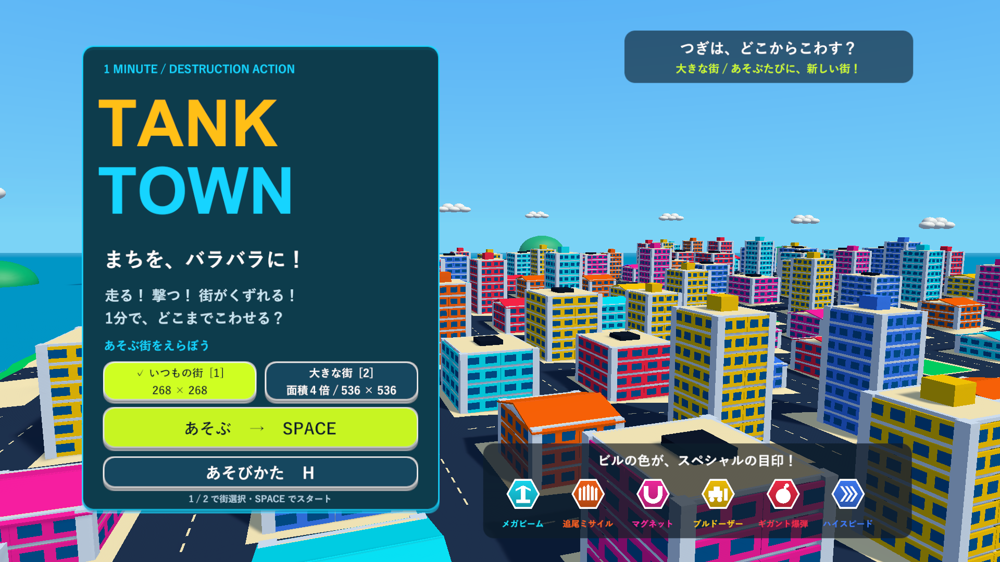
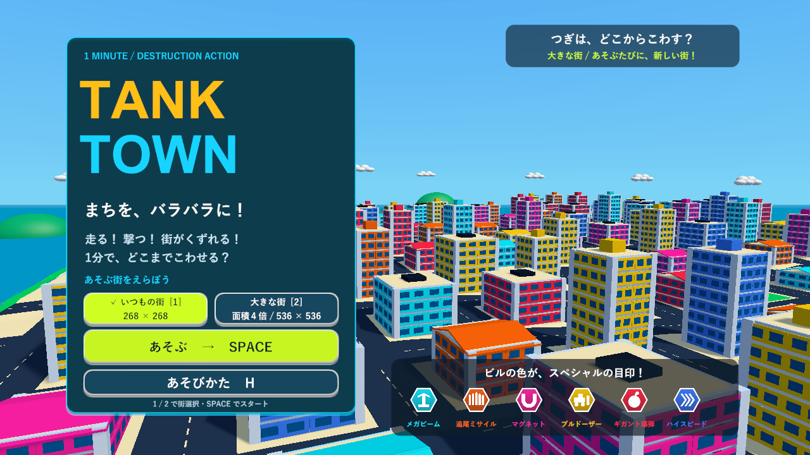
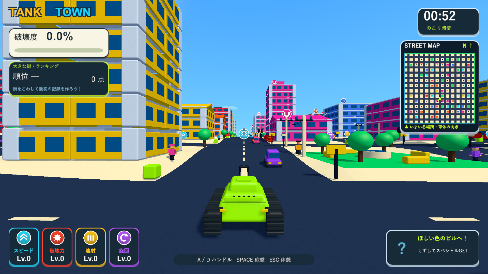

# 追加の最適化とタイトル背景の固定化

2026-10-07。Issue #5。従来と面積4倍の街を維持し、タイトルのステージ選択によるロードを廃止しました。

## タイトルと開始

- 背景は常に536×536・132棟の大型街。プレイ用と同じシード、区画、建物の形・階数・色、地形を使う背景モデルを一度生成します。背景モデルにはCollider、Rigidbody、交通・通行人・破壊のスクリプトを持たせません。近景の樹木や燃料・アイテムなどの細部も省略しています。
- ボタンと数字1/2は遊ぶステージと選択表示・ランキングだけを切り替えます。同じゲーム、背景、街のシードを維持し、カメラの巡回・時間停止も続きます。シーンの再読み込みや暗転は発生しません。
- 「あそぶ」で選択した街が既存のプレイ用の街と異なる場合だけ、完全に覆ったフレームを描いてからプレイ用の街を生成します。大型街の開始では背景と同じシードを引き継ぎます。再挑戦では従来どおり新しい街を生成します。
- 背景だけのレイヤー13とUIレイヤー5をタイトルカメラに許可し、開始後は通常のカメラ範囲に戻します。ミニマップのレイヤー12と干渉させません。従来ステージと大型ステージのランキング保存先は維持しています。

## 最適化

- 近くの建物も元の柱・壁・梁・床・窓の形状を材質ごとにまとめます。ひびが入った部材とカメラで透過させる部材をまとめたメッシュから外し、元のRendererで表示します。飛散した部材は元のCollider・Rigidbodyへ戻し、変化した近景は描画前に更新します。支持と重心の判定、当たり判定、破壊度の分母を変えません。
- 車は全モデルを材質ごとにまとめて車体に追従させます。固定した地面・道路・路面の印は静的バッチへまとめ、路面の小さな印には影を作りません。動く雲・車・通行人や壊せる構造物は静的バッチの対象外です。
- 角の丸い箱は300から108三角形へ削減し、丸みのあるハイライトを維持します。材質の粒とひびが距離で完全に消えた画素ではノイズ計算を省略します。
- Project SettingsのPhysicsをAutomatic Box Pruningへ変更し、広い街の接触候補を空間で絞ります。方式の選択は[Unity 6000.3の公式資料](https://docs.unity.com/en-us/engine/6000.3/manual/physics-section/physics-overview/physics-optimization/cpu/broad-phase)を参考にし、実行版で比較しました。ソルバーや破片の衝突対象は前回と同じです。
- 爆発・ビーム・体当たりのOverlap配列、重複部材と建物の集合、支持探索・支持多角形の作業領域を再利用します。Overlapのバッファが一杯なら倍増して再検索し、範囲内の対象を落としません。入れ子の破壊処理は別の作業領域を借り、終了時に参照を消して戻します。部材の分離が増えていない建物の支持判定も省略します。
- 破片の物理状態と消える直前の表示更新を既存の所有者の登録簿へ集約します。Renderer配列を共有し、フェード用のMaterialPropertyBlockは必要になった時だけ用意します。空のマテリアル上書きも避けます。非アクティブな破片と時間停止中の更新を止めます。

破片の上限2,000、ばらついた寿命、全破片から一様に選ぶ上限超過時の消去、物理的な飛散・部材への衝突連鎖は維持しています。建物の数、砲撃・誘爆・スペシャルの威力、車・通行人の数も減らしていません。

## 検証

Unity 6000.3.19f1の分離プロジェクトで全PlayModeテスト133/133成功。破片の更新集約を含む最終の関連テスト35/35成功。最後のタイトル・UI・開始・結果検証7/7成功。選択を繰り返してもゲーム・背景・シードを維持すること、正しい街の開始、シードの引き継ぎ、ステージ別記録、再挑戦・従来の街への復帰を確認しました。タイトルの可視UIがカメラの描画対象に含まれることも検証しています。巡回カメラの移動量の検証は、大型背景の半径と実経過時間から上限を求めます。

ログは`Logs/performance2-full-tests.xml`、`Logs/performance2-final-tests.xml`、`Logs/performance2-hud-verified-tests.xml`。Overlapが1,024件を超えても1,100対象すべてを処理すること、近景からひび・透過対象・壊れた部材を分離すること、破片の寿命・ランダム消去・連鎖、坂・操舵・カメラと時間停止も確認しました。無効なGUIDだった既存のPerformanceTestsのmetaを32桁へ修正し、追加テストがUnityで認識されることも確認しています。

画面確認は、ネイティブUnityアプリに合わせてWindows x64 Development BuildのD3D11実描画で実施しました。Skillのブラウザ確認に相当する検証をネイティブ画面で行い、1920×1080と1280×720のタイトルUI・大型街の背景、ゲーム画面を目視確認しました。診断ではプレイヤーのランキング保存を無効にしています。

最終の`--tank-town-extreme-specials-smoke --tank-town-stages-check`はexit 0。数字キーによる選択で同じタイトルを維持し、Spaceで大型街を開始、ミサイルの自動取得・レーザー／爆弾との併用、結果・再挑戦、タイトルへ戻って従来の街の開始まで完了しました。大型街は132棟・144台・288人、従来の街は33棟で、Resourcesの設定も変更していません。ログは`Logs/performance2-hud-stages-player.log`。ビルドは`Logs/performance2-hud-delivery-build.log`で成功しています。

## 同条件での描画診断

GTX 1660 Ti・D3D11・1920×1080・シード2026。実際のURPカメラとHUDをRenderTextureに描き、1画素を読み戻してGPU完了を待つ前回と同じ診断です。単なる非表示ウィンドウの更新速度ではありません。通常画面は車・通行人を残したまま、同じ位置で戦車を固定します。大爆発は同じ位置・同じ威力の巨大爆弾を起爆し、その後2.8秒を計測します。起爆関数の最初の同期処理時間と街の生成時間は計測区間に含みません。

|場面|変更前 fps|最終版 fps|変更前 平均 / 95%点 ms|最終版 平均 / 95%点 ms|
|---|---:|---:|---:|---:|
|大型街のタイトル|63.6|190.8|15.7 / 18.6|5.2 / 6.9|
|通常画面・ミニマップあり|86.3|87.4|11.6 / 13.6|11.4 / 13.9|
|通常画面・地図描画なし|83.9|81.6|11.9 / 13.8|12.3 / 15.3|
|大量倒壊・破片2,000個|17.7|33.3|56.4 / 108.8|30.0 / 75.5|

通常画面の描画数は18,544→11,198（約40%削減）、三角形は約460万→342万。タイトルは42,901→2,522描画、約885万→175万三角形。大量倒壊の最悪フレームは166.8→98.2ms、平均のGC確保は125,035→70,424 bytes。通常走行のfpsには今回の最終測定で明確な改善がなく、主にタイトルと大量倒壊の負荷が改善しています。描画数には影・深度・診断用描画など複数のパスが含まれます。

途中の実行版では大量倒壊29〜40fpsのばらつきがありました。生きた交通と物理接触による誘爆があるため、シード・位置・威力をそろえてもフレーム単位で同じ崩壊にはなりません。平均fpsを手動プレイの保証値にはしていません。大規模な連鎖の瞬間には依然として負荷が残ります。

変更前は`Logs/performance2-baseline-results.json`、最終版は`Logs/performance2-hud-delivery-results.json`と対応する`-player.log`。最終版は132棟・総部材14,981・破片上限2,000を確認しています。

## 更新版

検証済みの実行版を`Builds/TankTown`と`Builds/TankTown-LocalBlast`へコピーしました。メイン、検証プロジェクト、レビュー用ブランチのソース・設定・音声・meta計176ファイルとPhysics設定がSHA-256で一致しています。配布先2か所の実行ファイル・Runtime DLL・resources.assetsも検証版との一致を確認しました。

- `TankTown.Runtime.dll`：`75974FD27B3BD0C8C5DC89122967CB122236D96C07AF112D32C733691B8369E4`
- `resources.assets`：`07DA56ECB9278EF2776460EA885657415026DA76EF55AA4464939DBE5C9EA67B`

