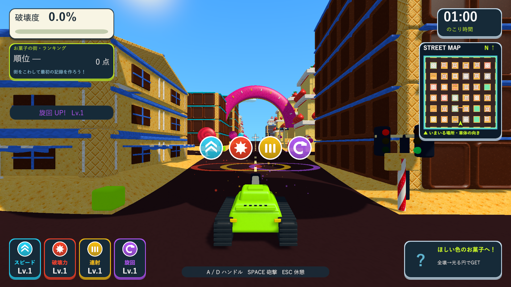
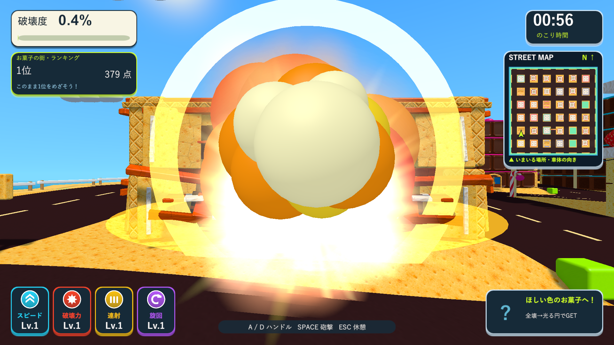

# 取得アイコンと短い復帰

2026-10-10。Issue #5。取得したパワーアップを戦車の上で確認できるようにし、衝突時の復帰を速くしました。

## 取得したパワーアップ

フィールドで表示していた同じQuad・テクスチャ・共有材質を使い、取得時の位置から戦車の上へ0.28秒で弧を描いて移動させます。大きさも連続して縮め、取得時に別のアイコンへ置き換えたり点滅したりしません。取得判定だけを直ちに無効にし、能力値は取得した時点で1回だけ上がります。

取得から2.2秒表示し、複数取得時はカメラの横方向へ間隔を空けて並べます。5個以上は4個ずつの段へ分かれます。表示の追加・終了時の横移動も滑らかにつなぎます。戦車とカメラの描画更新後に位置と正対方向を更新し、旋回中も読み取れるようにしました。ポーズ中は表示時間と移動を止め、最後の0.28秒で薄くなります。爆散・リザルトでは表示を片付けます。能力の上限、衝突後の強化維持、再挑戦でのリセットは既存の仕組みを使います。

Settingsの`pickupFlyTime`と`pickupDisplayDuration`で時間を調整できます。対象はスピード・破壊力・連射・旋回の丸いパワーアップです。

## 衝突爆発と復帰

「ドカーン！」と復帰の説明文字を削除しました。復帰待ちは1.2秒から0.45秒へ短縮しています。位置と方向の切り替えは、既存の短い暗転の裏で行います。3秒の時間ペナルティと復帰直後の衝突猶予は維持しています。

通常の着弾相当だった爆発演出を、より大きな火球・多数の火花・二重の衝撃波へ変更しました。衝突爆発は実際に半径10、基本衝撃力の1.8倍（初期値21.6）で近くの部材にも作用します。建物の支持判定・破片の物理演算・近い爆発による燃料の点火は既存の処理を通します。復帰状態を先に設定するので、同じ衝突を重複加点・重複爆発しません。無敵中は従来どおり爆散しません。

Settingsの`respawnDelay`、`crashBlastRadius`、`crashBlastImpulseMultiplier`で調整できます。

## 検証

Unity 6000.3.19f1の分離したプロジェクトで、取得演出・UI・マグネット・衝突・強化の維持・暗転復帰のPlayMode 19ケースを検証しました。`Logs/pickup-feedback-tests.xml`で18件が成功し、1件は従来の「1.3秒後も復帰待ち」という検証が短縮した復帰に合わず失敗しました。衝突直後を待って確認する方法へ更新し、`Logs/pickup-feedback-collision-tests.xml`でその1件も成功しました。ゲーム実装の変更は不要でした。

新しい取得演出の検証では、元のQuad・Renderer・材質の同一性、取得時の位置の連続性、4個の横並び、移動・旋回時の追従、重複取得の防止、表示の停止・消去・上限到達時の取得不可を確認します。衝突では近くの物体への破壊と衝撃、範囲外の物体の維持、1回だけのペナルティ、短い復帰、能力維持、表示の片付けを確認しました。既存の暗転検証では復帰時の位置変更が完全に隠れ、結果画面が暗いまま残らないことも成功しています。

Windows x64 Development Buildは`Logs/pickup-feedback-build.log`で成功し、D3D11の実描画を1920×1080と1280×720で確認しました。Unityネイティブゲームなので、Skillのブラウザ確認に相当する画面確認はWindowsプレイヤーで行っています。`Logs/pickup-feedback-player.log`はexit 0、同じアイコンの再使用、4個の同時表示、実衝突後0.450秒での復帰、衝突爆発による16部材の破壊、爆散1回を記録しています。診断用のアイテム・戦車の配置と一部オブジェクトの無効化を使用し、通常プレイ全体の代わりにはしません。

検証したビルドを`Builds/TankTown-PickupFeedback`と、既存の`TankTown-Entrances`、`TankTown-CandyDetails`、`TankTown-CandyTextures`、`TankTown-FastShell`、`TankTown`、`TankTown-LocalBlast`へ反映しました。7か所すべてで実行ファイル・Runtime DLL・resources.assets・テクスチャresS・音声resourceのSHA-256が一致しています。Runtime DLLは`9AA911E30B1AA5DD2AB815F06758D6B1C4B13BC603731F66A39D4D2E176F86E4`です。メイン・検証・レビュー用プロジェクトのソース・素材・meta計233ファイルも一致しています。

[取得前](images/tank-town-upgrade-feedback-01-field.png)、[移動途中](images/tank-town-upgrade-feedback-02-flight.png)、[単独の表示](images/tank-town-upgrade-feedback-03-above.png)、[1280×720](images/tank-town-upgrade-feedback-05-multiple-720.png)、[旋回中](images/tank-town-upgrade-feedback-06-driving.png)、[復帰後](images/tank-town-upgrade-feedback-08-recovered.png)。
